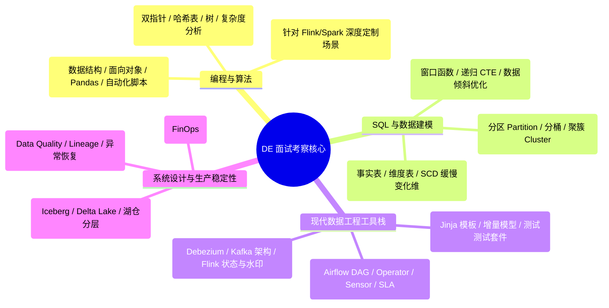

# Data Engineer 市场招聘需求分析与面试画像 (Malaysia & SEA)

本文档聚焦于各企业 **“公司 DE 实际做什么 (What DE Does)”** 与 **“面试官重点考察什么 (What Interviewer Expects)”** 两大核心维度，对 15 家代表性企业进行结构化拆解与面试通关指引。

---

## 目录
1. [企业分级梯队与面试侧重点 (Tier Overview)](#企业分级梯队与面试侧重点-tier-overview)
2. [DE 核心考察能力雷达与高频考点](#de-核心考察能力雷达与高频考点)
3. [各梯队企业岗位详析与面试画像](#各梯队企业岗位详析与面试画像)
   - **Tier 1: 顶级科技巨头与超级独角兽**
     - [1. Grab - Senior Data Engineer](#1-grab---senior-data-engineer)
     - [2. Shopee - Fresh Graduate Data Engineer](#2-shopee---fresh-graduate-data-engineer)
     - [3. Tencent (腾讯) - Data Engineer](#3-tencent-腾讯---data-engineer)
     - [4. Carsome - Data Engineer (Autohive Project)](#4-carsome---data-engineer-autohive-project)
   - **Tier 2: 数字银行与前沿金融科技 (FinTech / Modern Data Stack)**
     - [5. GXBank - Senior Data Engineer](#5-gxbank---senior-data-engineer)
     - [6. MoneyLion (Gen Digital) - Data Engineer](#6-moneylion-gen-digital---data-engineer)
     - [7. Ant International (蚂蚁国际) - Senior / Junior Data Engineer](#7-ant-international-蚂蚁国际---senior--junior-data-engineer)
     - [8. Boost Bank - Data Engineer (SME Micro-lending)](#8-boost-bank---data-engineer-sme-micro-lending)
     - [9. TNG Digital (Touch 'n Go) - Data Engineer](#9-tng-digital---data-engineer)
     - [10. ONL Biz Solutions - Senior Data Engineer (Lakehouse)](#10-onl-biz-solutions---senior-data-engineer-lakehouse)
   - **Tier 3: 跨国全球数字化中枢 (Global MNC Hubs & Tech Centers)**
     - [11. Roche (罗氏制药) - Junior Data Engineer](#11-roche-罗氏制药---junior-data-engineer)
     - [12. Tranglo - Junior Data Engineer](#12-tranglo---junior-data-engineer)
   - **Tier 4: 咨询公司与企业级数字化交付 (Consulting & Enterprise Solutions)**
     - [13. EY (安永) - Junior Data Engineer](#13-ey-安永---junior-data-engineer)
     - [14. Ambition (Client) - Microsoft Fabric Data Engineer](#14-ambition---microsoft-fabric-data-engineer)
     - [15. Focal Consulting - Data Engineer](#15-focal-consulting---data-engineer)

---

## 企业分级梯队与面试侧重点 (Tier Overview)

| 梯队 | 核心代表公司 | 公司 DE 核心任务 (What DE Does) | 面试核心考察 (What Interviewer Expects) |
| :--- | :--- | :--- | :--- |
| **Tier 1: 顶级科技大厂 / 超级独角兽** | **Grab, Shopee, Tencent, Carsome** | 支撑海量高并发业务，处理百亿级日志/订单/定位流，跨业务系统平滑割接，探索 AI+Data 智能化赋能 | **CS 基础扎实**（算法/数据结构/OS/网络）、分布式计算引擎底层原理（Spark/Flink 调优）、高可用与零数据丢失割接（Cutover）能力 |
| **Tier 2: 数字银行 & 高增长 FinTech** | **GXBank, MoneyLion, Ant Intl, Boost Bank, TNG Digital, ONL Biz** | 构建 Snowflake/Iceberg 现代数据栈，对接实时信贷风控与反欺诈，实现金钱流向的严格准确性与合规治理 | **SQL 极端调优**、dbt 宏与测试套件、Airflow 复杂调度、金融级数据质量与安全（RBAC/脱敏）、FinOps 算力成本管控 |
| **Tier 3: 跨国全球数字化中心 (MNC Hubs)** | **Roche, Tranglo** | 支撑全球多区域团队的数据消费，在严格法规（FDA/GDPR）下建设云原生标准化数据管道与 Snowflake 数仓 | 规范化软件工程习惯、Git/CI-CD 流程、受监管数据环境的隐私意识、优秀中英文跨国沟通能力、快速自学能力 |
| **Tier 4: 科技咨询与企业级集成** | **EY, Ambition (Fabric), Focal Consulting** | 为企业客户实施从传统自建机房到云端（Azure Fabric/AWS）的现代化数据平台迁移与定制化报表底座 | 多云平台熟悉度（AWS/Azure）、客户业务需求理解与口头表达能力、端到端快速 POC 交付能力 |

---

## DE 核心考察能力雷达与高频考点

---

## 各梯队企业岗位详析与面试画像

### Tier 1: 顶级科技巨头与超级独角兽

#### 1. Grab - Senior Data Engineer
- **工作地点**: 马来西亚 (KL) / 新加坡 / 中国（完全线下 Onsite）
- **公司 DE 实际做什么 (Job Description)**:
  - **业务生命线支撑**: 构建驱动东南亚第一 Superapp（外卖、打车、金融）决策背后的核心数据骨干网络，直接对接业务与产品方。
  - **跨系统平滑迁移 (Cutover)**: 与后端团队紧密配合进行源系统架构升级，在活动系统割接期间重新指向并验证数据管线，**确保零数据丢失且不违反 SLA**。
  - **规模化生产管道**: 用 Python 和 SQL 构建、维护并工业化多层数据架构下的批处理与实时流管道，供下游 BI 和算法团队消费。
- **面试重点考察 (Interviewee Qualification & Expectations)**:
  - **系统级迁移与容错经验**: 面试会深挖你在面对大规模架构重构时，如何保证流批数据的幂等性（Idempotency）、断点续传和 SLA 可用性。
  - **深入的 Python 与 SQL 工程能力**: 考察生产级高质量代码规范，不仅是脚本开发，还包括模块化封装与性能瓶颈诊断。
  - **强沟通与业务把控力**: 考察能否作为核心工程接口人，直接翻译业务方模糊的需求并拆解为严谨的技术架构指标。

---

#### 2. Shopee - Fresh Graduate Data Engineer
- **工作地点**: 新加坡 / 马来西亚 Hub
- **公司 DE 实际做什么 (Job Description)**:
  - **海量数仓与在线数据服务**: 为超大规模业务数据搭建数据仓库、实时计算系统与统计分析方案；建设在线大数据服务平台支持高并发业务查询与预估。
  - **前沿 AI+Data 智能化探索**: **探索将 LLM（大模型）、AI Agent 和 RAG 技术落地到数据工程领域**，提升数据智能研发与自动资产治理水平。
  - **流批与 OLAP 现代化改造**: 应用流计算与 OLAP 引擎改造传统业务流程，提升计算与洞察效率。
- **面试重点考察 (Interviewee Qualification & Expectations)**:
  - **计算机科学硬核基础 (CS Fundamentals)**: 重点手撕算法（LeetCode）、操作系统、网络、数据库底层原理与数据结构。
  - **多语言编程能力**: 熟练掌握 Java, Python, Go, C/C++ 至少一种，能够理解底层内存与并发模型。
  - **大数据生态敏锐度**: 熟悉 Hadoop, Hive, Spark, Flink, Kafka, ClickHouse 等至少一项组件的运作机理。
  - **对 AI 原生技术的热情**: 关注并了解如何利用 AI 赋能自动化测试、SQL 生成、智能血缘与数据治理。

---

#### 3. Tencent (腾讯) - Data Engineer
- **公司 DE 实际做什么 (Job Description)**:
  - **复杂交易分析链路**: 处理大规模、高复杂度交易数据集，攻克非标准分析难题。
  - **数据管道与 API 服务开发**: 开发高性能批处理/流式管道，提供高效数据查询与获取 API，赋能后端系统与决策大盘。
  - **用户行为特征工程**: 研发行为特征提取模型，提炼深度业务特征以支撑算法策略迭代。
- **面试重点考察 (Interviewee Qualification & Expectations)**:
  - **海量数据调优能力**: 考察 Python, SQL 以及 HiveQL / SparkSQL 深度调优技巧（针对数据倾斜、执行计划排查、Shuffle 瓶颈）。
  - **流批一体实战经验**: 考察在大数据环境下搭建稳定 Streaming/Batch 管道的架构能力。
  - **双语与跨职能协同**: 必须具备出色的**中英双语沟通能力**，能无障碍对齐跨国业务方需求。

---

#### 4. Carsome - Data Engineer (Autohive Project)
- **公司 DE 实际做什么 (Job Description)**:
  - **车辆标准化核心底座 (Autohive)**: 打造汽车库标准命名体系，打通 Carsome 与 iCarAsia 的数据孤岛，确保全平台车辆数据一致性。
  - **自动化数据质检**: 深度自动化数据清洗、校验机制，防止脏数据流入核心应用与下游分析。
  - **云原生混合数据湖构建**: 选型并落地可扩展架构（关系型+NoSQL），管理支持多元化业务流的云基础设施。
- **面试重点考察 (Interviewee Qualification & Expectations)**:
  - **Python 数据工程与自动化**: 考察使用 Python 进行复杂清洗、正则匹配、Schema 规范化及自动化校验管道开发。
  - **多源存储应用经验**: 熟练掌握 PostgreSQL 以及 MongoDB 等 NoSQL 数据库的物理建模与读写调优。
  - **主数据治理 (MDM) 思维**: 考察如何跨业务系统解决实体对齐（Entity Matching）与数据质量断层问题。

---

### Tier 2: 数字银行与前沿金融科技 (FinTech / Modern Data Stack)

#### 5. GXBank - Senior Data Engineer
- **公司 DE 实际做什么 (Job Description)**:
  - **现代金融数据栈核心**: 设计、维护基于 **Snowflake + dbt** 的高韧性生产级 ELT 转换管道。
  - **复杂生产编排**: 使用 **Apache Airflow** 编排调度金融核心数据流（DAG、Custom Operator、Sensor、XCom），保障时效性 SLA。
  - **异构源实时与批量接入**: 用 Python 开发数据抽取连接器，结合 Snowpipe 及外部 Stages 实现批量与实时流接入。
  - **金融级安全治理与成本管控**: 落地严格的 RBAC 角色权限体系与动态数据脱敏；调优 Snowflake 仓库利用率与聚簇分区，精细化管理云算力成本。
- **面试重点考察 (Interviewee Qualification & Expectations)**:
  - **dbt 进阶与工业级实践**: 深度考察 Jinja 宏、数据契约/测试、增量模型（Incremental Logic）及文档自动化。
  - **Snowflake 深度调优与 FinOps**: 考察对虚拟数仓算力弹性、Micro-partitioning、Clustering 调优及成本抑制机制的理解。
  - **金融级容灾与合规意识**: 考察银行级数据敏感度（动态脱敏、审计追溯、血缘图谱）。

---

#### 6. MoneyLion (Gen Digital) - Data Engineer
- **公司 DE 实际做什么 (Job Description)**:
  - **AI 原生金融数仓架构**: 打造以 Snowflake 为核心的大规模分析环境，日常借助 Claude Code 与 Snowflake Cortex Code 进行前沿工程交付。
  - **实时流与湖仓建设**: 依托 Apache Kafka 搭建事件驱动架构，落地 Apache Iceberg 开放表格式湖仓。
  - **PB 级高性能建模与查询**: 针对数十亿级交易记录编写超高性能 SQL，落地成熟的 Kimball 维度建模。
- **面试重点考察 (Interviewee Qualification & Expectations)**:
  - **PB 级 SQL 调优功底**: 考察如何在高并发、海量数据环境下写出极致性能的 SQL，避免内存溢出与无谓全表扫描。
  - **开放湖仓实战 (Iceberg / Delta)**: 考察对湖仓格式元数据、ACID 机制、Compaction 压缩及底层存储原理的认知。
  - **现代工程思维与自治度**: 考察敏捷交付、团队技术分享（Building in public）习惯及对 AI 辅助开发工具的掌握。

---

#### 7. Ant International (蚂蚁国际) - Senior / Junior Data Engineer
- **公司 DE 实际做什么 (Job Description)**:
  - **全球跨境支付数据底座**: 负责服务全球商户的跨国支付核心数仓建模与实时分析流建设。
  - **端到端 ETL 管道开发与监控**: 研发高可靠 ETL 管道，提供 7x24 高可用保障，实时排障与合规监控。
- **面试重点考察 (Interviewee Qualification & Expectations)**:
  - **分布式计算引擎掌握度**: 至少精通 Hive、Spark、Flink 其中之一的分布式计算机制。
  - **严谨的数仓建模实践**: 考察在实际生产中落地规范模型设计、事实表/维度表规范与分层设计经验。
  - **跨国合规敏感度与双语流利度**: 能够用英文和中文进行流畅的技术沟通，理解跨境数据流动安全规范。

---

#### 8. Boost Bank - Data Engineer (SME Micro-lending)
- **公司 DE 实际做什么 (Job Description)**:
  - **小微企业信贷风控引擎底座**: 构建高效、可扩展的数据管道，支持高频小微贷款决策、征信评分与动态反欺诈。
  - **异构复杂格式清洗与治理**: 基于 AWS 大数据工具链与 SQL，处理海量半结构化/非结构化多格式文件（JSON, XML, CSV）。
  - **数据信任机制 (Build Trust)**: 建立端到端自动化测试、质检与验证流程，确保信贷入参百分百真实可信。
- **面试重点考察 (Interviewee Qualification & Expectations)**:
  - **AWS 纯熟度**: 深度考察 S3, EMR, Spark, Glue, Athena, Redshift, DynamoDB 的组合架构设计。
  - **多格式文件处理与 Linux 运维底座**: 考察 Shell 脚本自动化、文件流解析性能以及底层网络/安全组（Security Group, IAM, Tunneling）知识。
  - **ETL 工具链经验**: 具备 Apache NiFi 或 Talend 等数据集成工具使用经验者为加分项。

---

#### 9. TNG Digital - Data Engineer
- **公司 DE 实际做什么 (Job Description)**:
  - **国民电子钱包数据中台**: 建设与维护高可用、强韧性的数据管道架构，确保千万级用户交易流的数据 SLA 达成。
  - **数仓使能与商业洞察交付**: 支撑各业务线数据消费，开发关键核心报表、仪表盘，并运用统计学方法支持预测性分析。
- **面试重点考察 (Interviewee Qualification & Expectations)**:
  - **全面的全栈数工能力**: 考察高级 SQL 编写、Hadoop/Spark/Kafka 大数据工具、主流云平台运用综合能力。
  - **分析赋能与商业敏感度**: 不仅要求管道建设能力，还会考察数据可视化（Tableau, Power BI）以及业务洞察推演能力。

---

#### 10. ONL Biz Solutions - Senior Data Engineer (Lakehouse)
- **公司 DE 实际做什么 (Job Description)**:
  - **打造中立开源湖仓 (Vendor-Neutral Lakehouse)**: 落地 Debezium CDC + Kafka + Apache Iceberg (S3) + Apache Polaris (REST catalog)。
  - **流批双引擎深度开发**: 用 Apache Flink 做实时 Upsert，用 Apache Spark 做批量加工（Silver/Gold 层）；用 ClickHouse 承载极速查询服务。
  - **调度与全链路监控**: 采用 Dagster 编排调度，搭建 Prometheus, Grafana, Alertmanager 告警栈。
- **面试重点考察 (Interviewee Qualification & Expectations)**:
  - **分布式计算底层源码级/深度调优**: 针对 Spark 与 Flink 的分区、Compaction、Checkpoints、状态管理做极限性能调优。
  - **现代开源组件全景视野**: 深度考察对开放表格式（Iceberg）、CDC 拓扑及高速 OLAP（ClickHouse）的物理原理理解。

---

### Tier 3: 跨国全球数字化中枢 (Global MNC Hubs & Tech Centers)

#### 11. Roche (罗氏制药) - Junior Data Engineer
- **工作地点**: 吉隆坡全球数字中心 (Informatics Hub KL)
- **公司 DE 实际做什么 (Job Description)**:
  - **全球受监管环境数据基建**: 协助建设结构化与非结构化数据管道，在 Senior 指导下于 **Snowflake** 中实施模型开发。
  - **学习与落地现代转换工具**: 学习并使用 **dbt** 进行模型转换，参与 AWS 数据基建（S3, Lambda, Glue）管理与任务监控。
  - **自动化与合规执行**: 协助应用 Airflow / Prefect 进行任务自动化，践行医药级合规安全最佳实践。
- **面试重点考察 (Interviewee Qualification & Expectations)**:
  - **扎实的初级工程基础**: 熟练使用 Python 编写自动化处理脚本，掌握标准 SQL 复杂查询逻辑。
  - **学习敏锐度与求知欲**: 考察对现代数据技术栈（Snowflake, dbt, Airflow/Prefect）的学习意愿与接受速度。
  - **合规合规合规**: 考察对数据隐私（GDPR/HIPAA）、数据访问审计和工程严谨性的基本认知。

---

#### 12. Tranglo - Junior Data Engineer
- **公司 DE 实际做什么 (Job Description)**:
  - **跨境金融基础管道运维**: 维护跨本地机房与云端环境的 ETL/ELT 管道与数据湖仓。
  - **数据映射与清洗规范**: 编写严密的数据源与目标 Schema 映射文档（Data Mapping Documents），排查异常数据。
- **面试重点考察 (Interviewee Qualification & Expectations)**:
  - **工程基本功**: 扎实的 SQL、Python/Java 基础及数据结构理解。
  - **细致度与文档规范**: 考察对待数据映射文档编制的严谨态度以及基础排障逻辑。

---

### Tier 4: 咨询公司与企业级数字化交付 (Consulting & Enterprise Solutions)

#### 13. EY (安永) - Junior Data Engineer
- **公司 DE 实际做什么 (Job Description)**:
  - **企业级定制化交付**: 在 Senior DE 带教下，为大型跨国客户开发覆盖结构化、半结构化与非结构化数据的 ETL/ELT 管道。
  - **多源数据仓储接入**: 建设数据湖、数仓与流存储，协作支持数据科学与机器学习团队的数据交付。
- **面试重点考察 (Interviewee Qualification & Expectations)**:
  - **扎实的基本盘**: 熟练掌握 SQL 与至少一门编程语言（Python, Java, Scala）。
  - **多技术栈接触面 (加分项)**: 了解 Spark、Kafka、Airflow、主流云数仓（BigQuery, Synapse, Redshift）及 Docker/Git 规范。

---

#### 14. Ambition - Microsoft Fabric Data Engineer
- **公司 DE 实际做什么 (Job Description)**:
  - **微软下一代架构整合**: 融合 Microsoft Fabric（OneLake, Lakehouse, Data Factory）与 Databricks（Delta Lake, Unity Catalog）。
  - **PySpark 管道与模型优化**: 开发批处理、流式及 CDC 管道，落地星型模型与 Data Vault 架构。
- **面试重点考察 (Interviewee Qualification & Expectations)**:
  - **Fabric 与 Databricks 实战**: 考察 Microsoft Fabric 各组件协同与 Unity Catalog 权限管控经验。
  - **高级 PySpark 与 SQL 调优**: 考察 Spark 执行计划排查与存储层调优能力。

---

#### 15. Focal Consulting - Data Engineer
- **公司 DE 实际做什么 (Job Description)**:
  - **全托管 AWS 平台建设**: 结合 Debezium CDC、PySpark 与 SQLMesh / dbt 构建高扩展流批管道。
  - **多层湖仓与技术验证**: 构建 Raw/Staged/Curated 数据湖层级，进行前沿技术 POC。
- **面试重点考察 (Interviewee Qualification & Expectations)**:
  - **现代转换与 CDC 工具链**: 精通 dbt / SQLMesh、Debezium、Kafka 及 PySpark。
  - **独立交付与工程自主性**: 考察能否在轻量化团队中快速拉起一套端到端可用的数据平台。
