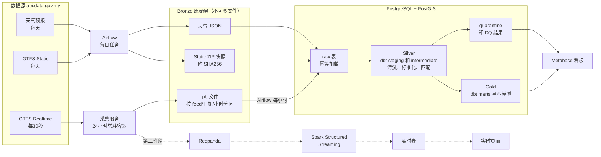
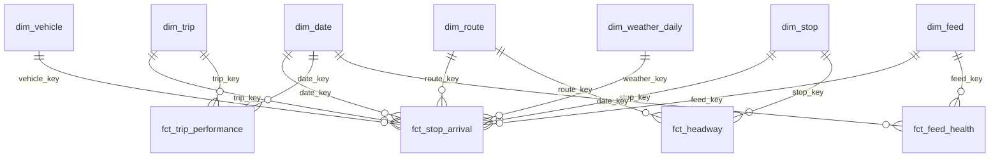

# FYP 项目设计书 v0.1：巴生谷巴士服务可靠性数据平台

> **英文工作标题**：*Design and Evaluation of a Data Pipeline for Bus Service Reliability Monitoring Using Malaysia's GTFS Realtime Open Data*
>
> **版本**：v0.2（2026-10-12）：按 15 家雇主画像调整了技术栈（§9），新增市场对齐（§13）
> **依据**：developer.data.gov.my 官方文档，以及你实际下载的 Static 样本和两次 Realtime 测试结果（10/5、10/11）

---

## 0. 先回答：为什么要从现在开始保存原始数据？

| # | 原因 | 不保存会怎样 |
|---|---|---|
| 1 | **API 只返回"此刻"的数据，没有历史接口** | 今天不存，今天的数据就永远拿不到。项目需要几个月的历史才能做趋势和实验 |
| 2 | **时刻表会变**（mrtfeeder 大约 6 周换一版，Ipoh 每天生成一版） | 算 9 月的延误必须用 9 月有效的时刻表。用现在的版本去算，结果是错的 |
| 3 | **你的处理逻辑一定会改**（例如到站半径、去重规则、修 bug） | 有原始数据，改完逻辑可以**全部重算**（回放/回填）；没有就只能将错就错 |
| 4 | **实验需要固定的输入** | 批处理和流处理的对比，必须用同一份数据回放，否则结果没有可比性 |
| 5 | **可追溯**（数据血缘与审计） | 指标有疑问时，可以一路追回到最原始的那个 `.pb` 文件 |

**成本**：按实测，约 10 KB/次 × 2 个 feed × 每天 2880 次 ≈ **每天 50 到 60 MB**，几乎可以忽略。

> [!IMPORTANT]
> 这就是业界的"**不可变原始层**"（immutable raw / Bronze layer）原则：原始数据原样保存、永不修改，所有清洗都在下游完成。面试经常会问到。

---

## 1. 业务场景定义

**场景**：巴生谷（Klang Valley）的 **Rapid KL 巴士**和 **MRT 接驳巴士（MRT Feeder）**的服务可靠性监测。

- MRT 接驳巴士负责"最后一公里"，它是否准时，直接影响人们愿不愿意坐 MRT。
- 政府通过 data.gov.my 开放了**每 30 秒更新一次的车辆 GPS**，但只告诉你"车在哪里"，没有告诉你"车准不准时""乘客要等多久"，也没有历史存档。

**一句话定位**：
> 把原始、有噪声的车辆 GPS 流，转换成**可信、可追溯、按小时和按天更新**的服务可靠性指标，供运营规划和监管使用。

**平台要回答的业务问题**：
1. 哪些路线、哪些时段最不准时？
2. 高频路线上，乘客平均**额外**多等了多久？
3. 串车（两辆车前后脚到站）最常发生在哪些路线和路段？
4. 预报下雨的下午，准点率有没有下降？
5. **这份开放数据本身有多可靠？**（数据质量本身就是业务问题）

### 范围

| 范围内 | 范围外（写进报告的 Limitations / Future Work） |
|---|---|
| `rapid-bus-kl`、`rapid-bus-mrtfeeder` 的 Realtime 和 Static 数据 | 轨道交通的实时数据（官方文档说明还不稳定） |
| `rapid-rail-kl` 的 Static 数据（MRT/LRT 站点维度，用于接驳分析） | 用机器学习预测到站时间（Future Work） |
| MET Malaysia 的每日天气预报 | 客流量（没有公开的实时数据） |
| 公共假期 | 其他州的 BAS.MY（可选扩展，用来演示多运营商标准化） |

---

## 2. 目标用户与利益相关者

| 利益相关者 | 类型 | 关心的问题 | 使用的产出 |
|---|---|---|---|
| **运营规划人员**（Rapid Bus 规划部门） | 主要用户 | 哪些路线和时段不可靠？哪里需要加车或调整班次？ | 路线评分卡、按小时热力图 |
| **监管机构**（APAD，陆路公共交通局） | 主要用户 | 运营商整体表现和趋势 | 每日、每月 KPI 汇总 |
| **调度中心** | 第二阶段 | 现在有没有串车？哪辆车脱班？ | 实时地图和告警 |
| **通勤者** | 次要用户 | 这条线大概要等多久？可不可靠？ | 简化的可靠性页面（可选） |
| **数据分析师和数据团队** | 内部用户 | 数据可不可信？字段是什么意思？ | 星型模型、dbt 文档、数据质量看板 |

> [!NOTE]
> 这些是**模拟的利益相关者**，项目不是由 Prasarana 委托的。FYP 报告的需求章节需要说明需求是怎么得来的，建议做三件事：
> 1. 对 30 名以上使用接驳巴士的通勤者或同学做**问卷调查**
> 2. 在文献中整理公交运营商常用的 KPI
> 3. 可以尝试发邮件给 APAD 或 Prasarana（有回复是加分项，没有也不影响）

---

## 3. 核心痛点与问题陈述

### 痛点

| # | 痛点 | 证据 |
|---|---|---|
| P1 | **只有位置，没有表现**：没有到站时间、延误、发车间隔 | 官方文档写明目前只有 vehicle position，trip updates 计划在 2026 年推出 |
| P2 | **没有历史**：API 只返回当下的快照 | 没有历史接口 |
| P3 | **数据不能直接信任**：时间戳、ID、单位、GPS 都有问题 | 实测发现 12 类问题，见第 6 节 |
| P4 | **时刻表会变，而且各运营商格式不同** | mrtfeeder 的 `service_id` 带日期，约 6 周一版；`shapes.txt` 的经纬度列顺序各不相同 |
| P5 | **两种排班模式需要不同的指标** | rapid-bus-kl 按发车间隔排班（`frequencies.txt`，`exact_times=0`），mrtfeeder 按精确班次排班 |

### 问题陈述（可以直接用于报告）

> Malaysia's open GTFS Realtime feeds publish bus positions every 30 seconds, but provide no arrival, delay or headway information, no historical archive, and contain significant data quality issues such as inconsistent identifiers, invalid timestamps and GPS drift. As a result, stakeholders cannot directly use these feeds to measure bus service reliability. This project designs, implements and evaluates a data pipeline that turns raw vehicle position feeds into trustworthy, timely reliability metrics, and examines the trade-offs between batch and stream processing for this purpose.

### 项目目标

- **O1**：建立 24 小时不间断的采集与归档，包括 Realtime 数据和每天的 Static 快照
- **O2**：设计数据质量框架，对问题数据进行检测、隔离和量化
- **O3**：从 GPS 点推断到站事件，并计算准点率、发车间隔、额外等待时间、串车等指标
- **O4**：用星型模型构建数据仓库，并提供可视化看板
- **O5**：评估批处理与流处理在延迟、准确性和复杂度上的差异

### 研究问题

| RQ | 问题 | 评估方法 |
|---|---|---|
| **RQ1** | 用 30 秒采样的 GPS 数据推断到站时间，准确度有多高？ | 阈值敏感性分析；降采样自洽检验；**实地观测** 30 到 50 次真实到站作为对照（MAE） |
| **RQ2** | 数据质量规则对最终 KPI 有多大影响？ | 同一份数据在"有/无清洗规则"两种情况下计算 KPI，比较差异 |
| **RQ3** | 批处理与流处理在这个场景下的取舍是什么？ | 端到端延迟、结果差异率、迟到数据处理、资源占用、实现复杂度 |

---

## 4. 最终交付的业务产出与展现层

### 交付物

| 交付物 | 面向对象 | 说明 |
|---|---|---|
| **可靠性看板**（Metabase） | 规划人员、监管机构 | 见下方页面设计 |
| **数据质量与管道健康看板** | 数据团队、面试官 | 最能体现数据工程能力的一页 |
| **文档化的数据仓库** | 分析师 | 星型模型，附 dbt docs（血缘图和数据字典） |
| **实时监控页**（第二阶段） | 调度中心 | 实时地图和串车告警 |
| **GitHub repo** | 面试官 | README、架构图，`docker compose up` 一键启动 |
| **FYP 报告、答辩、2 分钟 demo 视频** | 学校、面试官 | |

### 看板页面设计

| 页面 | 内容 | 对应的业务问题 |
|---|---|---|
| ① 网络概览 | 在线车辆数、整体准点率、额外等待时间、7 天趋势 | 整体表现 |
| ② 路线评分卡 | 路线排名，以及"路线 × 小时"的准点率热力图 | 问题 1 |
| ③ 发车间隔与串车 | rapid-bus-kl 各路线的发车间隔变异系数、额外等待时间、串车率 | 问题 2、3 |
| ④ 站点与路段 | 站点平均延误地图、路段平均速度 | 问题 3 |
| ⑤ 天气影响 | 不同天气预报下的准点率对比 | 问题 4 |
| ⑥ **数据质量与管道健康** | feed 可用率、数据新鲜度、各规则违规数、trip 匹配率趋势 | 问题 5 |

---

## 5. 指标体系与公式

指标分三层：**L1 数据与管道健康**、**L2 运营事件**（中间产物）、**L3 业务 KPI**。

### L1：数据与管道健康

| 指标 | 公式 | 说明 |
|---|---|---|
| Feed 可用率 | $A = \dfrac{\text{成功采集次数}}{\text{预期采集次数}}$，每个 feed 每天预期 $86400/30 = 2880$ 次 | 目标 ≥ 95% |
| 数据新鲜度延迟 | $L = t_{\text{ingest}} - t_{\text{vehicle}}$，取中位数和 P95 | 衡量 GPS 时间戳有多旧 |
| 有效记录率 | 通过所有阻断性规则的记录数 ÷ 总记录数 | |
| 重复率 | 重复的 `(feed, vehicle_id, timestamp)` 数量 ÷ 总记录数 | 来自轮询 |
| Trip 匹配率 | 能匹配到当天有效 Static 的 `trip_id` 数量 ÷ 带 `trip_id` 的记录数 | 实测 86% 到 90% |
| 到站推断覆盖率 | 成功推断到站的站点数 ÷ 被观测班次应经过的站点数 | 衡量算法效果 |

### L2：运营事件（核心算法：到站推断）

**MVP 方法：半径法**。对车辆 $v$ 在班次 $k$ 上的每个站点 $s$，在距离 $d(p,s) \le r$ 的 GPS 点中，取距离最近的那个点的时间作为到站时间。距离用 Haversine 公式计算：

$$
d = 2R \arcsin\sqrt{\sin^2\frac{\Delta\varphi}{2} + \cos\varphi_1\cos\varphi_2\sin^2\frac{\Delta\lambda}{2}}
$$

> [!WARNING]
> **半径法的问题**：巴士以 40 km/h 行驶时，30 秒会开大约 333 米。如果半径设为 50 米，很多站点会被"跳过"。所以第二版要改用线性参照插值法。

**第二版方法：线性参照插值（Linear Referencing）**。把每个 GPS 点投影到班次的路线形状上，得到"沿线距离" $x(t)$（PostGIS 的 `ST_LineLocatePoint`）。站点 $s$ 的沿线位置是 $x_s$。找到前后两个点，使 $x_i \le x_s \le x_{i+1}$，然后插值：

$$
t_s = t_i + \frac{x_s - x_i}{x_{i+1} - x_i}\,(t_{i+1} - t_i)
$$

如果 $t_{i+1} - t_i > 120$ 秒（数据断档），就不推断，标记为缺失。mrtfeeder 的 `shapes.txt` 自带 `shape_dist_traveled`，可以直接使用。

### L3：业务 KPI

**(a) 精确班次型（mrtfeeder）：准点率**

$$
\delta = t_{\text{actual}} - t_{\text{scheduled}}, \qquad
\text{on-time} \iff -60\text{s} \le \delta \le 300\text{s}, \qquad
\text{OTP} = \frac{N_{\text{on-time}}}{N_{\text{total}}}
$$

$t_{\text{scheduled}}$ = 服务日期 + `stop_times.arrival_time`。注意 GTFS 的时间可以超过 `24:00:00`（跨午夜的班次）。

| 其他指标 | 公式 |
|---|---|
| 班次执行率 | 被观测到的班次数 ÷ 当天按 `calendar` 和 `calendar_dates` 计划的班次数 |
| 行程时间偏差 | 实际（终点到达 − 起点出发）− 计划（终点到达 − 起点出发） |

**(b) 发车间隔型（rapid-bus-kl）：间隔稳定性**

同一路线、同一方向、同一站点，按到站时间排序，实际间隔为：

$$
h_i = t_i - t_{i-1}
$$

计划间隔 $H$ 取自 `frequencies.txt` 的 `headway_secs`。

| 指标 | 公式 | 含义 |
|---|---|---|
| 间隔变异系数 | $\text{CoV}_h = \sigma_h / \mu_h$ | 越接近 0 越稳定 |
| 实际平均等待时间 | $\text{AWT} = \dfrac{\sum h_i^2}{2\sum h_i}$ | 假设乘客随机到站 |
| 计划平均等待时间 | $\text{SWT} = H/2$ | |
| **额外等待时间** | $\text{EWT} = \text{AWT} - \text{SWT}$ | 伦敦交通局（TfL）衡量高频路线的标准指标 |
| 串车率 | $h_i < 0.25H$ 的比例 | |
| 大间隔率 | $h_i > 1.5H$ 的比例 | |

**(c) 通用指标**

| 指标 | 公式 |
|---|---|
| 在线车辆数 | 每小时、每条路线的不同 `vehicle_id` 数量 |
| 路段平均速度 | $(x_{s_2} - x_{s_1}) / (t_{s_2} - t_{s_1})$ |
| 天气影响 | 比较"预报有雨或雷暴"和"预报无雨"的下午时段 OTP（只做描述性对比，不推断因果） |

> [!TIP]
> 所有阈值（半径 $r$、准点窗口、串车系数 0.25 等）都放进 dbt 的 `vars` 配置。RQ1 的敏感性分析就是改这些参数重跑，而这正需要第 0 节说的原始数据。

---

## 6. 技术难点与数据质量规则

### 技术难点

| # | 难点 | 解决思路 |
|---|---|---|
| D1 | 从 30 秒采样的稀疏 GPS 推断到站时间 | 先用半径法，再改进为线性参照插值（第 5 节） |
| D2 | ID 对不上：mrtfeeder 的 `routeId` 用的是 `route_long_name`；`tripId` 匹配率 86% 到 90% | 建映射表；去掉后缀后再匹配；用当天的 Static 版本匹配 |
| D3 | 时刻表版本变化 | 每天保存快照，**内容哈希变了才生成新版本**（SCD Type 2）；Realtime 数据用 as-of join 关联当天有效的版本 |
| D4 | 服务日期与跨午夜班次 | 时间戳是 UTC epoch，要转成 `Asia/Kuala_Lumpur`；GTFS 时间超过 24 小时要特别处理 |
| D5 | 重复、乱序、迟到的数据 | 去重键加上幂等加载；流处理中使用水位线（watermark） |
| D6 | 各运营商 schema 不同 | 一律按列名读取；每个运营商写一个 staging 模型，统一成标准 schema |
| D7 | API 限流每分钟 4 次 | 2 个 feed 每 30 秒一次正好是 4 次。需要确认限额是按 endpoint 还是总计；遇到 429 时退避重试，并记录到 feed_health |

### 数据质量规则目录

**处理方式**：🔴 隔离（移到 quarantine 表，不删除）｜ 🟡 标记（保留但打标签）｜ 🔧 修正 ｜ 📊 监控告警

| ID | 对象 | 规则 | 质量维度 | 处理 | 来源 |
|---|---|---|---|---|---|
| DQ01 | RT | `timestamp`、`vehicle_id`、经纬度不能为空 | 完整性 | 🔴 | 通用 |
| DQ02 | RT | `timestamp ≤ 采集时间 + 60 秒` | 准确性 | 🔴 | **实测：mrtfeeder 出现 2029 年的时间戳** |
| DQ03 | RT | `timestamp ≥ 采集时间 − 10 分钟` | 时效性 | 🟡 过期 | 通用 |
| DQ04 | RT | 经纬度在巴生谷范围框内 | 有效性 | 🔴 | 通用 |
| DQ05 | RT | 距离路线形状 ≤ 200 米 | 准确性 | 🟡 GPS 漂移 | **文档：E028** |
| DQ06 | RT | 速度单位统一为 m/s，> 100 km/h 标记 | 一致性 | 🔧 + 🟡 | **实测：mrtfeeder 的速度疑似 km/h** |
| DQ07 | RT | 相邻两点推算的速度 ≤ 120 km/h（检测"瞬移"） | 准确性 | 🟡 | 通用 |
| DQ08 | RT | `(feed, vehicle_id, timestamp)` 唯一 | 唯一性 | 🔧 去重 | **实测：轮询造成重复** |
| DQ09 | RT | `trip_id` 存在于当天有效的 Static 中 | 一致性 | 🟡；匹配率 < 80% 时📊 告警 | **实测：86% 到 90%** |
| DQ10 | RT | mrtfeeder 的 `routeId` 通过 long_name 映射成 `route_id` | 一致性 | 🔧 | **实测：匹配率 0%** |
| DQ11 | RT | `bearing` 在 0 到 360 之间 | 有效性 | 🟡 | 通用 |
| DQ12 | RT | `vehicle_id` 格式标准化（车牌和 `RAPID443`、`RPD429` 这类内部编号） | 一致性 | 🔧 | **实测** |
| DQ13 | Static | 必需的文件和列存在（按列名检查） | 完整性 | 🔴 拒绝该版本 | **实测：各运营商列不同** |
| DQ14 | Static | `stop_id`、`trip_id`、`route_id` 唯一 | 唯一性 | 🔴 | 通用 |
| DQ15 | Static | 引用完整性：`stop_times → trips → routes`，`stop_times → stops` | 一致性 | 🟡 | **实测：rapid-rail 的 `AG` 和 `AGL` 不一致** |
| DQ16 | Static | 同一个 trip 内 `stop_sequence` 递增、时间不倒退 | 有效性 | 🟡 | 通用 |
| DQ17 | Static | 排除 `problematic_trips.csv` 里的班次 | 准确性 | 🟡 | **文档** |
| DQ18 | Static | 检测无效值，例如 `[object Object]` | 有效性 | 🔧 置为 NULL | **实测：rapid-rail stops.txt** |
| DQ19 | Static | 文件名容错，例如 `calender_dates.txt` | 一致性 | 🔧 | **实测：待确认** |
| DQ20 | 管道 | 每个 feed 每天可用率 ≥ 95% | 时效性 | 📊 | 通用 |
| DQ21 | 管道 | 在线车辆数与过去 7 天同一时段相比，偏差不超过 ±50% | 完整性 | 📊 | 通用 |

---

## 7. 计算范式：批处理还是流处理

### 按使用场景决定

| 使用场景 | 用户 | 需要多新的数据 | 范式 |
|---|---|---|---|
| 路线评分卡、每日和每月 KPI | 规划人员、监管机构 | 小时到天 | **批处理** |
| 数据质量报告 | 数据团队 | 天 | **批处理** |
| 历史回算、敏感性分析 | 研究 | 不要求 | **批处理**（从原始层回放） |
| 实时串车告警、实时地图 | 调度中心 | 秒到分钟 | **流处理**（第二阶段） |
| Feed 中断告警 | 数据团队 | 分钟 | 采集服务直接告警即可 |

### 决定：**以批处理为主，流处理作为第二阶段的支线**

批处理优先的理由：
1. 主要用户（规划人员、监管机构）需要的是日报和趋势，不是秒级数据
2. 到站推断需要**整个班次的上下文**，还要和当天时刻表做 as-of join，批处理更自然
3. 迟到和乱序的数据，在批处理中重跑一次就能解决
4. 逻辑改了可以全量回算
5. 学习曲线和调试成本更低，适合第一个项目

> [!NOTE]
> 数据源本身是**每 30 秒轮询一次**，本质上是微批。所谓"流处理"，是指"轮询程序 → Kafka → 流处理引擎"这条链路。这一点在报告里要诚实说明，它本身也是很好的讨论点。

**流处理支线的范围（刻意保持很小）**：Redpanda topic 接收车辆位置 → Spark Structured Streaming（事件时间窗口加水位线）→ 计算**实时串车**和**实时在线车辆数** → 写入 Postgres → 实时页面。

**RQ3 的实验设计**：用同一份原始数据回放给两条链路，计算同样的串车指标，比较：
- 端到端延迟（从车辆时间戳到指标可用）
- 结果差异率（流处理因为迟到数据而漏掉或算错的比例）
- 资源占用（CPU、内存）
- 实现复杂度（组件数、代码行数）

---

## 8. 系统与数据仓库架构

### 整体架构



### 分层说明

| 层 | 存储 | 内容 | 原则 |
|---|---|---|---|
| **Bronze** | 文件系统（先本地，之后换 MinIO 或 GCS） | 原样保存的 `.pb`、ZIP、JSON | 不可变，只追加，可以回放 |
| **Raw** | Postgres `raw` schema | 解析后的原始字段，附加载批次 ID | 按（feed，小时）分区，**先删后插**，保证幂等 |
| **Silver** | Postgres，dbt staging 和 intermediate | 类型转换、去重、单位统一、ID 映射、到站推断 | 质量规则在这一层执行，问题数据进 quarantine |
| **Gold** | Postgres，dbt marts | 星型模型和聚合表 | 面向业务，有文档 |

**Bronze 目录结构**：
```
bronze/
├── gtfs_rt/feed=rapid-bus-mrtfeeder/date=2026-10-12/hour=08/20261012T003000Z.pb
├── gtfs_static/feed=rapid-bus-mrtfeeder/date=2026-10-12/gtfs.zip   (+ gtfs.zip.sha256)
└── weather/date=2026-10-12/forecast.json
```

### 星型模型（Gold）



| 事实表 | 粒度（每一行代表） | 关键度量 |
|---|---|---|
| `fct_vehicle_position` | 一辆车在一个时间戳的一个有效 GPS 点 | 经纬度、速度、沿线距离 |
| `fct_stop_arrival` ⭐ | 一辆车在一个班次中到达一个站点的一次事件 | 实际到站时间、计划时间、延误、推断方法 |
| `fct_headway` | 同一站点、路线、方向上相邻两次到站 | 实际间隔、计划间隔、是否串车 |
| `fct_trip_performance` | 一个服务日的一个计划班次 | 是否被观测到、行程时间偏差、起点延误 |
| `fct_feed_health` | 一次采集尝试 | HTTP 状态码、字节数、车辆数、耗时 |

| 维度表 | 说明 |
|---|---|
| `dim_route`、`dim_stop`、`dim_trip` | **SCD Type 2**：`valid_from`、`valid_to`、`feed_version`；代理键 = 运营商 + 原始 ID（避免两个运营商的数字 ID 冲突） |
| `dim_date` | 包含是否周末、是否公共假期、学校假期 |
| `dim_vehicle` | 标准化后的车辆 ID，以及首次和最后出现时间 |
| `dim_feed` | 运营商、排班模式（班次型或间隔型） |
| `dim_weather_daily` | 日期 × 地区；早、午、晚三个时段的天气预报 |

### Airflow DAG

| DAG | 调度 | 任务 |
|---|---|---|
| `static_snapshot` | 每天 04:00 | 下载 → 计算哈希 → 有变化才加载新版本（SCD2）→ DQ13 到 DQ19 |
| `rt_load` | 每小时 | 把上一个完整小时的 `.pb` 解析加载进 raw（先删后插，幂等） |
| `dbt_build` | 每小时 | `dbt build`（运行模型并执行测试） |
| `weather_daily` | 每天 | 拉取天气预报 |
| `dq_daily_report` | 每天 | 汇总质量指标，失败时发送告警 |

### 关键设计决策（面试高频话题）

1. **每 30 秒的采集不放进 Airflow**：Airflow 适合分钟级以上的批任务，调度开销不适合 30 秒轮询。采集用常驻容器（`restart: always`），Airflow 负责下游的批处理。
2. **幂等加载**：按（feed，小时）分区，先删除再插入。同一个小时重跑 10 次结果都一样。
3. **SCD2 用内容哈希触发**：每天下载快照，但只有内容变化时才生成新版本。
4. **问题数据隔离而不是删除**：可以统计、可以审计，也可以在规则改了之后放回来。
5. **As-of join**：Realtime 数据关联的是"当天有效"的时刻表版本，而不是最新版本。

---

## 9. 技术栈选型

> **v0.2 调整**：根据 15 家马来西亚雇主的岗位画像（见第 13 节）重新对齐。

| 层 | 选择 | 备选 | 理由（对应雇主） | 阶段 |
|---|---|---|---|---|
| 语言 | **Python 3.11 + SQL**（Python 按模块化包结构写，附单元测试） | | 所有岗位都要求；Grab 特别强调生产级代码规范 | MVP |
| 采集 | **requests + gtfs-realtime-bindings** | | 官方文档示例 | MVP |
| 原始存储 | **S3 API**：本地开发用 MinIO，部署用 **AWS S3** | GCS | AWS 是出现最多的云（Boost、Roche、Focal、MoneyLion）；用同一套 S3 API，切换不改代码 | MVP 用 MinIO，P3 换 AWS |
| 服务层数仓 | **PostgreSQL 16 + PostGIS** | | 免费、可持续运行；PostGIS 做地理计算；Carsome 明确要求 PostgreSQL | MVP |
| 湖仓（升级） | **Parquet → Apache Iceberg**（MinIO/S3 上），用 **PySpark 批处理**生成 Silver 层 | Delta Lake | Iceberg 出现在 MoneyLion、ONL；Spark 是 Tier 1 到 4 普遍要求的分布式引擎。也为"单机 Postgres 与 Spark 对比"实验提供条件 | P3 |
| 转换 | **dbt-core**，明确使用**增量模型、Jinja 宏、model contracts、tests、docs** | SQLMesh | GXBank 面试会深挖这些点；Roche、Focal 也要求 dbt | MVP 起逐步加 |
| 编排 | **Apache Airflow**，用到 Sensor、自定义 Operator、重试、SLA 回调 | Dagster | GXBank 点名 Sensor、Custom Operator、XCom | MVP |
| 数据质量 | dbt tests + dbt-expectations + quarantine 表 + **dbt source freshness** | Great Expectations | Boost "build trust"、Carsome 自动化质检、Grab SLA | MVP |
| 治理与安全 | **Postgres RBAC 角色**（engineer、analyst）+ **车牌号列脱敏/哈希** + dbt 血缘文档 | | GXBank 的 RBAC 与动态脱敏、Roche 的合规意识。车牌在真实数据中属于可识别信息，不需要再造假 PII | P3 |
| 可视化 | **Metabase**（业务看板） | Superset | | MVP |
| 可观测性 | 管道健康先放在 Metabase；可选 **Prometheus + Grafana** | | ONL 点名 Prometheus/Grafana/Alertmanager | 可选 |
| 容器 | **Docker Compose** | | 一键复现 | MVP |
| CI | **GitHub Actions**：ruff、pytest、sqlfluff、用样本数据跑 `dbt build` | | EY 提到 Git/Docker 规范 | P3 |
| 流处理 | **Redpanda（Kafka API）+ Spark Structured Streaming** | Kafka + Flink | Kafka 是 Tier 1/2 最常见的组件；Spark 一套引擎同时覆盖批和流，学习成本最低；Flink 写入"备选方案讨论" | P4 |
| 云数仓移植（可选） | 项目末期用 **Snowflake 30 天试用**，把 dbt 模型移植过去跑一遍 | BigQuery | GXBank、MoneyLion、Roche 都用 Snowflake + dbt。Snowflake 没有长期免费版，所以只做移植演示，不作为主数仓 | P5 可选 |
| AI 辅助（可选） | 基于星型模型和 dbt 文档做一个**自然语言转 SQL**的小功能，并评估准确率 | | Shopee（LLM/RAG 用于数据工程）、MoneyLion（AI 辅助开发） | Future Work 或 P5 |

> [!WARNING]
> **MVP 仍然只用 6 样**：Python、Postgres/PostGIS、dbt、Airflow、Metabase、Docker（外加 MinIO 存原始文件）。Iceberg、Spark、Kafka、AWS、Snowflake 都按阶段加入，不要一开始全部上。

> [!NOTE]
> AWS 和 Snowflake 的免费额度政策会变化（例如 AWS 2025 年起对新账户改为额度制）。使用前请到官网确认当前条款，避免产生费用。

---

## 10. MVP 范围与试点路线

### 原则：**采集全量，处理先做试点**

- **采集**：从第一天起采集两个 feed 的**全部路线**。成本很低，而且无法回填。
- **处理**：MVP 只处理 **mrtfeeder 的 3 到 5 条试点路线**。

**为什么先做 mrtfeeder**：
- 按精确班次排班，准点率最直观，最容易向导师和面试官解释
- `shapes.txt` 自带 `shape_dist_traveled`，方便之后做线性参照
- `routeId` 映射问题正好是第一个真实的数据质量案例

**试点路线的选择标准**（用你采集到的数据来决定）：在线车辆数多、trip 匹配率高、班次密集、最好连接同一个 MRT 站。

### 路线图

> 假设 FYP 在 2027 年 4 月左右提交。请按学校实际时间调整。

| 阶段 | 时间 | 学校方面 | 技术方面 | 求职方面 |
|---|---|---|---|---|
| **P0** | **10/12–10/18** | | ⭐ **采集服务 v0 上线，24 小时运行；每天保存 Static 快照** | |
| P1 | 10/19–11/15 | 提交 proposal，写文献综述，发需求问卷 | 用 Docker 启动 Postgres/PostGIS；Static 按 SCD2 加载；`rt_load` 和 staging 模型 | 补 SQL 和 Python |
| P2 | 11/16–12/20 | 设计章节 | **MVP**：半径法到站推断、`fct_stop_arrival`、试点路线准点率、核心质量规则、Airflow DAG、Metabase 看板 v1 | **整理 README，开始投实习** |
| P3 | 1 月 | 中期报告 | 推广到 mrtfeeder 全部路线；rapid-bus-kl 的发车间隔、额外等待时间、串车；线性参照插值；CI；dbt docs | 继续投递，练 SQL 题 |
| P4 | 2–3 月 | 做实验 RQ1 到 RQ3，包括实地观测 | 流处理支线；回放实验 | 准备面试时讲解项目 |
| P5 | 3–4 月 | 写最终报告，准备答辩 | 收尾，录 demo 视频 | 投毕业生岗位，把数字写进简历 |

### MVP 完成标准

- [ ] 采集服务连续运行 ≥ 14 天，可用率 ≥ 95%
- [ ] Static 快照有版本记录（至少观察到一次版本变化，或证明一直没有变化）
- [ ] 一条命令 `docker compose up` 就能启动 Postgres、Airflow 和 Metabase
- [ ] `rt_load` 重跑同一小时，结果行数不变（幂等性测试）
- [ ] 试点路线能产出每天的准点率，看板可以查看
- [ ] 至少 10 条质量规则以 dbt test 的形式运行，有违规统计
- [ ] README 包含架构图、数据源说明和启动步骤

---

## 11. 论文大纲与求职卖点映射

### 论文大纲

| 章节 | 内容 | 对应本文档 |
|---|---|---|
| 1 Introduction | 背景、问题陈述、目标、研究问题、范围、意义 | §1、§3 |
| 2 Literature Review | GTFS 与 GTFS-RT；公交可靠性指标（准点率、发车间隔、EWT、串车）；从 AVL 数据推断到站时间；数据架构（Medallion、Lambda/Kappa）；批处理与流处理；数据质量维度（DAMA） | §5、§7 |
| 3 Requirements & Data Analysis | 利益相关者、问卷结果、功能和非功能需求；**数据源剖析与质量问题目录** | §2、§6 |
| 4 System Design | 架构、数据模型、指标定义、质量框架、范式决策 | §5、§7、§8 |
| 5 Implementation | 采集、SCD2、到站推断算法、dbt 模型、编排、流处理、CI | §8、§9 |
| 6 Testing & Evaluation | 单元测试与数据测试；RQ1 准确度；RQ2 质量规则影响；RQ3 批处理与流处理对比；可扩展性 | §3 |
| 7 Results & Discussion | 巴生谷巴士可靠性的发现；天气分析；局限性 | §4 |
| 8 Conclusion & Future Work | 到站时间预测（ML）、更多运营商、云端部署 | |
| 附录 | 数据字典、质量规则目录、dbt 文档截图、用户手册 | |

### 求职卖点映射

| 项目内容 | JD 关键词 | 面试时能回答的问题 |
|---|---|---|
| 24 小时采集与 Bronze 原始层 | data ingestion, data lake, API integration | "原始数据为什么要保留？" |
| 按小时分区、先删后插 | **idempotency**, incremental load, backfill | "任务失败重跑，怎么保证数据不重复？" |
| Static 版本化 | **SCD Type 2**, dimensional modeling | "维度变化怎么处理？" |
| 星型模型、粒度定义 | **Kimball**, star schema, data warehouse | "这张事实表的粒度是什么？" |
| dbt 的 staging、intermediate、marts | **dbt**, ELT, data transformation | "为什么用 ELT 而不是 ETL？" |
| 21 条质量规则和 quarantine | **data quality**, data observability | "脏数据进来怎么办？" |
| Airflow DAG 和告警 | **Airflow**, orchestration, monitoring | "为什么 30 秒采集不放进 Airflow？" |
| PostGIS 线性参照 | SQL, geospatial | "到站时间怎么从 GPS 推出来？" |
| Redpanda + Spark 流处理 | **Kafka**, **Spark**, streaming, watermark | "迟到数据怎么处理？什么时候该用流处理？" |
| 批处理与流处理对比实验 | trade-off, system design | "为什么你选批处理为主？" |
| Docker Compose、GitHub Actions | **Docker**, **CI/CD** | "别人怎么复现你的环境？" |

### 简历要点模板（数字等完成后再替换）

> - Built a 24/7 ingestion service archiving Malaysia's GTFS Realtime bus feeds (**~X M records**, **Y months**), with idempotent hourly loads orchestrated by **Airflow**.
> - Designed a **Kimball star schema** in **PostgreSQL/PostGIS** using **dbt**, including **SCD Type 2** timetable versioning and an inferred stop-arrival fact table.
> - Implemented **21 data quality rules** (future timestamps, GPS drift, ID mismatches), quarantining **Z%** of records and improving trip match rate from **86% to N%**.
> - Compared batch (dbt) and streaming (**Redpanda + Spark Structured Streaming**) pipelines for bus-bunching detection, measuring latency and result divergence.

---

## 12. 风险与待决策事项

### 风险

| 风险 | 影响 | 应对 |
|---|---|---|
| 电脑关机导致采集断档 | 数据缺失 | 部署到 24 小时运行的环境；用 feed_health 记录缺口，在报告中说明 |
| API 改版或中断 | 采集失败 | 保存原始文件；schema 检查；告警 |
| 限流是按总计计算 | 2 个 feed 加上 Static 下载会超额 | 实测确认；错开请求时间；遇到 429 时退避 |
| trip 匹配率偏低 | 到站推断覆盖率下降 | 用 route 加 GPS 位置推断班次作为后备方案；在报告中讨论 |
| 没有官方到站时间作为对照 | RQ1 难以验证 | 实地观测、降采样自洽检验、敏感性分析 |
| 范围太大 | 做不完 | 严格按阶段推进，流处理放到第四阶段，做不完也不影响主体 |

### 待你决定

1. **采集服务在哪里运行？**
   - 自己的电脑（最简单，但会断档）
   - 云平台免费 VM，例如 Oracle Cloud Always Free 或 GCP e2-micro（推荐，需要确认现在的免费额度）
   - 旧电脑或树莓派
2. **学校 FYP 的评分标准和截止日期**，用来调整路线图和论文结构
3. **导师是否接受工程型加评估型的 FYP**
4. 是否需要加入 BAS.MY（例如 Ipoh），用来演示多运营商标准化（可选）


---

## 13. 市场对齐（v0.2 新增）：15 家雇主画像对项目的影响

### 13.1 先校准：这份资料怎么用

> [!IMPORTANT]
> - 15 个岗位里**大约 10 个是 Senior 职位**（Grab、GXBank、Ant Senior、ONL 等）。Senior 的要求代表**方向**，不是 junior 的门槛。真正和你直接相关的是 **Shopee Fresh Grad、Roche Junior、Tranglo Junior、EY Junior、Ant Junior**。
> - 这份资料的来源和日期我无法核实，部分措辞带有总结色彩。投递前请以官网的原始 JD 为准。

### 13.2 从 15 个画像提炼出的共性

| 共性 | 出现的雇主 | 项目里有没有覆盖 |
|---|---|---|
| **SQL + Python 扎实**（含代码规范） | 全部 | ✅ 全项目；Python 写成包，附 pytest |
| **幂等、断点续传、SLA、零数据丢失** | Grab、GXBank、TNG、Ant | ✅ 已有幂等加载；**新增 SLA 定义和"切换演练"**（13.3） |
| **数据质量自动化、建立信任** | Carsome、Boost、Ant、Tranglo | ✅ 21 条规则 + quarantine |
| **实体对齐 / 主数据（MDM）** | Carsome（Autohive） | ✅ **新增**：跨运营商站点和车辆实体对齐（13.3） |
| **数据映射文档** | Tranglo | ✅ **新增**：源到目标映射文档（论文附录） |
| **dbt 进阶**（增量、宏、契约、测试） | GXBank、Roche、Focal | ✅ 明确列入技术栈 |
| **Airflow 进阶**（Sensor、自定义 Operator） | GXBank、Roche | ✅ 明确列入技术栈 |
| **Kimball 维度建模、分层设计** | MoneyLion、Ant、Ambition | ✅ 星型模型 + Medallion 分层 |
| **AWS**（S3、Glue、EMR、Athena） | Boost、Roche、Focal、MoneyLion | 🟡 **调整**：原始层改用 S3（P3） |
| **Snowflake + dbt** | GXBank、MoneyLion、Roche | 🟡 **新增可选**：P5 移植演示 |
| **Spark** | Shopee、Tencent、Ant、TNG、ONL、Ambition、Focal、EY | 🟡 **提前**：P3 用 PySpark 做批处理，不只是流处理 |
| **Kafka、流批一体** | Grab、Tencent、MoneyLion、TNG、ONL | 🟡 P4 流处理支线 |
| **湖仓开放表格式（Iceberg/Delta）** | MoneyLion、ONL、Ambition | 🟡 **新增**：P3 Silver 层用 Iceberg |
| **RBAC、脱敏、审计、合规** | GXBank、Roche、Ant | 🟡 **新增**：P3 角色权限 + 车牌脱敏 |
| **SQL 调优**（执行计划、分区、倾斜） | Tencent、MoneyLion、Ambition | 🟡 **新增**：评估章节加入 `EXPLAIN ANALYZE`、分区与索引实验 |
| **CDC（Debezium）** | ONL、Focal、Ambition | ❌ 不纳入。数据源是 API 轮询，没有业务数据库可做 CDC，硬加会显得牵强。面试时能讲清概念即可 |
| **Flink、ClickHouse** | Shopee、ONL、Ant | ❌ 不纳入，写进"备选方案讨论"。工具太多反而做不深 |
| **AI + Data**（LLM、RAG、AI 辅助开发） | Shopee、MoneyLion | 🟡 可选 P5 或 Future Work |
| **CS 基础、LeetCode** | Shopee、Tranglo | ❌ **FYP 覆盖不了**，需要单独准备 |
| **中英双语沟通** | Tencent、Ant | ❌ FYP 覆盖不了；可以把 README 和 demo 视频做成英文版 |

### 13.3 新增到项目里的 5 项内容

**① SLA / SLO 定义**（回应 Grab、GXBank、TNG）

| SLO | 目标 | 实现方式 |
|---|---|---|
| 采集可用率 | 每个 feed 每天 ≥ 95% | `fct_feed_health` |
| Gold 层新鲜度 | 每小时指标在整点后 30 分钟内可用 | dbt source freshness + Airflow SLA 回调 |
| 数据丢失 | Bronze 层 0 丢失（采集成功的文件全部入库） | 每日对账：Bronze 文件数 = Raw 批次数 |
| 回填 | 任意一天可以在 X 分钟内重算 | 回放脚本 + 计时，写进评估章节 |

**② 切换演练（Cutover Drill）**（回应 Grab 的"零数据丢失割接"）
模拟一次上游变化，例如 mrtfeeder 换新版时刻表，或者把原始存储从 MinIO 切到 AWS S3。演练要求：
- 切换期间采集不中断
- 切换后用对账查询证明数据**零丢失、零重复**
- 写一份 runbook（操作手册）

这在学生项目里非常少见，面试时很有说服力。

**③ 实体对齐**（回应 Carsome 的 MDM）
- **站点对齐**：rapid-bus-kl、mrtfeeder、rapid-rail-kl 三套 `stop_id` 各自独立。用"名称模糊匹配 + 坐标距离"把公交站和 MRT 站对应起来，形成统一的 `dim_location`。这一步也是接驳分析的基础。
- **车辆对齐**：车牌和 `RAPID443` 这类内部编号的标准化，以及同一辆车是否在两个 feed 中出现。
- 可以评估匹配的精确率和召回率（人工标注 100 对作为对照），这又是一个能量化的成果。

**④ 治理**（回应 GXBank、Roche、Ant）
- Postgres 角色：`engineer` 能读 Raw 和 Silver；`analyst` 只能读 Gold
- `vehicle.licensePlate` 在 Gold 层用加盐哈希，`analyst` 看不到原值
- dbt docs 提供血缘图；`fct_feed_health` 和加载批次 ID 提供审计追溯
- **源到目标映射文档**（回应 Tranglo）：每个 Gold 字段从哪个原始字段来、经过什么转换

**⑤ 性能与调优实验**（回应 Tencent、MoneyLion）
在评估章节新增 RQ4：

| RQ4 | 随着数据量增长（1 周 → 1 个月 → 6 个月），不同存储和计算方案的性能如何变化？ |
|---|---|
| 对比方案 | Postgres（无分区）、Postgres（按日分区 + 索引）、Parquet/Iceberg + PySpark |
| 测量 | 到站推断任务耗时、典型看板查询耗时、存储大小 |
| 分析 | 用 `EXPLAIN ANALYZE` 和 Spark UI 解释原因（全表扫描、分区裁剪、shuffle） |

### 13.4 调整后的路线图（只列变化）

| 阶段 | 原计划 | v0.2 调整 |
|---|---|---|
| P0 | 采集服务上线 | 不变，原始文件写入 MinIO（S3 API） |
| P2 MVP | 试点路线准点率 | 不变，加上 **dbt 增量模型**和 **source freshness** |
| P3 | 推广、发车间隔、CI | 加入 **PySpark + Iceberg 的 Silver 层**、**实体对齐**、**RBAC 和脱敏**、**原始层迁到 AWS S3（顺便做切换演练）** |
| P4 | 流处理支线 | 不变（Redpanda + Spark Structured Streaming） |
| P5 | 收尾 | 可选：**Snowflake 移植演示**、**自然语言转 SQL 小功能** |

> [!WARNING]
> P3 的工作量明显增加了。如果时间不够，按这个顺序砍：Snowflake 移植 → 自然语言转 SQL → Prometheus/Grafana → 流处理支线。**不要砍**：数据质量、SLA、实体对齐、幂等加载。这些是 junior 岗位最看重的，也是学生项目最缺的。

### 13.5 按目标雇主的面试准备侧重

| 目标类型 | 项目里重点讲 | 项目外要准备 |
|---|---|---|
| Shopee 等 Tier 1 应届岗 | Spark 批处理、性能实验（RQ4）、流处理 | **LeetCode Medium、操作系统、网络、数据库原理** |
| GXBank、Roche 等 dbt/Snowflake 系 | dbt 增量模型和宏、Airflow、RBAC 和脱敏、Snowflake 移植 | Snowflake 基本概念（虚拟仓库、micro-partition） |
| Boost 等 AWS 系 | S3 原始层、Parquet/Iceberg、数据质量 | AWS Glue、Athena、IAM 基础 |
| Carsome、Tranglo 等数据质量和映射系 | 实体对齐、21 条规则、映射文档 | 正则表达式、MongoDB 基础 |
| EY 等咨询公司 | 端到端交付、文档、Docker | 多种云数仓的基本差异 |
