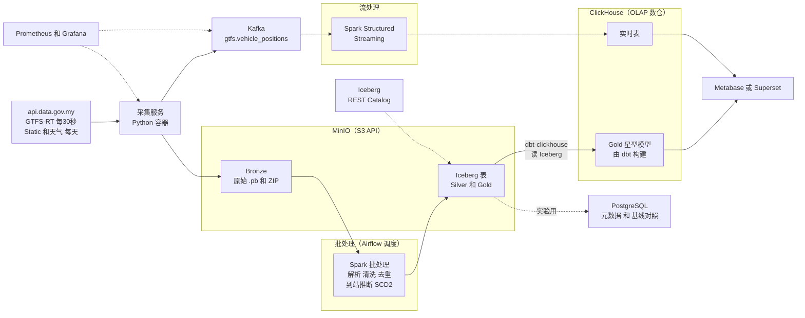

# v0.3 架构与技术栈：全本地 Docker 湖仓（零成本）

> 本文档**取代** [fyp_project_design.md](file:///C:/Users/johnc/.gemini/antigravity/brain/346d611e-fd24-4d39-9f07-75868a17a4cd/fyp_project_design.md) 的 §8（架构）和 §9（技术栈），以及 §13 中关于 AWS 和 Snowflake 的部分。其他章节（业务、指标、数据质量规则、论文结构）继续有效。

---

## 1. 原则

1. **零成本**：全部在本地 Docker 运行，不用云，不用 Snowflake。
2. **用大公司真实在用的开源组件**：Kafka、MinIO（S3 API）、Iceberg、Spark、ClickHouse、dbt、Airflow。
3. **每个组件都必须有理由**：在架构中承担真实职责，或者服务于一个可测量的实验。不为凑关键词而加。
4. **对比实验是核心**：把"普通数据库与真正的数仓、湖仓"的性能和取舍做成研究问题（RQ4），这样工具选择本身就成了论文的贡献。

---

## 2. 组件与职责

| 组件 | 职责 | 对应雇主 |
|---|---|---|
| **Python 采集服务** | 每 30 秒拉取 GTFS-RT；把原始 `.pb` 写入 MinIO，同时把解析后的消息发送到 Kafka | 全部 |
| **Apache Kafka**（KRaft 模式，不需要 ZooKeeper） | 事件总线：`gtfs.vehicle_positions` topic，按 feed 分区 | Grab、MoneyLion、TNG、ONL、Shopee |
| **MinIO** | S3 兼容的对象存储：Bronze 原始文件，以及 Iceberg 的数据文件 | Boost、Roche、ONL、Focal（S3） |
| **Apache Iceberg + REST Catalog** | 湖仓表格式，Silver 和 Gold 层的主存储，支持 ACID、schema 演进、时间旅行、快照 | MoneyLion、ONL |
| **Apache Spark**（PySpark） | 批处理：解析、清洗、去重、到站推断、SCD2，写入 Iceberg；流处理：Structured Streaming 消费 Kafka | Shopee、Tencent、Ant、TNG、ONL、Ambition、Focal、EY |
| **ClickHouse** | **OLAP 数仓和服务层**：Gold 星型模型，承载看板查询；也直接读取 Iceberg 表 | Shopee、ONL |
| **dbt**（dbt-clickhouse） | 在 ClickHouse 里构建 Gold 层的维度和事实表，提供测试、文档和血缘 | GXBank、Roche、Focal |
| **Apache Airflow** | 编排所有批处理任务：Static 快照、Spark 作业、dbt、数据质量、Iceberg 维护 | GXBank、Roche |
| **PostgreSQL** | ① Airflow 和 Metabase 的元数据库；② **实验中的"普通数据库"基线** | Carsome |
| **Metabase 或 Superset** | 业务看板（连接 ClickHouse） | TNG |
| **Prometheus + Grafana** | 管道和系统监控：消费延迟、采集成功率、容器资源 | ONL |

### 为什么选 Iceberg，不同时用 Delta Lake？

- 两者解决的是同一个问题。**同时用两个，面试官会问"为什么要两个"，你很难答好。**
- Iceberg 不绑定特定厂商，Spark、ClickHouse、Trino、Flink 都能读写，和"开放湖仓"的方向一致。
- 论文里可以写一小节 **Iceberg、Delta Lake、Hudi 的对比**，说明为什么选 Iceberg。面试同样能讲。

### 为什么 ClickHouse 和 Iceberg 两个都要？

| | Iceberg（湖仓，在 MinIO 上） | ClickHouse（OLAP 数仓） |
|---|---|---|
| 角色 | 系统的"唯一事实来源"，便宜、开放、可回放 | 高速服务层，支撑看板的亚秒级查询 |
| 写入 | Spark 批处理 | dbt 从 Iceberg 读取后构建 Gold；流处理结果也写入这里 |
| 业界对应 | 湖仓存储层 | 湖仓之上的查询和服务引擎 |

这正是 ONL 画像里的 **"Iceberg（S3）+ Spark + ClickHouse"** 模式。

---

## 3. 架构图



### 分层

| 层 | 存储 | 由谁写入 | 内容 |
|---|---|---|---|
| Bronze | MinIO 原始文件 | 采集服务 | `.pb`、ZIP、JSON，不可变 |
| Silver | Iceberg | Spark 批处理 | 解析后的车辆位置（去重、单位统一、ID 映射、质量标记）、Static 的 SCD2 版本、quarantine 表、推断出的到站事件 |
| Gold | Iceberg（存档）+ ClickHouse（服务） | dbt-clickhouse | 星型模型：`fct_stop_arrival`、`fct_headway`、`fct_trip_performance`、`fct_feed_health` 和各维度 |
| Realtime | ClickHouse | Spark Structured Streaming | 实时串车、在线车辆数 |

### 原设计中依赖 PostGIS 的部分怎么处理

| 功能 | 新方案 |
|---|---|
| 最近站点、距离计算 | Spark 里用 Haversine UDF，或者 **Apache Sedona**（Spark 的地理扩展） |
| 线性参照插值 | Sedona；或者在 Spark 中直接使用 mrtfeeder `shapes.txt` 的 `shape_dist_traveled` |
| 看板中的地理查询 | ClickHouse 内置的 `greatCircleDistance`、`pointInPolygon` |

---

## 4. 对比实验：RQ4 升级为核心研究问题

> **RQ4**：对于公共交通遥测数据，普通关系型数据库（PostgreSQL）、OLAP 数仓（ClickHouse）和湖仓（Spark + Iceberg）在**写入、转换和分析查询**上的性能、存储和运维取舍分别是什么？

### 实验设计

| 维度 | 设置 |
|---|---|
| 数据量 | 1 周、1 个月、全部（约 6 个月，约 1 亿行）三档 |
| 系统 | ① PostgreSQL（行存，有索引）② PostgreSQL（按日分区 + 索引）③ ClickHouse（MergeTree，按日分区，`ORDER BY (feed, route, ts)`）④ Spark + Iceberg（Parquet，按日分区） |
| 工作负载 | W1 批量写入；W2 到站推断（重型转换）；W3 看板查询：按路线和小时聚合准点率；W4 点查询：某辆车某天的轨迹；W5 去重和更新（upsert） |
| 测量 | 耗时（重复 5 次取中位数）、压缩后的存储大小、CPU 和内存峰值 |
| 解释 | 用 Postgres 的 `EXPLAIN ANALYZE`、ClickHouse 的 `EXPLAIN` 和 `system.query_log`、Spark UI，解释差异来源：行存与列存、压缩、分区裁剪、向量化执行、shuffle |

### 预期能写出的结论类型（需要实验验证）

- 聚合查询（W3）上 ClickHouse 远快于 Postgres，原因是列存和向量化执行
- 点查询（W4）和频繁更新（W5）上，Postgres 未必吃亏
- Spark 在这个数据量（单机、约 10 GB 级别）下有启动和调度开销，不一定更快。**这正说明"分布式不是越早上越好"，在面试中是很成熟的回答**
- 存储大小：列存加压缩相对行存的倍数

### 附加小实验：流处理两种方案对比

| 方案 | 说明 |
|---|---|
| A | Kafka → Spark Structured Streaming → ClickHouse |
| B | Kafka → **ClickHouse Kafka 表引擎 + 物化视图**（不需要 Spark） |

比较端到端延迟、资源占用和实现复杂度。这能回答"什么时候需要独立的流处理引擎"，可以并入 RQ3。

---

## 5. 本地运行：资源规划

全部组件同时运行大约需要 **12 到 16 GB 内存**。用 Docker Compose 的 **profiles** 按需启动：

| Profile | 包含 | 估计内存 | 什么时候用 |
|---|---|---|---|
| `ingest`（常驻） | 采集服务、MinIO、Kafka | 约 2 GB | 24 小时运行 |
| `batch` | Spark、Iceberg REST Catalog、Airflow、Postgres（元数据） | 约 5 到 6 GB | 每天定时跑，或开发时 |
| `serve` | ClickHouse、Metabase | 约 2 到 3 GB | 查看看板时 |
| `stream` | Spark Streaming | 约 2 GB | P4 和实验时 |
| `monitor` | Prometheus、Grafana | 约 1 GB | 可选 |
| `bench` | Postgres 基线库 | 约 1 到 2 GB | 只在跑实验时 |

```bash
docker compose --profile ingest up -d                      # 24 小时常驻
docker compose --profile batch --profile serve up -d       # 开发时
```

> [!WARNING]
> **你的电脑有多少内存？** 8 GB 会很吃力，只能分批启动；16 GB 可以舒服地开发；32 GB 基本可以全部同时运行。另外，因为不上云，**采集服务需要电脑一直开机**。断档的时段会记录在 `fct_feed_health`，并在报告中说明。

---

## 6. 修订后的路线图

| 阶段 | 时间 | 技术内容 | 学习重点 |
|---|---|---|---|
| **P0** | 本周 | 采集服务 + MinIO（Bronze），24 小时运行 | Docker、Python、S3 API |
| P1 | 10 月底到 11 月中 | Kafka 接入（采集服务同时发消息）；Spark 批处理读 Bronze，写 Iceberg Silver；Static 的 SCD2 | **Spark 基础**、Iceberg 基础 |
| P2 **MVP** | 11 月中到 12 月 | ClickHouse + dbt-clickhouse 构建 Gold；试点路线准点率；核心质量规则；Airflow 串起全流程；Metabase 看板 | ClickHouse、dbt、Airflow |
| P3 | 1 月 | 发车间隔、EWT、串车；实体对齐；线性参照；CI；SLA、切换演练 | 进阶 |
| P4 | 2 月 | Spark Structured Streaming 与 ClickHouse Kafka 引擎两种方案；Prometheus/Grafana | 流处理 |
| P5 | 2 到 3 月 | **RQ4 基准测试**（加入 Postgres 基线）；RQ1 到 RQ3 | 性能调优 |
| P6 | 3 到 4 月 | 写报告、答辩、录 demo | |

> [!IMPORTANT]
> 和 v0.2 相比，**学习曲线前移了**：P1 就要学 Spark 和 Iceberg，而原来是 Postgres。MVP（12 月前可以投实习）的难度更高。如果到 12 月初 Spark 和 Iceberg 还没跑通，**后备方案**是 MVP 先用 ClickHouse 直接读取 Bronze 解析后的 Parquet，把 Iceberg 推迟到 P3。看板和投递简历不受影响。

---

## 7. 技术栈与雇主要求对照

| 关键词 | 项目中的实际用途 | 雇主 |
|---|---|---|
| Kafka | 车辆位置事件总线 | Grab、MoneyLion、TNG、ONL、EY |
| Spark（批和流） | Silver 层加工、到站推断、流处理 | 几乎所有 Tier 1 到 4 |
| Iceberg、湖仓、S3（MinIO） | Silver 和 Gold 的主存储 | MoneyLion、ONL、Boost、Roche |
| ClickHouse、OLAP | Gold 服务层、实时表 | Shopee、ONL |
| dbt | Gold 星型模型、测试、文档 | GXBank、Roche、Focal |
| Airflow | 全部批处理编排 | GXBank、Roche、EY |
| Kimball 星型模型、SCD2 | Gold 层设计 | MoneyLion、Ant、Ambition |
| 数据质量、SLA、幂等 | 21 条规则、quarantine、对账 | Grab、Boost、Carsome |
| SQL 和引擎调优 | RQ4 基准测试与执行计划分析 | Tencent、MoneyLion、Ambition |
| Prometheus、Grafana | 管道监控 | ONL |
| Docker | 全部组件 | 全部 |

**仍未覆盖、也刻意不加**：Delta Lake（只在论文里比较）、Flink（只在论文里讨论）、CDC/Debezium（没有业务数据库，硬加很牵强）、Snowflake 和云平台（零成本原则）。
