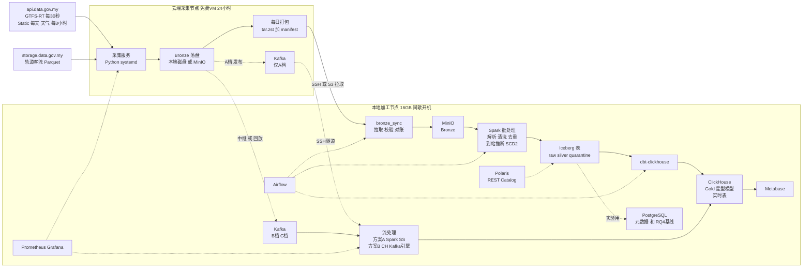
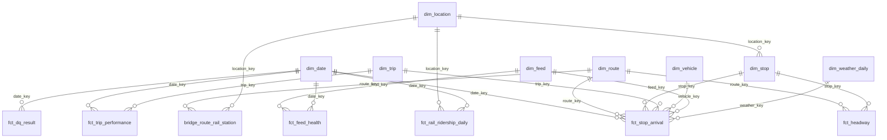
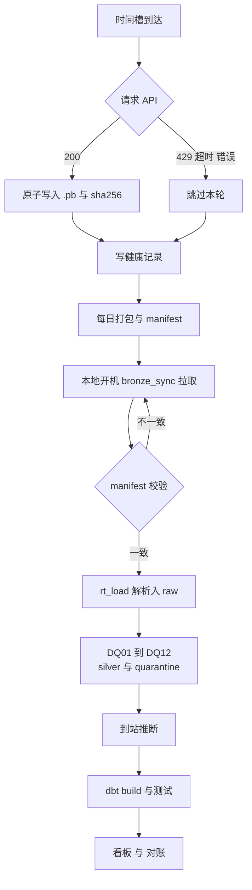

# FYP 项目设计书 v0.5：巴生谷巴士服务可靠性数据平台

> **FYP 英文标题**（✅ 2026-10-20 确定）：**DEVELOPMENT AND EVALUATION OF AN OPEN LAKEHOUSE DATA PIPELINE FOR BUS SERVICE RELIABILITY MONITORING USING MALAYSIA'S GTFS REALTIME OPEN DATA**
>
> *（Title Case：Development and Evaluation of an Open Lakehouse Data Pipeline for Bus Service Reliability Monitoring Using Malaysia's GTFS Realtime Open Data）*
>
> **版本**：v0.5（2026-10-27）。本文是**当前有效的设计基线**，取代 [`fyp_project_design_v0.4.md`](archive/fyp_project_design_v0.4.md)（与 v0.2、v0.3 一起放在 `docs/fyp-design/archive/`，不再维护）。**v0.5 只改范围优先级、时间线、文献关口和开发流程**（§3.3、§3.4 的标注，§10，§12，§14.1，§14.5，§14.9，§15.5）；架构、指标、数据质量规则与 v0.4 相同。后续根据文献综述（关口 G1–G3，§10.7）和实现证据继续迭代，每次修订在文末记录变更。
>
> **依据（冲突时按此顺序裁决）**：
> 1. [`docs/context/my-context.md`](../context/my-context.md)：个人决策、学校政策、2027 真实时间线
> 2. [`docs/data-source/data-source-summary.md`](../data-source/data-source-summary.md)（下文简称 **summary**）：数据源事实、实测证据、脏点 E01–E44、限流、辅助数据源决策
> 3. [`fyp_project_design_v0.3.md`](archive/fyp_project_design_v0.3.md)：架构与技术栈（全本地 Docker 湖仓）
> 4. [`Job_Market.md`](../career/Job_Market.md)：工具选型约束（15 家公司 JD）
> 5. [`fyp_project_design_v0.2.md`](archive/fyp_project_design_v0.2.md)：业务、指标、数据质量规则、论文结构的原文基础
> 6. `docs/context/{proposal,fyp1,fyp2}/` 的 guidelines 与 template，[`docs/context/fyp-index.md`](../context/fyp-index.md)，[`docs/context/academic-calendar.md`](../context/academic-calendar.md)（UTAR 2027–2028 校历）
> 7. 已有原型：[`ingestion/collect_gtfs_rt.py`](../../ingestion/collect_gtfs_rt.py)、[`ingestion/download_gtfs_static.py`](../../ingestion/download_gtfs_static.py)、[`.github/workflows/`](../../.github/workflows/)（只作可行性证据，不是约束）
>
> **状态标记**：✅ 已确认或已完成 ｜ 🟡 部分完成 ｜ ⏳ 待 V06/V07 实测校准 ｜ ❓ 待确认（汇总在 §15）
>
> **章节导航**：§0–§7 业务与方法 ｜ §8 系统架构（含采集层）｜ §9 技术栈与 JD 对标 ｜ §10 MVP 与路线图 ｜ §11 与 UTAR 三份报告的映射 ｜ §12 风险、已确认决策与待办 ｜ §13 雇主对齐 ｜ §14 评估与实验设计 ｜ §15 合并说明与待确认事项

---

## 0. 为什么要从现在开始保存原始数据？

| # | 原因 | 不保存会怎样 |
|---|---|---|
| 1 | **API 只返回"此刻"的数据，没有历史接口** | 今天不存，今天的数据就永远拿不到。项目需要几个月的历史才能做趋势和实验 |
| 2 | **时刻表会变**（mrtfeeder 现行版本 2026-11-13/15 到期，版本周期未知，`calendar` 的起始日期会随导出日期滚动；rapid-bus-kl 在 2026-10-19 至 10-21 之间就改过 `frequencies` 和 `stop_times`；rapid-rail-kl 2026-12-31 到期；rapid-bus-kl 2027-03-31 到期） | 算 9 月的延误必须用 9 月有效的时刻表。用现在的版本去算，结果是错的 |
| 3 | **处理逻辑一定会改**（例如到站半径、去重规则、修 bug） | 有原始数据，改完逻辑可以**全部重算**（回放/回填）；没有就只能将错就错 |
| 4 | **实验需要固定的输入** | 批处理与流处理对比（RQ3）、三种引擎对比（RQ4），都必须用同一份数据回放，否则结果没有可比性 |
| 5 | **可追溯**（数据血缘与审计） | 指标有疑问时，可以一路追回到最原始的那个 `.pb` 文件 |
| 6 | **天气预报同样没有历史接口**（summary §6.1.3，💡 待 V01 确认） | 天气与准点率的分析范围只能从开始归档那天算起 |

**成本**：按实测，每次下载约 6–11 KB（晚间），两个 feed 每天各 2880 次，合计**每天约 50–60 MB**，6 个月约 10 GB。✅ V07（2026-10-21）：傍晚高峰单次最大约 11 KB（kl 98 辆、feeder 145 辆），深夜 kl 为 0 辆、文件 15 字节，所以这个数字是上限，全天平均更低。准确值以 VM 首个完整日（10-22）打包 manifest 的 `raw_bytes` 为准。

> [!IMPORTANT]
> 这就是业界的"**不可变原始层**"（immutable raw / Bronze layer）原则：原始数据原样保存、永不修改，所有清洗都在下游完成。面试经常会问到。
>
> **当前状态（2026-10-21）**：GTFS Static 已由 GitHub Actions **每天**检查并按文件去重存档 ✅；天气预报与警告由 GitHub Actions 每 3 小时临时归档 ✅；**GTFS Realtime 尚未 24 小时采集**（云端 VM 仍未到手）。在 P0 上线之前，**每过一天就永久损失一天的 Realtime 数据**，所以 P0 是全项目最高优先级（§10）。

---

## 1. 业务场景定义

**场景**：巴生谷（Klang Valley）的 **Rapid KL 巴士**和 **MRT 接驳巴士（MRT Feeder）**的服务可靠性监测。

- MRT 接驳巴士负责"最后一公里"，它是否准时，直接影响人们愿不愿意坐 MRT。
- 政府通过 data.gov.my 开放了**每 30 秒更新一次的车辆 GPS**，但只告诉你"车在哪里"，没有告诉你"车准不准时""乘客要等多久"，也没有历史存档。

**一句话定位**：
> 把原始、有噪声的车辆 GPS 流，转换成**可信、可追溯、按小时和按天更新**的服务可靠性指标，供运营规划和监管使用。

**平台要回答的业务问题**：
1. 哪些路线、哪些时段最不准时？
2. 高频路线上，乘客平均**额外**多等了多久？
3. 串车（两辆车前后脚到站）最常发生在哪些路线和路段？
4. 预报下雨或雷暴的时段，准点率有没有下降？
5. **这份开放数据本身有多可靠？**（数据质量本身就是业务问题）
6. 客流大的 MRT 站，它的接驳巴士是否可靠？**应该优先改善哪里？**（需求加权可靠性，依据 Rapid Rail OD 客流）

### 范围

| 范围内 | 范围外（写进报告的 Limitations / Future Work） |
|---|---|
| `rapid-bus-kl`、`rapid-bus-mrtfeeder` 的 Realtime 和 Static 数据（核心） | 轨道交通的实时数据（官方文档说明没有稳定的 Realtime，E12） |
| `rapid-rail-kl` 的 Static 数据（MRT/LRT 站点维度，用于接驳分析和客流关联） | 用机器学习预测到站时间（Future Work） |
| MET Malaysia 的每日天气预报（P0 起归档，P3 建模；MVP 用州级，县级可选） | **巴士客流**（没有公开数据；轨道客流只作为接驳巴士所服务 MRT 站的需求代理） |
| 公共假期（dbt seed 人工维护，MVP 起加入 `dim_date`） | KTMB、BAS.MY 各城市、Penang、Kuantan（E10、E11；BAS.MY Ipoh 可作为"多运营商标准化"的可选扩展） |
| **Rapid Rail OD 每日客流**（次核心；FYP 1 中后段一次性回填 2023 年起的历史，之后每天增量） | 实际观测天气（如 Open-Meteo，FYP 2 可选，需先验证条款） |
| 天气警告（**只归档**，不分析） | 天气警告和洪水警告的分析（Future Work） |
| | 行政区人口（2026-10-23 移出范围：只能提供背景属性，对研究问题帮助有限） |
| | 云数仓与托管服务（Snowflake、Databricks、Fabric、AWS 等，违反零成本原则，见 §13） |
| | 通用的自然语言转 SQL 产品（只做 stretch 目标 O7 的 agent 访问层评估，见 §14.9） |

各数据源的采用方式、粒度和清洗规则以 summary §9 为准，本文 §6 和 §8 给出对应的质量规则与采集落地方式。

---

## 2. 目标用户与利益相关者

| 利益相关者 | 类型 | 关心的问题 | 使用的产出 |
|---|---|---|---|
| **运营规划人员**（Rapid Bus 规划部门） | 主要用户 | 哪些路线和时段不可靠？哪里需要加车或调整班次？先改善哪里？ | 路线评分卡、按小时热力图、需求加权优先级 |
| **监管机构**（APAD，陆路公共交通局） | 主要用户 | 运营商整体表现和趋势 | 每日、每月 KPI 汇总 |
| **调度中心** | 第二阶段 | 现在有没有串车？哪辆车脱班？ | 实时页面和告警 |
| **通勤者** | 次要用户 | 这条线大概要等多久？可不可靠？ | 简化的可靠性页面（可选） |
| **数据分析师和数据团队** | 内部用户 | 数据可不可信？字段是什么意思？管道是否健康？ | 星型模型、dbt 文档、数据质量与管道健康看板 |

> [!NOTE]
> 这些是**模拟的利益相关者**，项目不是由 Prasarana 委托的。FYP 报告的需求章节需要说明需求是怎么得来的，建议做三件事：
> 1. 对 30 名以上使用接驳巴士的通勤者或同学做**问卷调查**（只收集出行习惯与对可靠性的感受，不收集可识别个人身份的信息）。❓ 需确认 UTAR 是否要求问卷做伦理审批或知情同意书（§15）
> 2. 在文献中整理公交运营商常用的 KPI（准点率、发车间隔稳定性、EWT 等，见 §11 文献清单）
> 3. 可以尝试发邮件给 APAD 或 Prasarana（有回复是加分项，没有也不影响）

### 2.1 功能需求（FR）

| ID | 需求 | 对应目标 |
|---|---|---|
| FR1 | 24 小时不间断采集两个 GTFS-RT feed，并每天检查 3 个核心 GTFS Static 是否有新版本 | O1 |
| FR2 | 原样归档所有原始文件（`.pb`、ZIP、JSON、Parquet），附校验和，可按任意时间段回放 | O1 |
| FR3 | 对实时和静态数据执行 DQ01–DQ29 规则，问题数据进入 quarantine 并可统计 | O2 |
| FR4 | 从 GPS 点推断到站事件，计算准点率、发车间隔、EWT、串车率等指标 | O3 |
| FR5 | 以星型模型提供按小时和按天的指标，并通过看板展示 | O4 |
| FR6 | 提供实时串车与在线车辆数（流处理支线） | O5 |
| FR7 | 关联天气、假期和轨道客流，支持天气影响与需求加权分析 | O3、O4 |
| FR8 | 记录每一次采集尝试与每一次管道运行，提供管道健康与数据新鲜度视图 | O1、O2 |

### 2.2 非功能需求（NFR）

| ID | 需求 | 衡量方式 |
|---|---|---|
| NFR1 可用性 | 采集层每个 feed 每天可用率 ≥ 95% | `fct_feed_health` |
| NFR2 零丢失 | 采集成功的文件 100% 进入本地 Bronze（每日对账） | manifest 对账 |
| NFR3 幂等 | 任意批处理任务重跑结果不变 | 重跑行数与校验和比较 |
| NFR4 可复现 | 一组 `docker compose --profile ...` 命令即可在 16 GB 电脑上启动 | README 步骤实测 |
| NFR5 性能 | 看板典型查询在 6 个月数据量下 P95 < 1 秒（目标值，以 RQ4 实测为准） | ClickHouse `system.query_log` |
| NFR6 零成本 | 不产生任何云费用 | 只使用免费 VM 与开源组件 |
| NFR7 隐私 | 车牌在分析层脱敏，分析师角色看不到原值 | ClickHouse 角色权限测试 |

### 2.3 用例（Use Case）

| ID | 参与者 | 用例 | 触发方式 |
|---|---|---|---|
| UC1 | 采集服务（系统） | 按时间槽采集 RT、每天检查 Static、每 3 小时拉取天气 | 定时 |
| UC2 | Airflow（系统） | 同步 Bronze、解析入湖、构建 Silver 与 Gold、运行数据测试 | 定时 / 数据到达 |
| UC3 | 运营规划人员 | 查看路线评分卡和热力图，导出问题路线清单 | 看板 |
| UC4 | 监管机构 | 查看运营商月度 KPI 与趋势 | 看板 |
| UC5 | 调度中心 | 查看实时串车与在线车辆 | 实时页面 |
| UC6 | 数据工程师 | 查看管道健康、DQ 违规、断档，重跑或回填某一天 | 看板 + Airflow |
| UC7 | 数据分析师 | 查阅数据字典与血缘，在 Gold 层自助查询（无车牌原值） | dbt docs + SQL |

---

## 3. 核心痛点、问题陈述、目标与研究问题

### 3.1 痛点

| # | 痛点 | 证据 |
|---|---|---|
| P1 | **只有位置，没有表现**：没有到站时间、延误、发车间隔 | 官方文档写明目前只有 vehicle position，trip updates 和 service alerts 计划在 2026 年推出，截至本文日期尚未上线（E13，V13 每月检查） |
| P2 | **没有历史**：API 只返回当下的快照 | 没有历史接口 |
| P3 | **数据不能直接信任**：时间戳、ID、单位、GPS 都有问题 | summary §5 记录了 E01–E44 共 43 类问题（E21 编号不存在），见 §6 |
| P4 | **时刻表会变，而且各运营商格式不同** | mrtfeeder 的 `service_id` 带日期，版本周期未知；rapid-bus-kl 两天内就改过发车频率和时刻；`shapes.txt` 的经纬度列顺序各不相同（E18） |
| P5 | **两种排班模式需要不同的指标** | rapid-bus-kl 按发车间隔排班（`frequencies.txt`，`exact_times=0`），mrtfeeder 按精确班次排班 |

### 3.2 问题陈述（可以直接用于报告）

> Malaysia's open GTFS Realtime feeds publish bus positions every 30 seconds, but provide no arrival, delay or headway information, no historical archive, and contain significant data quality issues such as inconsistent identifiers, invalid timestamps and GPS drift. As a result, stakeholders cannot directly use these feeds to measure bus service reliability. This project designs, implements and evaluates an open-source lakehouse data pipeline that turns raw vehicle position feeds into trustworthy, timely reliability metrics, and examines the trade-offs between batch and stream processing, and between relational, OLAP and lakehouse engines, for this purpose.

### 3.3 项目目标（可度量）

| 目标 | 内容 | 可度量的完成标准 |
|---|---|---|
| **O1** 采集与归档 | 建立 24 小时不间断的采集与归档，包括两个 Realtime feed、每天的 Static 版本检查和天气预报 | 每个 feed 每天可用率 ≥ 95%；Bronze 每日对账零丢失；Static 每个新版本都被捕获 |
| **O2** 数据质量框架 | 对问题数据进行检测、隔离和量化 | DQ01–DQ28 全部实现为自动化测试或作业内检查（DQ29 已停用）；每条规则有每日违规统计；quarantine 可回放 |
| **O3** 到站推断与指标 | 从 GPS 点推断到站事件，计算准点率、发车间隔、额外等待时间、串车等指标 | mrtfeeder 全部路线产出每日和每小时 OTP；rapid-bus-kl 高频路线产出 EWT 与串车率；到站推断覆盖率与精度（RQ1）有实测数字 |
| **O4** 数据仓库与看板 | 用 Kimball 星型模型构建服务层，并提供可视化看板 | Gold 层 5 张以上事实表通过 dbt 测试；看板 7 个页面可用；P95 查询时间达到 NFR5 |
| **O5** 流批对比（Should，FYP 2 期间，§10.2） | 评估批处理与流处理在延迟、准确性和复杂度上的差异 | 实现一种流处理方案（Kafka → Spark Structured Streaming → ClickHouse），与批处理结果比较，量化延迟、差异率、资源与复杂度 |
| **O6** 引擎对比 | 评估普通关系型数据库、OLAP 数仓和湖仓在写入、转换和查询上的取舍 | PostgreSQL、ClickHouse、Spark + Iceberg 在 W1–W5 五类工作负载（W = Workload）、三档数据量下的耗时、存储、资源数据，并用执行计划解释原因 |
| **O7** Agent 访问层（**stretch**；v0.5 起默认转入 Future Work，只在 G3 条件满足时启动，§10.7） | 为 LLM agent 提供机器可读的数据访问层（MCP server：指标定义、字段说明、已知数据问题、只读查询），并评估数据层设计对 agent 回答准确度的影响 | MCP server 可用；50 道带标准答案的题目在 3 种条件下的答对率与幻觉率（RQ5）。未完成时整体转入 Future Work，不影响 O1–O6 |

### 3.4 研究问题

| RQ | 问题 | 评估方法（详细设计见 §14） | 对应目标 |
|---|---|---|---|
| **RQ1** | 用 30 秒采样的 GPS 数据推断到站时间，准确度有多高？ | **留出验证**（隐藏恰好停在站点上的 GPS 点，用其余点推断后对比，样本量大、不需要出行）；**实地观测** 30–50 次真实到站作为外部对照（MAE，可请 KL 的朋友按统一规程记录，或在 FYP 1 与 FYP 2 之间的学期假期亲自观测）；降采样自洽检验；物理合理性检查；阈值敏感性分析 | O3 |
| **RQ2** | 数据质量规则对最终 KPI 有多大影响？ | 同一份数据在"有/无清洗规则"两种情况下计算 KPI，比较差异 | O2 |
| **RQ3**（FYP 2 期间） | 批处理与流处理在这个场景下的取舍是什么？什么时候需要独立的流处理引擎？ | 同一份 Bronze 数据回放给批处理与流处理（Kafka → Spark Structured Streaming → ClickHouse）两条链路，比较端到端延迟、结果差异率、迟到数据处理、资源占用、实现复杂度 | O5 |
| **RQ4** | 对于公共交通遥测数据，普通关系型数据库（PostgreSQL）、OLAP 数仓（ClickHouse）和湖仓（Spark + Iceberg）在**写入、转换和分析查询**上的性能、存储和运维取舍分别是什么？ | 三档数据量 × 三种系统 × 五类工作负载（W1–W5）的基准测试，用执行计划解释差异 | O6 |
| **RQ5**（stretch，默认 Future Work） | 精选的 Gold 指标层和机器可读的元数据（字段说明、已知数据问题），能把 LLM agent 回答公交可靠性问题的准确率提高多少？对照组是只能访问 Silver | 50 道题 × 3 种条件（只给 Silver 表结构 / 加元数据 / 再加 Gold 指标），本地 7–8B 模型为主，测答对率、幻觉率、重试次数（§14.9） | O7 |

### 3.5 创新点（Novelty）与项目复杂度论证

这一节为三份报告提供"novelty"和"project complexity"的论证素材（Proposal guideline 第 2、7 项，FYP1 Ch3 "Novel aspects"，FYP2 Contribution/Innovation 10%）。"首次"一类的说法必须经过文献检索确认后才能写进报告（检索清单见 §11），在此之前一律写作 "to the best of the author's knowledge"。

**创新点**：

| # | 创新点 | 说明 |
|---|---|---|
| N1 | **对马来西亚开放 GTFS-RT 的系统性可靠性测量与数据质量评估** | 把一个国家级开放数据源从"只能看车在哪里"变成可追溯的可靠性指标，并把开放数据本身的质量问题编目（E01–E44）和量化（RQ2） |
| N2 | **同一管道内的双排班模式指标** | 精确班次型（mrtfeeder，OTP）与发车间隔型（rapid-bus-kl，EWT、串车率）在同一星型模型中并存，并通过 SCD2 时刻表版本做 as-of join |
| N3 | **在没有 trip updates 的条件下从 30 秒稀疏 GPS 推断到站** | 半径法与线性参照插值两种算法，用实地观测和降采样自洽检验做双重验证 |
| N4 | **基于真实交通遥测数据、可复现的引擎对比** | RQ4 用同一份数据回答"什么规模下才值得用湖仓或分布式引擎"，结论对中小型公共部门数据团队有参考价值 |
| N5 | **断续算力下的零成本混合架构** | 常驻的免费云端采集节点加上间歇开机的本地湖仓，配合零丢失对账、断点追赶和回放，这是资源受限团队可以直接复用的模式（§8） |
| N7 | **数据质量对 AI agent 可靠性的影响（stretch，RQ5）** | 用本项目编目的真实数据问题（E01–E45）量化"数据层设计"对 LLM agent 答对率和幻觉率的影响；只给 MCP 接口本身不算新颖，新颖之处在于把数据质量工作与 agent 可靠性连起来测量 |
| N6 | **需求加权可靠性** | 把接驳巴士可靠性与其服务的 MRT 站客流结合，从"测量"走向"决定先改善哪里" |

**复杂度论证**：

| 维度 | 体现 |
|---|---|
| 数据 | 两个 30 秒级实时 feed，6 个月约 1 亿行（⏳ 待 V07 校准）；3 个运营商的 Static，schema 各不相同；另有 4 个辅助数据源（天气预报、天气警告、假期、轨道客流） |
| 算法 | 稀疏 GPS 到站推断、线性参照投影与插值、发车间隔与 EWT、SCD2 as-of join、跨午夜服务日期推断 |
| 架构 | 约 11 个组件（Kafka、MinIO、Iceberg、Polaris、Spark、ClickHouse、dbt、Airflow、PostgreSQL、Metabase、Prometheus/Grafana），批流两条链路，湖仓与 OLAP 两层，云端与本地两个节点 |
| 质量 | 29 条数据质量规则、quarantine、每日对账、SLO |
| 评估 | 4 个核心研究问题加 1 个 stretch（RQ5），包括留出验证与实地观测、基准测试、流批对照实验 |
| 运维 | 24/7 运行、断档记录、切换演练、CI、回放与回填 |

---

## 4. 最终交付的业务产出与展现层

### 交付物

| 交付物 | 面向对象 | 说明 |
|---|---|---|
| **可靠性看板**（Metabase，连接 ClickHouse） | 规划人员、监管机构 | 见下方页面设计 |
| **数据质量与管道健康看板** | 数据团队、面试官 | 最能体现数据工程能力的一页；业务层面放在 Metabase，系统指标（采集成功率、消费延迟、容器资源）放在 Grafana |
| **文档化的数据仓库** | 分析师 | 星型模型，附 dbt docs（血缘图和数据字典）和源到目标映射文档 |
| **实时监控页**（第二阶段） | 调度中心 | 实时串车与在线车辆数，数据来自 ClickHouse 实时表 |
| **采集服务部署包** | 运维 | 可在免费 VM 上部署的采集服务（systemd 或 Docker），附 runbook |
| **实验与评估包** | 学校、面试官 | RQ1–RQ4 的可复现脚本、原始结果和图表 |
| **GitHub repo** | 面试官 | README、架构图，按 profile 一键启动的 `docker compose`，CI |
| **三份报告、答辩、2 分钟 demo 视频** | 学校、面试官 | IIPSPW Proposal、FYP 1、FYP 2（见 §11） |

### 看板页面设计

| 页面 | 内容 | 对应的业务问题 |
|---|---|---|
| ① 网络概览 | 在线车辆数、整体准点率、额外等待时间、7 天趋势 | 整体表现 |
| ② 路线评分卡 | 路线排名，以及"路线 × 小时"的准点率热力图 | 问题 1 |
| ③ 发车间隔与串车 | rapid-bus-kl 各路线的发车间隔变异系数、额外等待时间、串车率 | 问题 2、3 |
| ④ 站点与路段 | 站点平均延误地图、路段平均速度 | 问题 3 |
| ⑤ 天气影响 | 不同预报类别和严重程度下的准点率对比（按早、午、晚时段） | 问题 4 |
| ⑥ **数据质量与管道健康** | feed 可用率、数据新鲜度、各规则违规数、trip 匹配率趋势、Bronze 同步与对账状态、客流文件新鲜度 | 问题 5 |
| ⑦ **需求加权可靠性** | MRT 站 × 接驳路线的"不准时 × 进站量"优先级排名，以及准点率与进站量的散点图 | 问题 6 |

---

## 5. 指标体系与公式

指标分四层：**L1 数据与管道健康**、**L2 运营事件**（中间产物）、**L3 业务 KPI**、**L4 需求加权**。

### L1：数据与管道健康

| 指标 | 公式 | 说明 |
|---|---|---|
| Feed 可用率 | $A = \dfrac{\text{成功采集次数}}{\text{预期采集次数}}$，每个 feed 每天预期 $86400/30 = 2880$ 次 | 目标 ≥ 95%。"成功"指 HTTP 200 且能解析为合法 Protobuf；**深夜 0 辆车的空 feed 算成功**，另记为"空快照"（2026-10-20 02:11 探测，kl 返回 0 辆车） |
| 数据新鲜度延迟 | $L = t_{\text{ingest}} - t_{\text{vehicle}}$，取中位数和 P95 | 衡量 GPS 时间戳有多旧；同时解析 `FeedHeader.timestamp`，计算 feed 自身的生成延迟 |
| 有效记录率 | 通过所有阻断性规则的记录数 ÷ 总记录数 | |
| 重复率 | 重复的 `(feed, vehicle_id, timestamp)` 数量 ÷ 总记录数 | 来自轮询 |
| Trip 匹配率 | 能匹配到当天有效 Static 的 `trip_id` 数量 ÷ 带 `trip_id` 的记录数 | 同日 Static 实测：上午约 99%，傍晚 91–97%，深夜 83–86%（V06 ✅，原因见 summary §4.4） |
| 到站推断覆盖率 | 成功推断到站的站点数 ÷ 被观测班次应经过的站点数 | 衡量算法效果 |
| Bronze 同步完整率 | 本地 Bronze 中某天的文件数 ÷ 云端 manifest 记录的文件数 | 必须为 100%（NFR2），否则不清理云端文件 |
| Gold 新鲜度 | 当前时间 − Gold 层最新完整小时 | 只在本地加工节点开机期间考核（见 §13 SLO） |

### L2：运营事件（核心算法：到站推断）

**MVP 方法：半径法**。对车辆 $v$ 在班次 $k$ 上的每个站点 $s$，在距离 $d(p,s) \le r$ 的 GPS 点中，取距离最近的那个点的时间作为到站时间。距离用 Haversine 公式计算（在 PySpark 中实现为向量化 UDF）：

$$
d = 2R \arcsin\sqrt{\sin^2\frac{\Delta\varphi}{2} + \cos\varphi_1\cos\varphi_2\sin^2\frac{\Delta\lambda}{2}}
$$

其中 $R = 6\,371\,000$ m 为地球平均半径，$\varphi$ 为纬度、$\lambda$ 为经度（弧度）。

> [!WARNING]
> **半径法的问题**：巴士以 40 km/h 行驶时，30 秒会开大约 333 米。如果半径设为 50 米，很多站点会被"跳过"。所以第二版要改用线性参照插值法。

**第二版方法：线性参照插值（Linear Referencing）**。把每个 GPS 点投影到班次的路线形状上，得到"沿线距离" $x(t)$。在 Spark 中实现，不依赖 PostGIS：

1. **构建沿线距离**：mrtfeeder 的 `shapes.txt` 自带 `shape_dist_traveled`（单位推测为公里，E22，统一换算为米）；rapid-bus-kl 的 `shapes.txt` 没有这一列，按 `shape_pt_sequence` 排序后用 Haversine 累加相邻形状点距离得到。rapid-rail-kl 的形状列顺序是 `lon, lat`，一律按列名读取（E18）。
2. **投影**：对每个 GPS 点，在该班次形状的候选线段中找垂直距离最近的线段（局部用等距圆柱近似把经纬度换成平面米制坐标），点在线段上的投影比例为 $\tau \in [0,1]$，则 $x(t) = D_j + \tau \cdot \ell_j$，$D_j$ 是线段起点的累计距离，$\ell_j$ 是线段长度。垂直距离同时作为 DQ05（偏离路线）的输入。
3. **单调性约束**：同一班次内 $x(t)$ 应不减；GPS 抖动造成的小幅后退（< 30 m）按前值处理，大幅后退标记为异常。
4. **插值**：站点 $s$ 的沿线位置是 $x_s$。找到前后两个点，使 $x_i \le x_s \le x_{i+1}$，然后插值：

$$
t_s = t_i + \frac{x_s - x_i}{x_{i+1} - x_i}\,(t_{i+1} - t_i)
$$

如果 $t_{i+1} - t_i > 120$ 秒（数据断档），就不推断，标记为缺失。

> 备选：如果纯 PySpark 的投影实现遇到性能或精度瓶颈，可以引入 Apache Sedona（Spark 的地理扩展）。Sedona 不在 JD 清单中，所以只作为备选，不进入主方案（§15 已确认）。

### L3：业务 KPI

**(a) 精确班次型（mrtfeeder）：准点率**

$$
\delta = t_{\text{actual}} - t_{\text{scheduled}}, \qquad
\text{on-time} \iff -60\text{s} \le \delta \le 300\text{s}, \qquad
\text{OTP} = \frac{N_{\text{on-time}}}{N_{\text{total}}}
$$

$t_{\text{scheduled}}$ = 服务日期 + `stop_times.arrival_time`。注意 GTFS 的时间可以超过 `24:00:00`（跨午夜的班次）。mrtfeeder 的 Realtime 没有 `startDate`（E05），服务日期要用车辆时间戳（转成 `Asia/Kuala_Lumpur`）结合当天有效时刻表中该班次的时间窗来推断。

| 其他指标 | 公式 |
|---|---|
| 班次执行率 | 被观测到的班次数 ÷ 当天按 `calendar` 和 `calendar_dates` 计划的班次数 |
| 行程时间偏差 | 实际（终点到达 − 起点出发）− 计划（终点到达 − 起点出发） |

**(b) 发车间隔型（rapid-bus-kl）：间隔稳定性**

同一路线、同一方向、同一站点，按到站时间排序，实际间隔为：

$$
h_i = t_i - t_{i-1}
$$

计划间隔 $H$ 取自 `frequencies.txt` 的 `headway_secs`。rapid-bus-kl 的班次实例用 Realtime 的 `trip_id` + `startTime` 区分（`stop_times.txt` 只是模板，实际时间 = 频率窗口起点 + 模板偏移）。

| 指标 | 公式 | 含义 |
|---|---|---|
| 间隔变异系数 | $\text{CoV}_h = \sigma_h / \mu_h$ | 越接近 0 越稳定 |
| 实际平均等待时间 | $\text{AWT} = \dfrac{\sum h_i^2}{2\sum h_i}$ | 假设乘客随机到站 |
| 计划平均等待时间 | $\text{SWT} = H/2$ | |
| **额外等待时间** | $\text{EWT} = \text{AWT} - \text{SWT}$ | 伦敦交通局（TfL）衡量高频路线的标准指标 |
| 串车率 | $h_i < 0.25H$ 的比例 | |
| 大间隔率 | $h_i > 1.5H$ 的比例 | |

**(c) 通用指标**

| 指标 | 公式 |
|---|---|
| 在线车辆数 | 每小时、每条路线的不同 `vehicle_id` 数量 |
| 路段平均速度 | $(x_{s_2} - x_{s_1}) / (t_{s_2} - t_{s_1})$ |
| 天气影响 | 比较"预报有雨或雷暴"（`is_wet = 严重程度 ≥ 1`、`is_thunderstorm = 严重程度 ≥ 3`）和"预报无雨"时段的 OTP，只做描述性对比，不推断因果 |

天气时段与小时的对应是项目假设（MET 没有官方定义）：早 06:00–11:59，午 12:00–18:59，晚 19:00–05:59。优先使用早、午、晚三个分时段预报字段，`summary_*` 只作补充；"最佳可得预报"取当天早上采集的提前 0 天预报。这个假设要写进报告的假设与局限部分，并在敏感性分析中调整（summary §6.1.2）。

### L4：需求加权（Rapid Rail OD 客流）

| 指标 | 公式 | 说明 |
|---|---|---|
| 改善优先级 | $\text{Priority}_{r,d} = (1 - \text{OTP}_{r,d}) \times E_{m,d}$ | $r$ 为接驳路线，$m$ 为它服务的 MRT 站（来自 `bridge_route_rail_station`），$E_{m,d}$ 为该站当天进站量（`origin = 站点, destination = A0` 的行） |
| 可靠性与客流关联 | MRT 站 × 日的接驳 OTP 与进站量的相关系数 | 描述性，不推断因果；客流计的是出行次数，不是人数 |

> [!TIP]
> 所有阈值（半径 $r$、准点窗口、串车系数 0.25、断档阈值 120 秒、天气时段边界等）都放进统一的配置文件，Spark 作业和 dbt `vars` 读取同一份。RQ1 的敏感性分析就是改这些参数重跑，而这正需要第 0 节说的原始数据。每组参数的结果写入 Iceberg 的独立分支（branch），互不覆盖。

---

## 6. 技术难点与数据质量规则

### 技术难点

| # | 难点 | 解决思路 |
|---|---|---|
| D1 | 从 30 秒采样的稀疏 GPS 推断到站时间（没有 trip updates，E13） | 先用半径法，再改进为线性参照插值（第 5 节），全部在 PySpark 中实现 |
| D2 | ID 对不上：mrtfeeder 的 `routeId` 用的是 `route_long_name`（E01）；`tripId` 匹配率随时段从 99% 降到 83%（E02、E45） | 建版本化映射表；三级匹配：完整 `trip_id` → 去掉末尾序号匹配路线 + 方向（V05 ✅）→ 仍对不上的进 quarantine 并单独统计（E45）；用当天的 Static 版本匹配 |
| D3 | 时刻表版本变化（E32） | 每天检查快照，分两层处理：**Bronze 按文件、按内容哈希去重存档**（任何字节变化都保留，可还原任意一天的完整内容；`download_gtfs_static.py` 已实现）；**Silver 再判断是否构成真正的新版本**（SCD Type 2），忽略只因 `calendar.txt` 起始日期滚动、行顺序变化或 `__MACOSX/` 打包文件产生的伪变化（summary §3.4.2、§3.7）；Realtime 数据用 as-of join 关联当天有效的版本 |
| D4 | 服务日期与跨午夜班次 | 时间戳是 UTC epoch，要转成 `Asia/Kuala_Lumpur`；GTFS 时间超过 24 小时要特别处理；mrtfeeder 缺 `startDate`（E05），用时间戳和时刻表推断 |
| D5 | 重复、乱序、迟到的数据（E07） | 去重键 `(feed, vehicle_id, timestamp)`；Iceberg 用 `MERGE INTO` 或按分区覆盖写入保证幂等；流处理中使用水位线（watermark） |
| D6 | 各运营商 schema 不同（E17–E19） | 一律按列名读取；每个运营商写一个 staging 转换，统一成标准 schema；时间字符串统一解析 |
| D7 | API 限流每分钟 4 次 | ✅ **V02 已确认**：依据官方限流文档（`docs/data-source/raw-data-source/04_Rate_Limit.md` 按 API 类别分别列出限额），各类别**独立计数**，Static 和天气不占用 Realtime 的额度。两个 RT feed 每 30 秒一次正好 4 次/分钟，没有余量，所以两个 feed 错开 15 秒，失败不重试、跳过本轮；所有 429 照常记录到 `fct_feed_health` 作为监控 |
| D8 | **本地加工节点不是 24 小时开机** | 采集与加工分离（§8）；Airflow 使用 `catchup` 自动补跑关机期间的时段；Bronze 同步按 manifest 对账；SLO 区分采集层和加工层 |
| D9 | **小文件问题**：每个 feed 每天 2880 个小 `.pb` 文件 | 云端每天打包成一个归档包附 manifest；Silver 层按天分区写入，定期执行 Iceberg `rewrite_data_files`（合并小文件）与 `expire_snapshots`（清理旧快照） |
| D10 | 跨引擎一致性（Iceberg 与 ClickHouse） | Gold 层以 Silver 为唯一输入，可以全量重建；每日对账 Silver 与 Gold 的行数和关键汇总值 |

### 数据质量规则目录

**处理方式**：🔴 隔离（移到 quarantine 表，不删除）｜ 🟡 标记（保留但打标签）｜ 🔧 修正 ｜ 📊 监控告警

**执行位置**：Realtime 规则（DQ01–DQ12）在 Spark 解析 Bronze、写入 Silver 时执行，违规记录写入 Iceberg quarantine 表；Static 规则（DQ13–DQ19）在 Static 版本入湖时执行；管道和辅助数据规则（DQ20–DQ29）以 dbt test（dbt-clickhouse）和 Airflow 检查任务的形式运行。所有规则的违规数汇总到 `fct_dq_result`，供看板 ⑥ 和 RQ2 使用。

| ID | 对象 | 规则 | 质量维度 | 处理 | 来源 |
|---|---|---|---|---|---|
| DQ01 | RT | `timestamp`、`vehicle_id`、经纬度不能为空 | 完整性 | 🔴 | 通用 |
| DQ02 | RT | `timestamp ≤ 采集时间 + 60 秒` | 准确性 | 🔴 | **实测 E03：mrtfeeder 三次实测出现同一个 2029-10-07 05:45:56 的时间戳（10/20 为车辆 `VAL4552`）** |
| DQ03 | RT | `timestamp ≥ 采集时间 − 10 分钟` | 时效性 | 🟡 过期 | 通用；E08（快照内时间戳跨度约 84 秒） |
| DQ04 | RT | 经纬度在巴生谷范围框内 | 有效性 | 🔴 | 通用 |
| DQ05 | RT | 距离路线形状 ≤ 200 米（垂直距离由 §5 线性参照投影得到） | 准确性 | 🟡 GPS 漂移 | **文档：E028（summary E09）** |
| DQ06 | RT | 速度单位统一为 m/s，> 100 km/h 标记 | 一致性 | 🔧 + 🟡 | **实测 E04：mrtfeeder 的速度疑似 km/h**（V08 用一天的分布确认） |
| DQ07 | RT | 相邻两点推算的速度 ≤ 120 km/h（检测"瞬移"） | 准确性 | 🟡 | 通用 |
| DQ08 | RT | `(feed, vehicle_id, timestamp)` 唯一 | 唯一性 | 🔧 去重 | **实测 E07：轮询造成重复** |
| DQ09 | RT | `trip_id` 存在于当天有效的 Static 中 | 一致性 | 🟡；按时段与 7 天基线比较后📊 告警（不用固定阈值） | **实测（同日 Static）：99% → 83%**（V06 ✅，E02、E45） |
| DQ10 | RT | mrtfeeder 的 `routeId` 通过 long_name 映射成 `route_id`（前提：`route_long_name` 在同一版本内唯一，用测试保证） | 一致性 | 🔧 | **实测 E01：匹配率 0%** |
| DQ11 | RT | `bearing` 在 0 到 360 之间 | 有效性 | 🟡 | 通用 |
| DQ12 | RT | `vehicle_id` 格式标准化（车牌和 `RAPID443`、`RPD429` 这类内部编号） | 一致性 | 🔧 | **实测 E06** |
| DQ13 | Static | 必需的文件和列存在（按列名检查），非标准字段标准化并保留有用字段 | 完整性 | 🔴 拒绝该版本 | **实测 E17、E20：各运营商列不同** |
| DQ14 | Static | `stop_id`、`trip_id`、`route_id` 唯一 | 唯一性 | 🔴 | 通用 |
| DQ15 | Static | 引用完整性：`stop_times → trips → routes`，`stop_times → stops`；`trips` 与 `frequencies` 对应 | 一致性 | 🟡 | **实测 E16：rapid-rail 的 `AG` 和 `AGL` 不一致；E30：kl 的 trips 2097 行、frequencies 2094 行** |
| DQ16 | Static | 同一个 trip 内 `stop_sequence` 递增、时间不倒退（先按 `trip_id, stop_sequence` 排序再检查） | 有效性 | 🟡 | 通用；E25（文件未排序） |
| DQ17 | Static | 排除 `problematic_trips.csv` 里的班次 | 准确性 | 🟡 | **文档 E14**（V14 核对行数与是否出现在 Realtime 中） |
| DQ18 | Static | 检测无效值，例如 `[object Object]` | 有效性 | 🔧 置为 NULL | **实测 E15：rapid-rail stops.txt** |
| DQ19 | Static | 文件名容错，例如 `calender_dates.txt` | 一致性 | 🔧 | **实测：待确认**（summary 中没有对应的 E 编号） |
| DQ20 | 管道 | 每个 feed 每天可用率 ≥ 95% | 时效性 | 📊 | 通用 |
| DQ21 | 管道 | 在线车辆数与过去 7 天**同一星期类型、同一小时**相比，偏差不超过 ±50%；在线车辆基数过小（例如深夜 < 10 辆）的时段不参与比较 | 完整性 | 📊 | 通用；2026-10-20 深夜探测 kl 为 0 辆，说明必须按时段比较 |
| DQ22 | 天气预报 | 规范化后的预报文字必须存在于映射表中，出现新值时告警 | 有效性 | 📊 + 🟡 | summary E34、E42（实测出现 `Jerebu`、`Tiada Hujan`） |
| DQ23 | 天气预报 | 每个目标地点每天至少有一份预报；`min_temp ≤ max_temp` | 完整性、有效性 | 🟡 | summary E35 |
| DQ24 | 客流 | A0 汇总行与明细行分离；明细表中不能出现 `A0` | 一致性 | 🔧 | summary E36 |
| DQ25 | 客流 | 对账：每站每天 `Σ 明细 = A0 汇总行`（容许误差待 V09 确定） | 一致性 | 📊 | summary §6.4.3 |
| DQ26 | 客流 | `(date, origin, destination)` 唯一；`ridership ≥ 0`；最新日期不早于"今天 − 2 天" | 唯一性、有效性、时效性 | 🔴 / 📊 | summary E39 |
| DQ27 | 客流 | 站点代码能关联到 rapid-rail-kl 的站点（覆盖率 ≥ 95%，未匹配的列出） | 一致性 | 📊 | summary E37 |
| DQ28 | 公共假期 | `(holiday_date, state_code)` 唯一；seed 覆盖到"今天 + 90 天" | 唯一性、完整性 | 📊（失败时提醒更新） | summary E41 |
| DQ29 | （停用） | 行政区人口于 2026-10-23 移出范围，编号保留、不再使用 | — | — | — |

### 脏点 → 规则对照表（summary E01–E44）

| E | 问题（简述） | 处理 | 规则或难点 |
|---|---|---|---|
| E01 | mrtfeeder `routeId` 填成 `route_long_name` | 🔧 版本化映射表 | DQ10 |
| E02 | `tripId` 匹配率不足 | 🟡 + 后备推断；< 80% 时📊 | DQ09 |
| E03 | 未来时间戳（2029-10-07） | 🔴 | DQ02 |
| E04 | 速度单位疑似不一致 | 🔧 统一为 m/s + 🟡 | DQ06 |
| E05 | mrtfeeder 缺 `startTime`、`startDate` | 🔧 用时间戳和时刻表推断 | D4 |
| E06 | 车辆 ID 格式不统一 | 🔧 标准化 | DQ12 |
| E07 | 轮询产生重复记录 | 🔧 去重 | DQ08 |
| E08 | 快照内时间戳跨度约 84 秒 | 🟡 过期标记 | DQ03 |
| E09 | GPS 漂移到服务区之外（官方 E028） | 🟡 | DQ05 |
| E10 | Penang/Kuantan 的 ID 不存在于 Static | 📝 排除出范围 | 范围决定（§1） |
| E11 | Penang `trip_id` 带前缀 | 📝 排除出范围 | 范围决定（§1） |
| E12 | rapid-rail-kl 没有稳定的 Realtime | 📝 只用 Static | 范围决定（§1） |
| E13 | 没有 trip updates 和 service alerts | 📝 自行推断 | D1 |
| E14 | kl 约 2% 班次从 `stop_times` 移除 | 🟡 黑名单 | DQ17 |
| E15 | `geometry` 为 `[object Object]` | 🔧 置为 NULL | DQ18 |
| E16 | 同一 ID 在不同表写法不同（`AG`/`AGL`） | 🟡 引用完整性检查 | DQ15 |
| E17 | 非标准字段 | 🔧 schema 标准化 | DQ13 |
| E18 | `shapes.txt` 经纬度列顺序相反 | 🔧 按列名读取 | D6 |
| E19 | 时间格式不统一（`6:00:00`） | 🔧 统一解析 | D6 |
| E20 | mrtfeeder 缺 `agency_id` 等字段 | 🔧 补默认值、重新映射 | DQ13 |
| E22 | 浮点精度问题，距离单位未说明 | 🔧 四舍五入；📝 单位假设（公里） | §5 线性参照 |
| E23 | `calendar` 只对下载当天有效（Ipoh） | 📝 不在范围；但同样说明必须每天检查快照 | D3 |
| E24 | 名称重复、站点按路线重复（Ipoh） | 📝 不在范围 | — |
| E25 | 文件未按顺序排列 | 🔧 先排序 | DQ16 |
| E26 | KTMB `route_type` 疑似分类错误 | 📝 不在范围 | — |
| E27 | KTMB 有距离字段但没有形状文件 | 📝 不在范围 | — |
| E28 | 联系信息格式不统一 | 📝 只记录 | — |
| E29 | kl `trip_headsign`、`stop_headsign` 为空 | 📝 用终点站名补充 | `dim_trip` 派生字段 |
| E30 | kl `trips` 与 `frequencies` 行数不一致 | 🟡 | DQ15 |
| E31 | 数字 `stop_id` 跨运营商冲突风险 | 🔧 代理键 = 运营商 + 原始 ID | 设计决定（§8 星型模型） |
| E32 | 版本有效期在项目期间到期 | 🔧 SCD2 | D3 |
| E33 | mrtfeeder 服务组合异常（`26100203`） | 🟡 待 V04 确认 | 计划班次数计算 |
| E34 | 天气预报只有马来文 | 🔧 映射表；新值📊 | DQ22 |
| E35 | 天气地点没有坐标；记录没有发布时间 | 🔧 地点映射表；采集时间代替发布时间 | DQ23 |
| E36 | 客流混有 A0 汇总行 | 🔧 分离 | DQ24 |
| E37 | 站点字段是"代码: 名称" | 🔧 拆分 | DQ27 |
| E38 | `date` 列实际是日期时间字符串 | 🔧 转为日期 | Silver 转换 |
| E39 | 客流文件按年份命名、每天整份覆盖 | 🔧 文件名动态生成；哈希识别更新；MERGE | DQ26 |
| E40 | （停用：行政区人口已移出范围） | — | — |
| E41 | 公共假期没有官方 API | 🔧 dbt seed 人工维护 | DQ28 |
| E42 | 天气预报实际取值与文档枚举不一致 | 🔧 规范化 + 映射表收录同义写法；新值📊 | DQ22 |
| E43 | ZIP 内混入 `__MACOSX/` 打包文件 | 🔧 Bronze 标记为 junk，Silver 忽略 | D3 |
| E44 | 内容不变的重新导出（伪版本） | 🔧 Bronze 按文件去重，Silver 按实体判断版本 | D3 |

---

## 7. 计算范式：批处理还是流处理

### 按使用场景决定

| 使用场景 | 用户 | 需要多新的数据 | 范式 |
|---|---|---|---|
| 路线评分卡、每日和每月 KPI | 规划人员、监管机构 | 小时到天 | **批处理** |
| 数据质量报告 | 数据团队 | 天 | **批处理** |
| 历史回算、敏感性分析 | 研究 | 不要求 | **批处理**（从原始层回放） |
| 需求加权分析（客流 T+1） | 规划人员 | 天 | **批处理** |
| 实时串车告警、实时在线车辆 | 调度中心 | 秒到分钟 | **流处理**（第二阶段） |
| Feed 中断告警 | 数据团队 | 分钟 | 采集服务直接告警即可（本地关机时的告警通道见 §15） |

### 决定：**以批处理为主，流处理作为第二阶段的支线**

批处理优先的理由：
1. 主要用户（规划人员、监管机构）需要的是日报和趋势，不是秒级数据
2. 到站推断需要**整个班次的上下文**，还要和当天时刻表做 as-of join，批处理更自然
3. 迟到和乱序的数据，在批处理中重跑一次就能解决
4. 逻辑改了可以全量回算
5. 学习曲线和调试成本更低，适合第一个项目
6. **本地加工节点不是 24 小时开机**（D8），批处理天然支持"开机后补跑"，流处理则必须处理长时间停机后的追赶

> [!NOTE]
> 数据源本身是**每 30 秒轮询一次**，本质上是微批。所谓"流处理"，是指"轮询程序 → Kafka → 流处理引擎"这条链路。这一点在报告里要诚实说明，它本身也是很好的讨论点。

**流处理支线的范围（刻意保持很小）**：Kafka topic `gtfs.vehicle_positions`（按 feed 分区，消息键为车辆 ID）接收车辆位置 → 计算**实时串车**和**实时在线车辆数** → 写入 ClickHouse 实时表 → 实时页面。只实现一种方案（2026-10-23 决定）：

| 方案 | 链路 | 特点 |
|---|---|---|
| **A** | Kafka → **Spark Structured Streaming**（事件时间窗口加水位线）→ ClickHouse | 独立流处理引擎；与批处理共用 PySpark 代码和到站推断逻辑 |

原设计中的方案 B（Kafka → ClickHouse Kafka 表引擎 + 物化视图）移到 Future Work：它和方案 A 比较的是两种流处理实现，而 RQ3 真正要回答的是"批处理和流处理之间的取舍"，一种流处理方案就足够回答。

Kafka 里的数据从哪里来，取决于最终拿到的 VM 规格：A 档 VM 上的 Kafka 直接接收采集服务发布的实时消息；B 档由本地中继程序从云端拉取最新文件再发布到本地 Kafka，或由回放程序把 Bronze 历史数据按原始节奏重新发布（§8）。这一层额外的延迟在 RQ3 中要单独列出。

**RQ3 的实验设计**（完整设计见 §14）：用同一份原始数据回放给批处理和方案 A 两条链路，计算同样的串车指标，以批处理结果为基准，比较：
- 端到端延迟（从车辆时间戳到指标可用），并拆分为"数据源延迟 + 采集 + 传输 + 计算"几段
- 结果差异率（流处理因为迟到数据而漏掉或算错的比例），以及水位线长度对差异率的影响
- 资源占用（CPU、内存）
- 实现复杂度（组件数、代码行数、需要处理的故障情形）

---

## 8. 系统与数据仓库架构

### 8.1 架构原则

1. **零成本**：只用免费 VM 和开源组件，不用付费云服务，也不用 Snowflake。
2. **用大公司真实在用的开源组件**：Kafka、S3 API（MinIO）、Iceberg、Spark、ClickHouse、dbt、Airflow，与 `Job_Market.md` 的 JD 对齐（§9）。
3. **每个组件都必须有理由**：要么在架构中承担真实职责，要么服务于一个可测量的实验，不为凑关键词而加。
4. **对比实验是核心**：把"普通数据库与 OLAP 数仓、湖仓"的性能取舍做成研究问题（RQ4），这样工具选择本身就成了论文的贡献。
5. **采集与加工分离**：采集必须 24 小时运行，加工节点（本地电脑）只在开机时运行。两者之间只通过 Bronze 文件和对账清单连接。
6. **先落盘，再发布**：任何数据先写进不可变的 Bronze，才会被发布到 Kafka 或进入下游。Bronze 是唯一事实来源，Kafka 里的数据丢了可以从 Bronze 回放重建。
7. **一切可回放**：所有下游结果都能从 Bronze 重新计算；Gold 层能从 Silver 全量重建。

### 8.2 整体架构

系统部署在两个节点上：**云端采集节点**（免费 VM，24 小时运行）和**本地加工节点**（16 GB 电脑，间歇开机）。



### 8.3 采集层设计

#### 8.3.1 必须满足的事实约束

| # | 约束 | 来源 |
|---|---|---|
| C1 | 个人电脑**不能 24 小时开机** | my-context §1.2 |
| C2 | 采集必须 24 小时不间断，**错过的数据无法补回**（API 只返回"此刻"） | summary §4、§0 |
| C3 | 云端只有免费 VM，规格**尚未确定**：Oracle A1.Flex（最多 4 OCPU / 24 GB）、Oracle E2.1.Micro（约 1 GB）、GCP e2-micro（约 1 GB）。目前 Oracle 新加坡区两种规格均 Out of capacity，每天重试 | my-context §1.3 |
| C4 | 总预算为零 | my-context、v0.3 |
| C5 | GTFS Realtime 限额 4 次/分钟，两个 feed 每 30 秒一次正好用满 | summary §2.3 |
| C6 | ✅ V02：各 API 类别独立计数（官方文档按类别分别列出限额），Static 和 Weather 各有自己的 4 次/分钟 | `docs/data-source/raw-data-source/04_Rate_Limit.md` |

#### 8.3.2 设计原则

1. **不补发**：错过的时间槽不重新请求。API 只返回当下快照，迟到的请求拿到的已经是下一刻的数据，补发只会多占限额。
2. **每个时间槽都留痕**：无论成功、失败还是空快照，都写一行健康记录。没有记录的时间槽（例如 VM 宕机）可以从预期网格推算出来。
3. **拉取式同步**：本地电脑主动从 VM 拉取数据，VM 永远不需要连回本地（本地在 NAT 之后，而且经常关机）。
4. **验证后才清理**：云端文件只有在本地校验通过（文件数和 sha256 都与 manifest 一致）之后才可以删除。在磁盘允许的范围内，云端保留完整副本作为第二份备份。
5. **同一套代码适配三档 VM**：采集服务本身只依赖 Python 和本地磁盘；MinIO 和 Kafka 是 A 档的可选增强，不是采集的前提。

#### 8.3.3 采集服务的组成（三档通用）

采集服务是一个常驻的 Python 进程，由 systemd 管理（`Restart=always`），包含以下模块：

| 模块 | 职责 | 调度 | 请求预算 |
|---|---|---|---|
| **RT 轮询** | 以 15 秒为一个时间槽，两个 feed 轮流占用（每个 feed 30 秒一次）；超时 10 秒（小于时间槽）；失败不重试；原子写入（先写 `.tmp` 再改名）；记录 sha256、字节数、耗时、HTTP 状态 | 常驻 | GTFS Realtime 4 次/分钟，用满 |
| **Static 检查** | 下载 3 个核心 Static ZIP，按 ZIP 内各文件内容计算指纹，**只有指纹变化才保存新版本** | 每天 04:00 MYT（官方建议），3 个请求间隔 ≥ 20 秒；失败时 60 秒后重试，最多 3 次（Static 额度独立，不影响 RT） | GTFS Static 每天 3–12 次 |
| **天气采集** | 天气预报每 3 小时一次（实测一天内会修订），天气警告每小时一次；内容哈希去重；采集时间作为发布时间（E35） | 定时 | Weather 每天约 32 次 |
| **每日打包** | 每天 00:30 MYT 把前一天的 RT 文件打包为 `tar.zst`，生成 manifest（文件清单、sha256、文件数、预期时间槽数、成功数），打包校验通过后删除零散文件 | 每天 | — |
| **健康与指标** | 健康日志 `.jsonl`（每次请求一行）；通过 `prometheus_client` 暴露 `/metrics`（采集成功率、最近成功时间、磁盘使用率） | 常驻 | — |
| **发布器**（仅 A 档） | 读取新落盘的文件，解析后发布到 Kafka；用检查点文件记录已发布到哪个文件；Kafka 不可用时只是暂停发布，不影响采集 | 常驻 | — |

**客流 Parquet 也由云端归档**（2026-10-23 改）：客流文件每天整份覆盖、包含全年历史，而且旧年份的文件也会被修订（2025 年的文件在 2026-04-02 仍有更新，summary §6.4.1）。只在本地开机时下载会丢掉中间的修订版本，而文件只有约 5 MB，所以由 VM 每 3 小时用 HEAD 比较 ETag，变化时才下载，并保留每一个不同的版本。行政区人口已移出范围。

**实现方式**（2026-10-23）：RT 轮询是常驻进程；其余模块各是一个 systemd timer 触发的一次性脚本（`ingestion/deploy/fyp-*.timer`），互相独立，任何一个出错都不会影响 RT 采集。

| 模块 | 脚本 | 时间（MYT） |
|---|---|---|
| RT 轮询 | `ingestion/collect_gtfs_rt.py`（常驻） | 每 15 秒 |
| 每日打包 | `ingestion/pack_gtfs_rt.py` | 00:30 |
| Static 检查 | `ingestion/download_gtfs_static.py` | 04:17（GitHub Actions 同时运行，作为异地备份） |
| 天气预报 | `ingestion/download_weather.py --only weather_forecast` | 每 3 小时的 :05 |
| 天气警告 | `ingestion/download_weather.py --only weather_warning` | 每小时的 :35 |
| 客流 | `ingestion/download_ridership.py` | 每 3 小时的 :50 |

**Bronze 目录结构**（云端落盘与本地 MinIO 使用同一套路径；`date` 和 `hour` 为马来西亚时间，文件名为 UTC 时间槽，与现有原型一致）：

```
bronze/
├── gtfs_rt/feed=rapid-bus-mrtfeeder/date=2026-11-01/hour=08/20261101T003000Z.pb
├── gtfs_rt/_packs/feed=rapid-bus-mrtfeeder/date=2026-11-01/rt.tar.zst   (+ manifest.json)
├── gtfs_static/rapid-bus-mrtfeeder/blobs/<sha256[:2]>/<sha256>.gz     （每个文件内容只存一次）
├── gtfs_static/rapid-bus-mrtfeeder/snapshots.jsonl                    （每天一行：各文件的哈希、哪些文件变了）
├── weather_forecast/date=2026-11-01/fetched_at=070500.json.gz          （+ manifest.json、fetch_log.jsonl）
├── weather_warning/date=2026-11-01/fetched_at=083500.json.gz           （同上）
├── ridership_rapidrail/year=2026/downloaded=2026-11-01/fetched_at=015000.parquet（+ year=2026/versions.jsonl）
└── _health/feed_health_2026-11-01.jsonl
```

#### 8.3.4 不同 VM 规格下的三档落地方案

| | **A 档：Oracle A1.Flex（4 OCPU / 24 GB）** | **B 档：约 1 GB（Oracle E2.1.Micro 或 GCP e2-micro）** | **C 档：还没拿到 VM（当前状态）** |
|---|---|---|---|
| 云端运行 | 采集服务 + **MinIO**（单节点，Bronze 主副本）+ **Kafka**（KRaft 单 broker，保留 7 天）+ 发布器 | **只运行采集服务**（systemd，约 100–200 MB），写本地磁盘；建议配置 1–2 GB swap | 无 |
| `.pb` 先落在哪里 | VM 本地磁盘落盘，再由上传进程写入 VM 上的 MinIO（MinIO 不可用时文件留在磁盘，恢复后补传） | VM 本地磁盘（即 Bronze 结构的落盘目录） | 本地电脑磁盘 |
| 如何进入本地 Bronze | 本地开机后用 `mc mirror` 从 VM 的 MinIO 拉到本地 MinIO（S3 到 S3），再按 manifest 对账 | 本地 Airflow 的 `bronze_sync` 通过 SSH 用 `rsync` 拉取打包文件和 manifest，校验 sha256 后写入本地 MinIO | 采集服务直接写本地落盘目录，`bronze_sync` 退化为本机上传 |
| Kafka 的角色 | **实时总线 + 7 天缓冲**：本地开机后，流处理通过 SSH 隧道消费 VM 上的 Kafka，从上次的 offset 追上积压（可以展示消费延迟 lag 的变化） | 本地 Kafka。数据来自**中继程序**（`rt_relay`：每 30 秒通过 SSH 拉取当天新增文件并发布，比实时多 30–60 秒延迟）或**回放程序** | 本地 Kafka，由采集服务直接发布或回放 |
| 云端内存估算 | 采集 + MinIO + Kafka 约 3–4 GB；可选再托管 ClickHouse + Metabase（约 3 GB）作为 24 小时在线 demo（列为可选，不进入主架构） | 约 0.2 GB | — |
| 云端磁盘 | 充足 | Oracle 免费块存储总额较大，可以保留全部历史；GCP 免费 30 GB 标准磁盘，压缩后也足够保存 6–12 个月（以官方条款为准） | — |
| 特别注意 | Oracle 会回收长期低负载的 Always Free 实例，需要按官方条款确认采集负载是否会被判定为空闲 | **GCP e2-micro 免费额度只在美国区，且每月只有 1 GB 免费出站流量**；原始数据每月约 1.5–1.8 GB，必须先压缩再同步，中继只在演示和实验时段开启（以官方条款为准，压缩率待实测） | 关机期间的断档如实记录在 `fct_feed_health`，报告中说明 |

**选择规则**：先拿到哪一档就先上线哪一档，不等待更好的规格。之后如果拿到更高规格（例如先用 GCP e2-micro，后来拿到 Oracle A1），升级迁移就作为一次正式的**切换演练**（§13），用对账证明零丢失、零重复。

**C → A/B 的交接规程**：两个采集实例不能同时运行（会让 RT 请求翻倍，超过 4 次/分钟；V02 只确认了按类别计数，没有确认按 IP 还是全局）。交接时，旧实例在某个时间槽 $T$ 结束后停止，新实例从 $T + 15$ 秒的时间槽开始，最多损失一个时间槽，并在健康日志中标记为 `cutover`。

#### 8.3.5 Kafka 与 MinIO 在采集链路中的角色

| 组件 | 角色 | 不承担的职责 |
|---|---|---|
| **MinIO**（S3 API） | Bronze 原始文件的对象存储，是**唯一事实来源**；同时存放 Iceberg 的数据文件。A 档时云端和本地各有一份（云端为主副本），B/C 档时只在本地 | 不做实时传输 |
| **Kafka**（KRaft） | 流处理的事件总线；A 档时还是云端到本地的 7 天缓冲 | **不是记录系统**：丢失或过期都可以从 Bronze 回放重建，所以 Kafka 只用单 broker、单副本 |

**Topic 设计**：`gtfs.vehicle_positions`，2 个分区（按 feed），消息键为 `feed:vehicle_id`（同一辆车的消息有序）；消息体为解析后的 JSON，带 `schema_version`、`slot_utc`、`feed_header_ts`、`source_file` 等元数据，方便下游去重和追溯。生产者开启幂等写入，语义为"至少一次"，下游按 DQ08 的去重键处理重复。

#### 8.3.6 失败、断档与回放

| 情形 | 处理 | 记录 |
|---|---|---|
| HTTP 非 200、429、超时、连接失败 | 跳过本轮，等下一个时间槽，不重试 | 健康日志：`http_error`、`rate_limited`、`timeout`、`network_error`（DNS/连接失败） |
| 落盘失败（磁盘满等） | 跳过本轮 | `write_error` |
| 返回空 feed（深夜无车） | 正常保存，计为成功 | `ok_empty` |
| 响应无法解析为 Protobuf | 原样保存到 `_invalid/`，不进入下游 | `parse_error` |
| 采集进程崩溃 | systemd 10 秒后自动重启 | 重启期间的时间槽没有记录，由网格推算为 `no_record` |
| VM 重启或宕机 | systemd 开机自启；宕机期间无法采集 | `no_record`，报告中说明 |
| 磁盘使用率 > 80% | 告警；检查清理任务 | `/metrics` |
| 时钟漂移 | 启用 NTP（chrony）；同时记录请求发出时间与 feed header 时间 | 健康日志 |
| 本地电脑长期关机 | 不影响采集；开机后 `bronze_sync` 补拉积压，Airflow `catchup` 补跑 | 同步记录 |
| 同步校验不一致 | 不删除云端文件，重新拉取；连续失败告警 | 同步记录 |
| Kafka 不可用（A 档） | 发布器暂停，按检查点恢复；采集不受影响 | `/metrics` |

**断档统计**：`fct_feed_health` 以"预期时间槽网格"为基础（每个 feed 每天 2880 个），左连接实际的健康记录，每个时间槽归入 `ok`、`ok_empty`、`http_error`、`rate_limited`、`timeout`、`network_error`、`write_error`、`parse_error`、`no_record`、`cutover` 之一。这样 VM 宕机这种"没有任何日志"的断档也能被统计。

**告警**：本地 Prometheus/Grafana 只在本地开机时运行，所以本地关机期间需要一个由采集服务直接发出的告警通道（例如连续 N 个时间槽失败时调用一个免费的消息推送 HTTP 接口）。具体通道待定（§15）。

**回放**：回放程序 `bronze_replayer` 按时间范围读取 Bronze，按事件时间顺序发布到 Kafka，速度可选 1 倍、10 倍或不限速。它用于 RQ3 实验、流处理逻辑修改后的重算，以及 Kafka 数据过期后的恢复。

#### 8.3.7 与现有原型的关系

[`ingestion/collect_gtfs_rt.py`](../../ingestion/collect_gtfs_rt.py) 已经实现了 RT 轮询的核心：15 秒时间槽、两个 feed 错开、失败不重试、原子写入、sha256、`.jsonl` 健康日志，以及 systemd 服务文件。这些全部沿用，是 FYP 1 Ch4 的可行性证据。[`ingestion/download_gtfs_static.py`](../../ingestion/download_gtfs_static.py) 的内容指纹逻辑也沿用到 Static 检查模块。需要随本设计演进的部分（输出路径改为 `bronze/gtfs_rt/...`，新增 Static、天气、打包、manifest、`/metrics`、发布器模块；GitHub Actions 每周 Static 备份改为异地备份）列在 §15，本次不修改代码。

### 8.4 分层

| 层 | 存储 | 由谁写入 | 内容 | 原则 |
|---|---|---|---|---|
| **Bronze** | MinIO 原始文件 | 采集服务、`bronze_sync`、本地下载任务 | `.pb`、ZIP、JSON、Parquet，附校验和与 manifest | 不可变，只追加，可以回放 |
| **Raw**（Iceberg `raw` 命名空间） | Iceberg | Spark 批处理 | 解析后的原始字段，不做任何清洗，附加载批次 ID 和来源文件 | 按（feed，小时）分区覆盖写入，保证幂等 |
| **Silver**（Iceberg `silver`、`quarantine`） | Iceberg | Spark 批处理 | 清洗后的车辆位置（去重、单位统一、ID 映射、质量标记）、Static 的 SCD2 版本、推断出的到站事件、天气预报快照、客流明细与进出站汇总；问题数据进 quarantine | 质量规则在这一层执行；系统的"唯一加工事实来源" |
| **Gold** | ClickHouse | dbt-clickhouse | 星型模型和聚合表 | 面向业务，有文档；**可以从 Silver 全量重建**，因此不在 Iceberg 中另存 Gold |
| **Realtime** | ClickHouse | 流处理方案 A 或 B | 实时串车、在线车辆数 | 只保留最近若干天，历史以批处理结果为准 |

Iceberg 表按天分区（例如 `days(event_ts)` 加 `feed`），表内按车辆和时间排序；表结构演进、时间旅行和快照用于回算与审计。ClickHouse 读取 Silver 的方式优先用 Iceberg 表函数或 DataLakeCatalog 数据库引擎（通过 Polaris）；如果实现中遇到兼容性问题，备选方案是由 Spark 把 Silver 增量写入 ClickHouse 的 staging 表，再由 dbt 构建 Gold（§15）。

**原设计中依赖 PostGIS 的部分怎么处理**：

| 功能 | 新方案 |
|---|---|
| 最近站点、距离计算 | PySpark 中的 Haversine 向量化 UDF |
| 线性参照投影与插值 | PySpark 实现（§5）；mrtfeeder 使用 `shape_dist_traveled`，rapid-bus-kl 用 Haversine 累加形状点距离 |
| 看板中的地理查询 | ClickHouse 内置的 `greatCircleDistance`、`pointInPolygon` |
| 备选 | Apache Sedona（只有当纯 PySpark 实现遇到瓶颈时才引入） |

### 8.5 星型模型（Gold）



| 事实表 | 粒度（每一行代表） | 关键度量 |
|---|---|---|
| `fct_vehicle_position` | 一辆车在一个时间戳的一个有效 GPS 点 | 经纬度、速度、沿线距离、偏离路线距离 |
| `fct_stop_arrival` ⭐ | 一辆车在一个班次中到达一个站点的一次事件 | 实际到站时间、计划时间、延误、推断方法 |
| `fct_headway` | 同一站点、路线、方向上相邻两次到站 | 实际间隔、计划间隔、是否串车、是否大间隔 |
| `fct_trip_performance` | 一个服务日的一个计划班次 | 是否被观测到、行程时间偏差、起点延误 |
| `fct_feed_health` | **一个预期采集时间槽**（每个 feed 每天 2880 行） | 状态类别、HTTP 状态码、字节数、车辆数、耗时 |
| `fct_dq_result` | 一条规则 × 一个 feed × 一天 | 检查数、违规数、违规率 |
| `fct_rail_ridership_daily` | 一个轨道站 × 一天（另有 OD 明细表） | 进站量、出站量 |
| `fct_weather_forecast`（可选） | 地点 × 目标日期 × 提前天数 | 预报类别、严重程度，用于分析预报稳定性 |

| 维度表 | 说明 |
|---|---|
| `dim_route`、`dim_stop`、`dim_trip` | **SCD Type 2**：`valid_from`、`valid_to`、`feed_version`；代理键 = 运营商 + 原始 ID（避免两个运营商的数字 ID 冲突，E31）。`dim_route` 保存 mrtfeeder 的 `route_long_name → route_id` 映射（DQ10）；`dim_trip` 中缺失的 headsign 用终点站名补充（E29） |
| `dim_date` | 是否周末；`is_holiday_wpkl`、`is_holiday_selangor`、`is_holiday_putrajaya`、`is_holiday_any`（来自 `seed_public_holidays.csv`）；学校假期（可选） |
| `dim_vehicle` | 标准化后的车辆 ID（DQ12）、车牌加盐哈希（原值只在受限视图中可见）、首次和最后出现时间 |
| `dim_feed` | 运营商、排班模式（班次型或间隔型） |
| `dim_weather_daily` | 地点 × 日期；早、午、晚三个时段的预报类别和严重程度；取当天早上采集的提前 0 天预报 |
| `dim_location` | **统一的物理地点**：巴士站与轨道站通过"名称模糊匹配 + 坐标距离"对齐（实体对齐，§13）；所属州和县 |
| `bridge_route_rail_station` | 接驳路线 ↔ 它服务的 MRT 站（由 `trip_headsign` 和终点站坐标匹配得到） |

**ClickHouse 物理设计**：事实表使用 MergeTree，按日期分区，`ORDER BY (feed, route, ts)` 一类的排序键；dbt 增量模型按分区更新。**治理**：ClickHouse 角色 `engineer` 可以读取全部 Gold 表和受限视图，`analyst` 只能读取 Gold 中不含车牌原值的表；车牌在 dbt 中以加盐哈希输出，盐值放在环境变量中（§13）。

### 8.6 Airflow DAG

| DAG | 调度 | 任务 |
|---|---|---|
| `bronze_sync` | 每小时（`catchup=True`） | 从云端拉取已打包的文件和 manifest → 校验 → 写入本地 MinIO → 记录同步结果；A 档改为 `mc mirror` |
| `static_load` | 新的 Static 版本到达时（数据感知调度） | Spark 解析 → SCD2 加载 → DQ13 到 DQ19 → 刷新映射表 |
| `rt_load` | 每小时（`catchup=True`，依赖 `bronze_sync`） | Spark 解析上一个完整小时的 `.pb` → Iceberg `raw`（按分区覆盖写入，幂等）→ 清洗 → DQ01–DQ12 → `silver` 与 `quarantine` |
| `arrival_inference` | 每小时处理两小时前已结束的班次；每天凌晨重算前一个服务日 | Spark 到站推断 → `silver.stop_arrival_event` |
| `dbt_build` | 每小时（推断完成后） | `dbt build`（增量模型 + 测试），产出 Gold |
| `weather_load` | 每天 | 解析天气预报与警告 → Silver → DQ22、DQ23 |
| `ridership_daily` | 每天 23:00（官方 22:00 更新之后，本地开机时） | 下载客流 Parquet → 哈希判断是否更新 → Iceberg `MERGE` → DQ24–DQ27 |
| `iceberg_maintenance` | 每天 | 合并小文件、清理过期快照与孤立文件 |
| `reconciliation_daily` | 每天 | Bronze 与 manifest 对账；Silver 与 Gold 行数和关键汇总值对账 |
| `dq_daily_report` | 每天 | 汇总质量指标到 `fct_dq_result`，失败时告警 |

自定义组件：`BronzeArrivalSensor`（等待某个小时的 Bronze 同步完成）和一个封装 Spark 作业参数的自定义 Operator；批次 ID 通过 XCom 在任务间传递。这些对应 GXBank JD 中的 Sensor、Custom Operator 与 XCom。

### 8.7 关键设计决策（面试高频话题）

1. **每 30 秒的采集不放进 Airflow**：Airflow 适合分钟级以上的批任务，调度开销不适合 30 秒轮询；而且 Airflow 在本地，本地不是 24 小时开机。采集用常驻进程（systemd `Restart=always`），Airflow 负责下游的批处理。
2. **幂等加载**：Iceberg 按（feed，小时）分区覆盖写入，或按自然键 `MERGE INTO`。同一个小时重跑 10 次结果都一样。
3. **SCD2 用内容指纹触发**：每天检查快照，但只有内容变化时才生成新版本。
4. **问题数据隔离而不是删除**：可以统计、可以审计，也可以在规则改了之后放回来。
5. **As-of join**：Realtime 数据关联的是"当天有效"的时刻表版本，而不是最新版本。
6. **采集与加工分离、先落盘再发布**：采集节点只依赖本地磁盘，任何下游组件故障都不会造成原始数据丢失。
7. **拉取式同步 + manifest 对账 + 验证后才清理**：证明"零丢失"，而不是假设零丢失。
8. **Kafka 不是记录系统**：单副本即可，丢了从 Bronze 回放。
9. **Gold 可重建**：Gold 只放在 ClickHouse，用 `dbt build --full-refresh` 从 Silver 重建，避免两份 Gold 之间的一致性问题。
10. **断档用预期网格统计**：没有日志的断档也能被看到和量化。

### 8.8 端到端流程（活动图素材）



---

## 9. 技术栈选型

### 9.1 选型规则

1. JD 中高频出现的工具（Kafka、Spark/PySpark、Iceberg、ClickHouse、dbt、Airflow、PostgreSQL、Docker、Git CI/CD、Python、SQL）能实现的功能，就不引入 JD 中没有出现的工具。
2. 组件清单以 v0.3 为准；PostgreSQL 只承担元数据库和 RQ4 对比基线。
3. JD 中出现但不满足"零成本"的平台（Snowflake、Databricks、Fabric、AWS）不进入架构，在 §13 说明技能迁移。
4. 不在 JD 中、但功能上必需的组件，必须单独说明理由（见 9.3）。

### 9.2 组件与职责

| 层 | 选择 | 备选 | 职责 | 阶段 |
|---|---|---|---|---|
| 语言 | **Python 3.12 + SQL**（Python 按模块化包结构写，附单元测试） | | 采集、Spark 作业、Airflow DAG、实验脚本 | P0 起 |
| 采集 | **requests + gtfs-realtime-bindings**，systemd 常驻 | | 按时间槽采集、落盘、健康记录 | P0 |
| 对象存储 | **MinIO**（S3 API） | | Bronze 原始文件与 Iceberg 数据文件 | P0（A 档）/ P1（本地） |
| 事件总线 | **Apache Kafka**（KRaft 模式，不需要 ZooKeeper） | | `gtfs.vehicle_positions`，流处理输入；A 档时兼作云端缓冲 | P1 接入，P4 流处理 |
| 湖仓表格式 | **Apache Iceberg** | | Raw、Silver、quarantine 的主存储：ACID、schema 演进、时间旅行、分支 | P1 |
| Catalog | **Apache Polaris**（Iceberg REST Catalog，元数据存放在 PostgreSQL） | iceberg-rest 参考实现 | 统一管理 Iceberg 表，Spark 与 ClickHouse 共用 | P1 |
| 批处理 | **Apache Spark（PySpark）** | | 解析、清洗、去重、到站推断、线性参照、SCD2，写入 Iceberg | P1 |
| 流处理 | **Spark Structured Streaming** | ClickHouse Kafka 表引擎（Future Work） | 实时串车、在线车辆数；RQ3 对比 | P4 |
| Agent 访问层（stretch） | **MCP server**（Python 官方 MCP SDK）+ 本地 LLM（**Ollama**，7–8B 4-bit 量化模型，GTX 1660 Super 6 GB 显存）；可选一个免费额度的 API 模型作对照 | | 指标定义、字段说明（读 dbt `manifest.json`/`catalog.json`）、已知数据问题、只读查询；RQ5 评测 | P5 |
| OLAP 服务层 | **ClickHouse** | | Gold 星型模型、实时表、看板查询、RBAC | P2 |
| 转换 | **dbt-core + dbt-clickhouse**，使用增量模型、Jinja 宏、model contracts、tests、docs、seeds | | 构建 Gold；假期、天气映射等 seed | P2 |
| 编排 | **Apache Airflow**，使用 Sensor、自定义 Operator、XCom、重试、SLA 回调、`catchup` | | 全部批处理编排 | P2 |
| 数据质量 | Spark 作业内检查 + **dbt tests + dbt-expectations** + quarantine 表 + **dbt source freshness** | | DQ01–DQ29 | P1 起 |
| 关系型数据库 | **PostgreSQL 16** | | ① Airflow、Metabase、Polaris 的元数据库；② RQ4 的"普通数据库"基线 | P1 / P5 |
| 可视化 | **Metabase**（连接 ClickHouse） | Superset | 业务看板 7 页 | P2 |
| 可观测性 | **Prometheus + Grafana** | | 采集成功率、Kafka 消费延迟、容器资源 | P4 |
| 治理与安全 | **ClickHouse 角色权限** + 车牌加盐哈希 + dbt 血缘与源到目标映射文档 | | engineer / analyst 两种角色；审计追溯 | P3 |
| 容器 | **Docker Compose**（按 profile 启动） | | 一键复现 | P1 |
| CI | **GitHub Actions**：ruff、pytest、sqlfluff、用样本数据跑 `dbt build`；另有每日 Static 检查与按文件去重存档（已上线） | | 代码与数据测试自动化 | 采集器部分 P1（2026-11），dbt 与 SQL 部分 P3；备份已上线 |

各组件的具体版本以实施时的稳定版为准，并在 `docker-compose.yml` 中锁定。

### 9.3 工具 → JD 对标表

依据 `Job_Market.md` 中各公司 "What DE Does" 与 "What Interviewer Expects" 的原文。

| 工具 | 在本项目中的真实职责 | 对应 JD（公司） | 备注 |
|---|---|---|---|
| Python | 采集、PySpark、DAG、测试 | Grab（生产级代码规范）、Shopee、Carsome（清洗与校验管道）、Roche、Tranglo、EY | 全部岗位的基础 |
| SQL | dbt 模型、RQ4 查询、执行计划分析 | Grab、Tencent、MoneyLion（PB 级 SQL 调优）、TNG、Roche、Tranglo、EY、Ambition | |
| Apache Kafka | 车辆位置事件总线、缓冲 | Shopee、MoneyLion、TNG、ONL、EY、Focal | |
| Apache Spark / PySpark | 批处理与流处理（方案 A） | Shopee、Tencent（SparkSQL 调优）、Ant、Boost（EMR/Spark）、TNG、ONL、EY、Ambition、Focal | 覆盖面最广 |
| Apache Iceberg | 湖仓表格式 | MoneyLion、ONL | 两家都考察元数据、ACID、Compaction |
| Apache Polaris | Iceberg REST Catalog | ONL（原文点名 Polaris） | |
| MinIO（S3 API） | Bronze 与 Iceberg 存储 | Boost（S3）、Roche（S3）、ONL（Iceberg on S3）、Focal（AWS） | MinIO 本身不在 JD，作为 S3 API 的本地替身，代码与 S3 通用 |
| ClickHouse | Gold 服务层、实时表 | Shopee、ONL | |
| dbt | Gold 星型模型、测试、文档 | GXBank（宏、契约、增量）、Roche、Focal | |
| Apache Airflow | 批处理编排 | GXBank（DAG、Operator、Sensor、XCom）、Roche（Airflow/Prefect）、EY | ONL 用 Dagster，概念可迁移 |
| PostgreSQL | 元数据库、RQ4 基线 | Carsome | |
| Docker | 全部组件容器化 | EY（Docker/Git 规范）；其余公司视为通用工程基础 | |
| Git + GitHub Actions CI | 测试与备份自动化 | Roche（Git/CI-CD 流程）、EY（Git 规范） | |
| Prometheus + Grafana | 管道监控 | ONL（Prometheus、Grafana、Alertmanager） | |
| Metabase | 业务看板 | TNG（报表、仪表盘，原文为 Tableau、Power BI） | Metabase 本身不在 JD，作为零成本 BI 工具，覆盖"仪表盘交付"技能 |
| Linux、systemd、SSH | 云端采集节点运维、隧道 | Boost（Shell 自动化、网络与 Tunneling） | 系统工具，不计为架构组件 |
| gtfs-realtime-bindings、protobuf | 解析 GTFS-RT | 不在 JD | 数据源规定的格式，没有替代 |

**技能维度对标**（不是具体工具，但面试必问）：

| 技能 | 项目中的体现 | 对应 JD |
|---|---|---|
| Kimball 星型模型、SCD2 | Gold 层设计 | MoneyLion、Ant、Ambition |
| 数据质量、SLA、幂等、零数据丢失 | 29 条规则、quarantine、对账、切换演练 | Grab、GXBank、Carsome、Boost、TNG、Ant |
| SQL 与引擎调优（执行计划、分区） | RQ4 基准测试 | Tencent、MoneyLion、Ambition、ONL |
| 批流一体 | 批处理 + Spark Structured Streaming | Grab、Tencent、TNG、ONL |
| RBAC、脱敏、审计 | ClickHouse 角色、车牌哈希、血缘 | GXBank、Roche、Ant |
| 实体对齐（MDM） | `dim_location`、车辆对齐 | Carsome |
| 数据映射文档 | 源到目标映射 | Tranglo |

### 9.4 明确不纳入的工具

| 工具 | 原因 |
|---|---|
| Redpanda | Kafka 本身就在 JD 中，没有理由用替代品 |
| Apache Flink | 只在论文中讨论；Spark 一套引擎覆盖批和流，工具太多反而做不深 |
| Delta Lake、Apache Hudi | 与 Iceberg 解决同一问题，同时用两个在面试中很难解释；论文中写一小节三者对比 |
| PostGIS | 空间计算由 PySpark 和 ClickHouse 完成 |
| Debezium / CDC | 数据源是 API 轮询，没有业务数据库，硬加很牵强；面试时能讲清概念即可 |
| Snowflake、Databricks、Microsoft Fabric、AWS、BigQuery | 违反零成本原则；技能迁移见 §13 |
| Dagster、Prefect、SQLMesh | 与 Airflow、dbt 功能重叠 |
| Trino | ClickHouse 已能读取 Iceberg 并承担查询 |
| Schema Registry | 单一 topic、单一生产者，用消息内的 `schema_version` 字段即可 |
| Apache Sedona、Superset | 仅作为备选（§8.4、§9.2） |
| LLM 自然语言转 SQL | 降为 Future Work |

### 9.5 资源规划

**本地加工节点（16 GB）**：用 Docker Compose 的 profiles 按需启动。

| Profile | 包含 | 估计内存 | 什么时候用 |
|---|---|---|---|
| `lake` | MinIO、Polaris、PostgreSQL（元数据） | 约 1.5 GB | 每次开机 |
| `batch` | Spark、Airflow | 约 4 到 5 GB | 每天补跑，或开发时 |
| `serve` | ClickHouse、Metabase | 约 2 到 3 GB | 查看看板时 |
| `stream` | Kafka（B/C 档）、Spark Streaming、中继或回放程序 | 约 2 到 3 GB | P4 和实验时 |
| `monitor` | Prometheus、Grafana | 约 1 GB | 可选 |
| `bench` | PostgreSQL 基线库 | 约 1 到 2 GB | 只在跑 RQ4 时 |

```bash
docker compose --profile lake --profile batch --profile serve up -d   # 日常开发，约 8 到 9 GB
docker compose --profile lake --profile stream --profile serve up -d  # 流处理实验
```

日常开发同时运行 `lake`、`batch`、`serve` 约 8 到 9 GB，16 GB 内存可以承受（my-context §1.1）；RQ4 基准测试时关闭无关 profile，避免资源争用影响测量。

**云端采集节点**：A 档用 Docker Compose 的 `ingest` profile（采集服务、MinIO、Kafka，约 3 到 4 GB）；B 档不使用 Docker，采集服务直接由 systemd 运行（约 0.2 GB）。

---

## 10. MVP 范围、试点路线与路线图

### 10.1 原则：**采集全量，处理先做试点**

- **采集**：从第一天起采集两个 feed 的**全部路线**。成本很低，而且无法回填。
- **处理**：MVP 只处理 **mrtfeeder 的 3 到 5 条试点路线**，P3 再推广到 mrtfeeder 全部路线和 rapid-bus-kl。

**为什么先做 mrtfeeder**：
- 按精确班次排班，准点率最直观，最容易向导师和面试官解释
- `shapes.txt` 自带 `shape_dist_traveled`，方便之后做线性参照
- `routeId` 映射问题（E01）正好是第一个真实的数据质量案例

**试点路线的选择标准**（用采集到的数据决定，至少积累 14 天后再选）：在线车辆数多、trip 匹配率高、班次密集、最好连接同一个 MRT 站（方便之后接入需求加权分析，也方便 RQ1 实地观测）。

### 10.2 范围优先级（MoSCoW）

| 优先级 | 内容 |
|---|---|
| **Must**（不能砍） | 24/7 采集与 Bronze 对账；采集器单元测试与 CI；Spark → Iceberg 的 Raw 与 Silver；Static SCD2；DQ01–DQ21 中的核心规则与 quarantine；到站推断（半径法 + 线性参照）；mrtfeeder OTP 与 rapid-bus-kl EWT、串车；ClickHouse + dbt 的 Gold 星型模型；Airflow 全流程；Metabase 看板 ①②③⑥；幂等与对账；SLO 与切换演练；实体对齐；RQ1、RQ2、RQ4 |
| **Should**（FYP 2 期间，S5） | 流处理方案 A（Spark Structured Streaming）与 RQ3；天气（州级）与看板 ⑤；Rapid Rail OD 客流、需求加权与看板 ⑦；看板 ④；RBAC 与车牌脱敏 |
| **Could** | Prometheus + Grafana（管道健康先由 Metabase 页面 ⑥ 承担）；县级天气（取决于 V11）；天气警告的事件标记；实际观测天气（Open-Meteo）；A 档 VM 上 24 小时在线 demo |
| **默认 Future Work** | Agent 访问层（MCP server）与 RQ5：只有 2027-07-01（G3）时 Must 与 Should 全部完成才启动；否则在 FYP 2 的 Future Work 中写设计（§14.9） |
| **Won't**（本项目不做） | 机器学习到站预测；流处理方案 B（ClickHouse Kafka 引擎）；RQ4 的"PostgreSQL 按日分区"配置与 W6 大表 JOIN；云数仓移植；其他州的 BAS.MY |

**时间不够时的砍需求顺序**（v0.5）：县级天气 → 天气警告 → 实际观测天气 → Prometheus/Grafana → 看板 ④⑤⑦ → 客流需求加权 → RQ3 只测延迟。**不要砍**：数据质量、SLA、实体对齐、幂等加载、RQ1、RQ2、RQ4。这些是 junior 岗位最看重的，也是学生项目最缺的。

**v0.5 调整的理由**：开发方式改为学生亲手实现核心代码、在真实数据上逐步迭代（§14.1），每个模块的时间比 v0.4 估计的长。对 junior 岗位来说，一条完整、正确、每个设计理由都讲得清的批处理管道，比一个没有吃透的流处理 demo 更有说服力；流处理在 2027-06 至 08 完成，仍然赶得上面试季。

### 10.3 路线图（2026-10 → 2027-09）

时间锚点（my-context §3）：休学期到 2027-01 中旬；**2027-01-25 至 06-06 为 Long Sem 1（FYP 1）**；**2027-06-07 至 10-17 为 Long Sem 2（FYP 2）**，6 月初开始大规模投递 10 月实习；2027-10-18 起实习。校历（`academic-calendar.md`）给出的提交窗口：**FYP 1 报告在 Sem 1 Teaching Week 12（2027-04-12 至 04-18）提交**，Sem 1 考试周为 05-03 至 05-23；**FYP 2 报告在 Sem 2 Teaching Week 12（2027-08-23 至 08-29）提交**，Sem 2 教学期到 09-12，考试周为 09-13 至 10-03。两次提交报告后都还要做 presentation，需要另交 PPT 和代码（FYP 2 还有 A4 海报），确切日期 ❓。v0.2 的"2027 年 4 月提交"和 v0.3 的"12 月完成 MVP"全部作废。

v0.5 起路线图按学习路线的阶段 S0–S6 组织（规则见 [`docs/learning/curriculum.md`](../learning/curriculum.md)）：先用轻量工具（Python、pandas）认识数据（S1），再进入 Spark 与 Iceberg（S2）。时间按每天约 4 小时、每周 6 天估算。

| 阶段 | 时间 | 学校方面 | 技术方面 | 求职方面 |
|---|---|---|---|---|
| **P0 采集上线** ✅ | 2026-10-22 完成（AWS EC2，B 档） | | 云端采集、Static、天气、客流、每日打包与 manifest；`bronze_sync` 第一版 | |
| **S0 基本功收尾** | 2026-10-28 → 11-15 | 跟进导师与换题审批 | 采集器自动测试（pytest）、ruff、GitHub Actions CI；部署脚本 `deploy.sh`；练习 ticket 收尾 | |
| **S1 认识数据** | 11-16 → 12-20 | 检索文献，起草 Proposal Ch1–Ch2 | 用 Python 解析和剖析 Realtime 与 Static；独立建立数据问题清单，再与 summary §5 对照；解析结果（Parquet）兼作 §10.6 的后备路径 | |
| **G1** | 约 12-20 | Proposal Ch2 完成 | 文献确认或调整方法（§10.7） | |
| **S2 湖仓基础** | 12-21 → 2027-01-31 | ⭐ Proposal 定稿，**目标 01-15 前提交**（推算截止日约 03-19，非官方）+ FYP 1 amendment form；FYP 1 开学（01-25） | 本地 `lake` profile（MinIO、Iceberg REST catalog、Spark）；Spark 解析 Bronze → Iceberg Raw/Silver；DQ01–DQ12 与 quarantine；Static SCD2 与 DQ13–DQ19；幂等加载与对账 | 补 Spark 与 Iceberg 基础 |
| **S3 MVP** | 02-01 → 03-21 | 写 FYP 1 Ch1–Ch3（从 Proposal 扩写）；G2（约 03-07）；Ch4 成果 03-31 冻结 | 试点路线；服务日期与计划时间；半径法到站推断；ClickHouse + dbt Gold；试点 OTP；Airflow 串起全流程；Metabase 看板 ①②⑥；假期 seed；3 月至 4 月上旬迁出 AWS（账户 04-22 关闭，作为切换演练） | 整理 README 初版 |
| **FYP 1 提交** | 04-12 → 04-18 | ⭐ **FYP 1 报告（Week 12）**；随后 presentation（PPT + 代码 + MVP 演示，确切日期 ❓） | | |
| **S4 推广** | 04-19 → 05-31（**05-31 硬截止**；05-03 至 05-23 考试周） | | 线性参照插值（到站推断第二版）；mrtfeeder 全部路线；rapid-bus-kl 发车间隔、EWT、串车与看板 ③；RQ4 初步基准（1 周、1 个月两档）；README、架构图、2 分钟 demo 视频 | ⭐ 简历定稿，写入真实数字 |
| **S5 实验** | 06-07 → 08-08 | FYP 2 开学（06-07）；同步写 Ch3–Ch6；G3（06-30） | RQ1 留出验证、实地观测（30–50 次到站；05-24 至 06-06 学期假期亲自去 KL，或请 KL 的朋友按规程记录）与敏感性分析；RQ2 消融；**RQ3 流处理**（Kafka 接入 + Spark Structured Streaming）与完整对比；RQ4 "全部数据"档；实体对齐 `dim_location`；Should 项（天气、客流与需求加权、看板 ④⑤⑦、RBAC） | **大规模投递实习，参加面试** |
| **S6 报告与答辩** | 08-09 → 09-12 | ⭐ **FYP 2 报告（Week 12，08-23 至 08-29）**；presentation（PPT + 代码 + A4 海报）；09-13 起考试周 | 冻结代码，打 tag，归档实验结果 | 面试中讲解项目 |
| 实习 | 2027-10-18 起 | | | 实习结束后投 Junior DE 正职 |

**与旧阶段名的对应**：本文其他章节（以及 v0.4 及更早的版本）使用 P0–P6。对应关系：P0 → 已完成；P1 → S0–S2；P2 → S3；P3 → S3–S4（天气、客流、实体对齐、看板 ④⑤⑦ 移到 S5）；P4 → S4（流处理移到 S5，Prometheus/Grafana 降为 Could）；P5 → S5；P6 → S6。

### 10.4 哪些必须在 2027-05-31 之前完成

| 2027-05-31 之前（投简历前必须有） | 可以留到 2027-06 至 08（FYP 2 期间） |
|---|---|
| 采集已连续运行数月，有真实的可用率数字 | RQ1 的实地观测与完整敏感性分析 |
| Spark + Iceberg + ClickHouse + dbt + Airflow + Metabase 全链路跑通 | RQ2 的逐条规则消融实验 |
| 两种排班模式的指标（OTP、EWT、串车）都能在看板上查看 | **流处理（RQ3）的实现与完整流批对比**（v0.5 从左列移来） |
| 数据质量框架、对账、SLO、至少一次切换演练（VM 迁移） | RQ4 的"全部数据"档与执行计划深入分析 |
| RQ4 初步数字（1 周、1 个月两档） | 实体对齐、天气、客流与需求加权、看板 ④⑤⑦ 等 Should 项 |
| 采集器测试与 CI | 县级天气、实际观测天气、Prometheus/Grafana 等 Could 项目 |
| README（英文）、架构图、demo 视频、简历中的真实数字；工程日志与 ADR | FYP 2 报告、海报、答辩 |

### 10.5 里程碑与验收标准

| 里程碑 | 目标日期 | 验收标准 |
|---|---|---|
| **M0 采集上线** | 2026-10-22 上线（AWS EC2）；7 天验收待确认 | 云端采集连续 7 天，每个 feed 每天可用率 ≥ 95%；每日打包与 manifest 正常；Static 每天检查；天气每天两次；runbook 写好 |
| **M1 湖仓基础** | **2027-01-31**（v0.4 为 2026-12-31） | 任意一小时的 `rt_load` 重跑 3 次，行数和校验和不变；至少一周数据进入 Silver；DQ01–DQ12 有违规统计；**mrtfeeder 11 月中旬的新版时刻表被 SCD2 正确捕获**；Bronze 对账零丢失 |
| **M2 IIPSPW 提交** | **目标 2027-01-15**；截止约 2027-03-19（推算） | Proposal 四章齐全，覆盖 guideline 七项内容（§11.1）；Word 与 PDF 各一份；amendment form 已签名 |
| **M3 MVP** | **2027-03-21**（v0.4 为 02-28；赶在 FYP 1 Ch4 数据 03-31 冻结之前） | 见下方 MVP 完成标准 |
| **M3a FYP 1 报告提交** | **2027-04-12 至 04-18**（Sem 1 Week 12） | 五章齐全；Ch4 包含截至 3 月底的初步成果与可行性证据（§11.2） |
| **M3b FYP 1 presentation** | Week 12 之后（确切日期 ❓） | PPT、代码、MVP 现场演示（看板 + 采集统计） |
| **M4 全面推广** | **2027-05-31**（v0.4 为 04-30，与 M5 同日） | 两种排班模式的指标覆盖 mrtfeeder 全部路线与 rapid-bus-kl 高频路线；看板 ①②③⑥ 可用；完成一次切换演练（VM 迁移）并附对账结果 |
| **M5 简历就绪** | **2027-05-31** | §10.4 左列全部完成；README 按步骤可以在一台新电脑上复现 |
| **M6 FYP 2 报告提交** | **2027-08-23 至 08-29**（Sem 2 Week 12） | RQ1–RQ4 全部有结果（RQ3 按 G3 的结论，至少有延迟对比）；实体对齐有精确率和召回率；看板 7 页中至少 6 页可用；RQ5 写入 Future Work（或有结果）；七章报告完成 |
| **M7 FYP 2 presentation** | Week 12 之后、09-12 之前（确切日期 ❓） | PPT、代码（打 tag 冻结）、A4 海报、现场演示 |

### 10.6 MVP 完成标准（M3）

- [ ] 采集服务连续运行 ≥ 14 天，每个 feed 每天可用率 ≥ 95%
- [ ] Static 有版本记录（至少观察到一次版本变化；mrtfeeder 预计在 2026-11 中旬换版）
- [ ] 按 profile 的 `docker compose` 命令可以启动 MinIO、Polaris、Spark、Airflow、ClickHouse 和 Metabase
- [ ] `rt_load` 重跑同一小时，结果行数不变（幂等性测试）
- [ ] 试点路线能产出每天的准点率，看板可以查看
- [ ] 至少 10 条质量规则以自动化测试的形式运行，有违规统计
- [ ] Bronze 对账连续 14 天零丢失
- [ ] README 包含架构图、数据源说明和启动步骤

> [!IMPORTANT]
> **后备方案**（沿用 v0.3，v0.5 改日期）：如果到 **2027-01-10** Spark 和 Iceberg 还没跑通，MVP 先用 ClickHouse 直接读取由 Python 解析 Bronze 得到的 Parquet（S1 写的解析器），把 Iceberg 推迟到 S4。如果 2027-03-07 时 S3 明显落后，同样改用这条路径完成 MVP，Spark 链路顺延。看板、FYP 1 的初步成果和 5 月底的简历不受影响。

### 10.7 文献关口与设计变更规程（v0.5 新增）

设计书里的决定分三类：
- **已定**：采集、分层、存储格式等架构决定（§8、§9）。
- **暂定，等文献确认**：指标定义与阈值（§5）、数据质量维度与规则分类（§6）、批流取舍的论证（§7）、基准测试方法（§14.6）。
- **未定，等文献和数据**：到站推断方法及其评估（§5 L2、§14.3）。

| 关口 | 时间 | 前置 | 决定什么 | 输出 |
|---|---|---|---|---|
| **G1** | 约 2026-12-20 | Proposal Ch2（文献综述）完成 | "暂定"与"未定"两类：到站推断候选方法（例如是否加入基于隐马尔可夫模型的地图匹配作为对比）、指标阈值的来源、数据质量维度、批流与湖仓的论证、基准方法 | 每项一份 ADR（`docs/adr/`）；设计书 v0.6（如有变化） |
| **G2** | 约 2027-03-07 | FYP 1 文献扩写 | 到站推断第二版的最终方法与 RQ1 评估细节；按 S3 进度确定 S4 范围 | ADR；设计书新版本（如有变化） |
| **G3** | 2027-06-30 | S5 前三周的进度 | 流处理（RQ3）是否完整实现或只测延迟；RQ5 是否启动（默认不启动） | ADR；§10.2 更新 |

**文献推翻原计划时**：还没开工的部分直接改，写 ADR，设计书升版本并在 §15.5 记录依据；已经实现的部分，新方法作为相应 RQ 的对比组，或写入局限与 Future Work。

---

## 11. 与 UTAR 三份报告的映射、求职卖点映射

### 11.0 总则

- **三份报告逐步演进、一脉相承**：IIPSPW Proposal → FYP 1 → FYP 2。部分章节在下一阶段复用或扩写，部分必须重写（§11.4）。Proposal 重交虽然不算分，但它是 FYP 1 的底稿，不能敷衍（my-context §2）。
- **三份报告分开映射、互不混用**：每份报告只按自己阶段的 guideline、template 和评分标准组织章节与编号（`fyp-index.md` 的"不交叉污染"规则）。下面三节的结构完全平行：①学校要求 ②本阶段交付 ③章节 → 设计书映射 ④时间节点。
- **template 里的示例内容一律不用**：Proposal template 中的 IC 设计摘要、U-Net 与深度学习、生物特征识别，FYP 1 template 中的"Internet of Things, Computer Vision"关键词示例，以及笔记本电脑规格表，都是旧占位内容，与本项目无关。本项目是 **Development-Based Data Engineering Project**，不写 IoT 或硬件内容；template 中以硬件命名的小节（例如 Hardware、Circuits and Components Design）改名为数据工程语境下的对应小节。
- **哪些内容不进入任何报告**：§9.3 的 JD 对标表、§13 的雇主对齐与面试准备、§11.6 的求职卖点与简历，都只是个人求职用途。报告中的技术选型理由一律写技术原因（职责、性能、开放性、成本），而不是"招聘需要"。
- **通用写作规则**：British English；第三人称（不用 I、we、you）；IEEE 引用格式；Times New Roman 12 pt、1.5 倍行距；小节最多三级；公式居中并在右侧编号，变量用斜体。
- **三份报告的格式差异**（以各阶段 guideline 为准；`fyp-index.md` 第 1 节"表格标题在上方"的全局规则只与 Proposal 一致，FYP 1 和 FYP 2 的 guideline 要求标题放在表格或图片的下方，见 §15）：

| 项目 | IIPSPW Proposal | FYP 1 | FYP 2 |
|---|---|---|---|
| 封面用词 | A PROPOSAL | A PROPOSAL（guideline：把 REPORT 改为 PROPOSAL） | A REPORT |
| 篇幅 | 各章页数范围（共约 10–55 页） | 20–50 页（不含图表） | 8,000–20,000 词 |
| 左页边距 | **1.5 英寸** | 1.0 英寸（封面 1.2 英寸） | 1.0 英寸（封面 1.2 英寸） |
| 表格标题位置 | **上方**居中 | 下方 | 下方 |
| 图片标题位置 | 下方居中 | 下方 | 下方 |
| 前置页 | 标题页、摘要、目录、各类列表 | 另加致谢、版权声明 | 另加封面、致谢、版权声明 |
| 参考文献数量 | 10–50 | 10–50 | 10–60 |
| 额外交付 | 无（只交报告本体） | presentation（PPT + 代码 + MVP 演示） | presentation（PPT + 代码 + 演示）+ A4 海报 |

### 11.1 IIPSPW Preliminary Proposal

**① 学校要求**

- **性质**：重交的 IIPSPW 报告只走换题审批流程，不重新算分；只写报告本体，不需要 Class Assessment 和 Presentation；**纯文字，不包含代码实现**（my-context §2）。
- **结构**：标题页 → 摘要（150–300 词，附 Area of Study 1–2 项、Keywords 5–10 个）→ 目录与各类列表 → Ch1 Project Background（2–10 页）→ Ch2 Literature Review（5–20 页）→ Ch3 Project Scope and Objectives（1–5 页）→ Ch4 Methods/Technologies Involved（2–20 页）→ References → Appendices。
- **guideline 要求覆盖的七项内容**及设计书中的素材：

| # | guideline 要求 | 设计书素材 |
|---|---|---|
| 1 | Purpose（系统的目的） | §1 一句话定位与业务问题，§3.2 问题陈述 |
| 2 | **Novelty**（创新点） | **§3.5 N1–N6** |
| 3 | Underlying theories / concepts（理论基础） | §5 指标公式（OTP、EWT、Haversine、线性参照）；§7 批流范式；§8.1、§8.4 不可变原始层、Medallion 分层、湖仓；§8.5 Kimball 星型模型与 SCD2；§6 数据质量维度 |
| 4 | Engineering methods（工程方法） | §14.1 迭代增量 + DataOps；§8 架构 |
| 5 | Tools, frameworks, technologies（工具） | §9.2 组件与职责、§9.4 不纳入的工具及理由 |
| 6 | Testing, validation, evaluation（测试与评估） | §14.2 测试策略；§14.3–14.6 RQ1–RQ4 实验设计 |
| 7 | **Project complexity**（复杂度论证） | **§3.5 复杂度论证表** |

**② 本阶段交付**：一份纯文字的设计型提案，写清楚"要做什么、为什么、怎么做、怎么验证"。已经完成的数据源剖析和实测（summary §4.4、§5）可以作为问题证据和可行性依据引用，但不展示代码，也不声称系统已经实现。

**③ 章节 → 设计书映射**

| Proposal 章节（建议小节） | 设计书来源 | 可以直接复用的内容 |
|---|---|---|
| Abstract | §3.2、§3.3、§3.5、§8.2 | 问题陈述的压缩版；目标；架构一句话；创新点。Area of Study 建议：*Data Engineering*、*Intelligent Transportation Systems*。Keywords 建议：GTFS Realtime、Data Lakehouse、Apache Spark、Apache Iceberg、ClickHouse、Data Quality、Bus Service Reliability、Stream Processing |
| Ch1.1 Introduction（巴生谷公共交通、开放数据、GTFS） | §1；summary §1、§2.2 | 场景描述；data.gov.my 开放数据的发展历程 |
| Ch1.2 Problem Statement | §3.1、§3.2 | P1–P5 痛点（附证据）；英文问题陈述 |
| Ch1.3 Motivation（谁受影响、为什么重要） | §2、§1 业务问题、§0 | 利益相关者表；"数据不保存就永远丢失" |
| Ch1.4 Project Aims | §3.3 | O1–O6 的概述 |
| Ch1.5 Contributions | §3.5 | N1–N6 |
| Ch2.1 GTFS 与 GTFS Realtime 标准 | summary §3、§4 | Static 文件构成、Realtime 字段、两种排班模式 |
| Ch2.2 公交可靠性指标 | §5 L3 | OTP、发车间隔 CoV、EWT、串车率 |
| Ch2.3 从 GPS/AVL 推断到站时间 | §5 L2 | 半径法与线性参照两类方法的比较 |
| Ch2.4 数据架构：数仓、数据湖、湖仓、Medallion、Lambda/Kappa | §8.1、§8.4、§9.4 | Iceberg、Delta Lake、Hudi 三者对比 |
| Ch2.5 批处理与流处理 | §7 | 场景与范式的对应表 |
| Ch2.6 数据质量框架 | §6 | 质量维度与处理方式（隔离、标记、修正、监控） |
| Ch2.7 现有系统与方案 | §11.5 待检索清单 | 交通绩效看板、GTFS 验证工具、GTFS-RT 归档项目 |
| Ch2.8 现有方案的局限与本项目的应对 | §3.5、§6 | 现有方案缺少马来西亚数据的质量处理、缺少双排班模式、缺少引擎取舍的实证 |
| Ch3.1 Project Scope | §1 范围表、§4 交付物、§10.2 MoSCoW | 范围内与范围外；交付物清单 |
| Ch3.2 Project Objectives | §3.3、§3.4 | O1–O6 与可度量的完成标准；RQ1–RQ4 |
| Ch3.3 Innovation and Engineering Contribution | §3.5 | 创新点表 |
| Ch4.1 Development Methodology | §14.1 | 迭代增量 + DataOps 及其理由 |
| Ch4.2 System Architecture | §8.1、§8.2 | 架构原则与总体架构图 |
| Ch4.3 Data Sources and Ingestion Design | summary §1、§7；§8.3 | 数据源采用决策；三档采集方案；限流与断档处理 |
| Ch4.4 Data Layering and Modelling | §8.4、§8.5 | 分层表、星型模型 |
| Ch4.5 Metrics and Algorithms | §5 | 公式（按 guideline 编号为 (4.1)、(4.2)……） |
| Ch4.6 Data Quality Framework | §6 | DQ 规则目录（完整表放附录） |
| Ch4.7 Tools and Technologies | §9.2、§9.4 | 组件职责表；**每个子目标用到哪些技术、为什么**（guideline 要求按子目标说明理由：O1 → 采集服务 + MinIO；O2 → Spark + dbt tests；O3 → PySpark；O4 → ClickHouse + dbt + Metabase；O5 → Kafka + Spark Structured Streaming；O6 → PostgreSQL、ClickHouse、Spark + Iceberg） |
| Ch4.8 Testing, Validation and Evaluation Plan | §14.2–§14.6 | 测试策略；RQ1–RQ4 实验设计 |
| Ch4.9 Project Complexity | §3.5 | 复杂度论证表 |
| Ch4.10 Project Plan（可选） | §10.3 | 路线图（甘特图） |
| References | §11.5 | 检索核实后的文献 |
| Appendices | summary §4.4、§5；§6 | A：数据源实测证据（10/5、10/11、10/20、10/21）；B：数据脏点目录 E01–E44；C：DQ 规则目录；D：问卷草稿（如适用） |

**④ 时间节点**：先定标题，同时开始文献检索；2026-11 中旬开始写；目标在 2027-01-25 复学前完成（校历注明"最好在学期开始前完成"）。推算的截止日约为 Sem 1 Week 8 星期五 17:00（2027-03-19 前后，非官方），只作为最后防线：它离 FYP 1 报告提交（Week 12）只有四周。提交方式：Word 和 PDF 各一份，邮件发给导师；Proposal 阶段只有导师，没有 moderator（FYP 1、FYP 2 才有）。V06/V07 的结果出来后再定稿规模估算的数字。

### 11.2 FYP 1

**① 学校要求**

- **结构**：标题页（PROPOSAL）、致谢、版权声明、摘要、目录与列表 → Ch1 Introduction（5–10 页：Problem Statement and Motivation、Project Scope、Project Objectives、Impact/Significance/Contribution、Background Information 至少 3 段）→ Ch2 Literature Review（5–20 页，含 Critical Remarks of Previous Works）→ Ch3 Proposed Method/Approach（3–20 页：Design Specifications 含方法、System Performance Definition、Verification Plan；System Design；Implementation Issues and Challenges；Novel aspects；Timeline 甘特图）→ Ch4 Preliminary Work（1–3 页）→ Ch5 Conclusion（1–3 页，不引入新内容）→ References → Appendices。全文 20–50 页（不含图表）。
- **评分重点**：报告 50%，其中 **Research Methods and/or Development Tools 10%（报告中权重最高）**，文献综述 7%，问题陈述与目标 7%，结论与讨论 7%，项目计划 6%，结构与引用 5%，语言 5%，标题 3%。Presentation 40%，其中 **Preliminary Work (Result) 10%、Innovation and/or Contributions 10%**。General Effort 10%。
- **提交**：Sem 1 Teaching Week 12（2027-04-12 至 04-18）交报告，之后做 presentation，需要 PPT 和代码（确切日期 ❓）。

**② 本阶段交付**：报告完成时（成果截至 2027-03 底）技术上应完成 M0–M3 和一部分 P3：采集已运行约 4 个月，湖仓基础与 MVP 跑通，有可以在 presentation 上现场演示的看板。Ch3 写的是**将要完整实现的设计**，Ch4 写的是**已经做出来的初步成果**，两者要分清。

**③ 章节 → 设计书映射**

| FYP 1 章节（建议小节） | 设计书来源 | 来自 Proposal 的复用 |
|---|---|---|
| Ch1.1 Problem Statement and Motivation | §3.1、§3.2、§2 | Proposal Ch1.2、Ch1.3 扩写，补充 FYP 1 期间新发现的证据 |
| Ch1.2 Project Scope | §1 范围表、§4、§10.2 | Proposal Ch3.1 复用 |
| Ch1.3 Project Objectives | §3.3、§3.4 | Proposal Ch3.2 复用，量化标准按实测更新 |
| Ch1.4 Impact, Significance and Contribution | §3.5、§2 | Proposal Ch1.5 扩写 |
| Ch1.5 Background Information | §1；summary §3、§4；§8.1 | Proposal Ch1.1 扩写：GTFS 发展、关键术语（Bronze/Silver/Gold、SCD2、水位线等） |
| Ch1.6 Report Organization | — | 新写 |
| Ch2.1–2.x Literature Review | §5、§6、§7、§8.4、§11.5 | Proposal Ch2 扩写，补充文献 |
| Ch2.y Critical Remarks of Previous Works | §3.5 | 新写：现有方案与本项目的对比表（数据质量处理、指标覆盖、架构、可复现性） |
| Ch3.1 Design Specifications：Methodology | §14.1 | Proposal Ch4.1 复用 |
| Ch3.1 Design Specifications：System Performance Definition | §2.2 NFR、§13.3 SLO（只写技术指标，不写求职内容） | 新写 |
| Ch3.1 Design Specifications：Verification Plan | §14.2–§14.6 | Proposal Ch4.8 扩写 |
| Ch3.2 System Requirements | §9.2、§9.5、§8.3.4 | 新写：本地加工节点（16 GB 电脑）与云端采集节点（按实际拿到的 VM 规格）的软硬件规格；**不要用 template 中的笔记本示例表** |
| Ch3.3 System Design | §8.2–§8.8、§5 | Proposal Ch4.2–4.6 重写为更详细的设计（架构图、采集层、分层、星型模型、DAG、公式） |
| Ch3.4 Data Quality Framework | §6 | Proposal Ch4.6 扩写 |
| Ch3.5 Implementation Issues and Challenges | §6 难点 D1–D10、§12.1 | 新写 1–2 段 |
| Ch3.6 Novel Aspects | §3.5 | Proposal Ch3.3 复用 |
| Ch3.7 Timeline | §10.3、§10.5 | Proposal Ch4.10 更新为 FYP 1 → FYP 2 的甘特图 |
| Ch4 Preliminary Work | 见下方证据表 | 新写 |
| Ch5 Conclusion | — | 新写，只总结，不引入新内容 |

**Ch4 Preliminary Work 的证据**（只有 1–3 页，但 presentation 的 Preliminary Work 占 10%，细节放在 PPT、演示和附录里）：

| 证据 | 状态（2026-10-20） | 在 Ch4 中的用途 |
|---|---|---|
| 数据源剖析与实测（10/5、10/11 两次实测；10/20 云端探测；E01–E44 脏点目录） | ✅ 已有（summary、`docs/evidence/`） | 证明对数据源的理解与问题的真实性 |
| V06/V07 全天实测（2026-10-21） | ✅ 成功 3 次（23:00 那次被 GitHub 延迟后失败，不补跑），结论见 summary §4.4 | 规模估算、trip 匹配率、全天车辆数曲线 |
| GTFS Static 每日检查与按文件去重存档（GitHub Actions；`snapshots.jsonl` 记录每天每个文件的哈希） | ✅ 已上线 | 证明版本化方案可行；可统计各运营商的真实更新频率与伪版本比例 |
| RT 采集原型本地测试 | ✅ 已有 | 采集方案可行 |
| 云端 VM 部署与连续采集统计（可用率、断档分类） | ❌ 需在 FYP 1 前完成（M0） | O1 的核心证据 |
| 切换演练 D1、D2 及对账结果 | ❌ 需完成 | 零丢失的证据 |
| Spark → Iceberg Silver；SCD2 捕获 mrtfeeder 换版；幂等测试 | ❌ 需完成（M1） | 湖仓方案可行 |
| DQ 违规统计（例如 E03 未来时间戳被隔离的数量） | ❌ 需完成 | O2 的初步结果 |
| MVP：试点路线 OTP、看板截图 | ❌ 需完成（M3） | O3、O4 的初步结果，presentation 现场演示 |
| 半径法的初步敏感性分析 | 🟡 可选 | RQ1 的初步结果 |

**④ 时间节点**：01-25 开学 → 2–3 月写 Ch1–Ch3（以 Proposal 为底稿）→ 3 月底冻结 Ch4 的成果数据 → **04-12 至 04-18 提交报告** → 随后 presentation（PPT + 代码 + MVP 演示）→ 05-03 至 05-23 考试周。

### 11.3 FYP 2

**① 学校要求**

- **结构**：封面与标题页（A REPORT）、版权声明、致谢、摘要、目录与列表 → Ch1 Introduction（5–10 页：1.1 Problem Statement and Motivation、1.2 Objectives、1.3 Project Scope、1.4 Contributions、1.5 Report Organization）→ Ch2 Literature Review（5–30 页：技术综述、现有系统综述、总结）→ Ch3 System Methodology/Approach（系统架构图、用例图与说明、活动图）→ Ch4 System Design（5–30 页，**要让第三方能够据此重建系统**）→ Ch5 System Implementation（环境、软件、配置、带截图的系统运行、实现问题）→ Ch6 System Evaluation and Discussion（测试与性能指标、测试设置与结果、项目挑战、目标达成评估）→ Ch7 Conclusion and Recommendation（2–5 页）→ References（10–60）→ Appendices → A4 海报。全文 8,000–20,000 词。
- **评分重点**：Technical Achievement 50%，其中 **Evaluation and Analysis 15%**、Prototyping 10%、General 15%、**Contribution/Innovation 10%**。报告 30%，其中 Implementation 5%、Experimental Results 5%、Conclusion 5%、Problem Analysis and **Hypothesis** 3%、**Modelling** 3% 等。Presentation 10%，General Effort 10%。
- **提交**：Sem 2 Teaching Week 12（2027-08-23 至 08-29）交报告，之后做 presentation，需要 PPT、代码和海报（确切日期 ❓）。

**② 本阶段交付**：完整系统（§10.4 两列全部完成）；RQ1–RQ4 的完整实验结果；冻结并打 tag 的代码仓库；报告、PPT、海报和现场演示。评分中的 "Hypothesis" 要求每个 RQ 都有明确的假设：H1（线性参照的 MAE 显著低于半径法）、H2（DQ 规则会显著改变至少一个核心 KPI）、H3（在 30 秒轮询的数据源上，流处理的端到端延迟优势有限，而结果差异率不可忽略）、H4（§14.6 列出的预期结论）；若完成 RQ5，再加 H5（加入 Gold 指标与元数据后，agent 的答对率显著高于只给 Silver，幻觉率显著降低）。"Modelling" 对应 §8.5 的星型模型与 §5 的指标模型。

**③ 章节 → 设计书映射**

| FYP 2 章节（建议小节） | 设计书来源 | 来自 FYP 1 的复用 |
|---|---|---|
| Ch1.1–1.4 | §3、§1、§3.5 | FYP 1 Ch1 改写：时态改为过去时，贡献按实际结果更新 |
| Ch1.5 Report Organization | — | 重写为七章结构 |
| Ch2.1 Review of the Technologies（替代 template 中的 Hardware/Firmware 小节）：2.1.1 消息队列（Kafka）；2.1.2 对象存储与开放表格式（Iceberg、Delta Lake、Hudi）；2.1.3 处理引擎（Spark、Flink）；2.1.4 存储与查询引擎（PostgreSQL、ClickHouse）；2.1.5 转换与编排（dbt、Airflow）；2.1.6 算法（到站推断、线性参照）；2.1.7 技术综述总结 | §7、§8.4、§9.2、§9.4、§5 | FYP 1 Ch2 重组 |
| Ch2.2 Review of the Existing Systems | §11.5 | FYP 1 Ch2 的现有系统部分扩写，每个系统一个小节，最后附总结对比表 |
| Ch3.1 System Methodology | §14.1 | FYP 1 Ch3.1 复用 |
| Ch3.1.1 System Architecture Diagram | §8.2 | FYP 1 Ch3.3 更新为实际实现的架构 |
| Ch3.1.2 Use Case Diagram and Description | §2.3 UC1–UC7 | 新写（画成 UML 用例图） |
| Ch3.1.3 Activity Diagram | §8.8 | 新写（画成 UML 活动图） |
| Ch4.1 System Block Diagram | §8.2、§8.3 | 重写为实际实现 |
| Ch4.2 System Components Specifications | §9.2、§9.5、§8.3.4 | 重写：版本、资源、部署节点 |
| Ch4.3 Pipeline and Data Model Design（替代 template 中的 Circuits and Components Design） | §8.4、§8.5、§5、§6 | 重写：分层、Iceberg 表结构、星型模型、算法、DQ 框架 |
| Ch4.4 System Components Interaction Operations | §8.3.5、§8.6、§8.8 | 新写：Kafka topic、DAG 依赖、同步与对账流程 |
| Ch5.1 Environment Setup（替代 Hardware Setup） | §8.3.4、§9.5 | 新写：云端 VM、本地电脑、Docker Compose profiles |
| Ch5.2 Software Setup、Ch5.3 Setting and Configuration | §9.2 | 新写：依赖、`docker-compose.yml`、DAG、dbt 项目、采集服务配置的关键片段 |
| Ch5.4 System Operation (with Screenshot) | §4 看板、§8.6 | 新写：看板、Airflow、Grafana、dbt docs 截图 |
| Ch5.5 Implementation Issues and Challenges | §6 D1–D10 | 重写为**实际遇到的问题**（开发过程中要持续记录开发日志） |
| Ch6.1 System Testing and Performance Metrics | §14.2、§2.2、§13.3 | FYP 1 Ch3.1 的验证计划改写为实际执行的测试 |
| Ch6.2 Testing Setup and Result | §14.3–§14.7 | 新写：6.2.1 RQ1、6.2.2 RQ2、6.2.3 RQ3、6.2.4 RQ4、6.2.5 SLO 与其他评估 |
| Ch6.3 Project Challenges | §12.1、§14.6 | 新写：架构取舍的讨论（例如"分布式不是越早上越好"） |
| Ch6.4 Objectives Evaluation | §14.8 | 新写：O1–O6 逐条对照证据；O7 写完成情况或转入 Future Work 的原因 |
| Ch7.1 Conclusion、Ch7.2 Recommendation | §1 范围外、§10.2 Won't | 新写：Future Work（机器学习到站预测、官方 trip updates、更多运营商、流处理方案 B、实际观测天气；若 RQ5 未完成，写入 agent 访问层的设计与已完成部分） |

**RQ1–RQ4 分别落在哪几章**：

| RQ | 设计（Ch4） | 实现（Ch5） | 结果与讨论（Ch6） |
|---|---|---|---|
| RQ1 到站推断准确度 | 4.3 算法设计 | 5.3 推断作业配置 | 6.2.1；6.3 |
| RQ2 DQ 规则的影响 | 4.3 DQ 框架 | 5.3 规则实现 | 6.2.2 |
| RQ3 批处理与流处理 | 4.4 流处理链路设计 | 5.3 两种方案的配置 | 6.2.3；6.3 |
| RQ4 引擎取舍 | 4.2 组件规格与基准环境 | 5.1 `bench` profile | 6.2.4；6.3 |

**④ 时间节点**：06-07 开学 → 6–7 月完成全部实验（**8 月上旬前**），同时写 Ch3–Ch5 → 8 月写 Ch6、Ch7 和摘要 → **08-23 至 08-29 提交报告** → 随后 presentation（PPT + 代码 + 海报）→ 09-13 起考试周。由于报告提交比原先设想的 9 月早约一个月，RQ1 实地观测应在 FYP 1 期间就开始。

### 11.4 逐步复用与重写对照表

| 内容 | Proposal | FYP 1 | FYP 2 |
|---|---|---|---|
| 问题陈述与动机 | Ch1.2–1.3（首次写） | Ch1.1 **扩写** | Ch1.1 **改写**（结合结果） |
| 背景知识 | Ch1.1 | Ch1.5 **扩写** | 分散到 Ch1、Ch2，**改写** |
| 范围 | Ch3.1 | Ch1.2 **复用** | Ch1.3 **复用**，按实际交付更新 |
| 目标 | Ch3.2 | Ch1.3 **复用**，量化标准更新 | Ch1.2 **复用** |
| 贡献与创新点 | Ch1.5、Ch3.3 | Ch1.4、Ch3.6 **扩写** | Ch1.4 **改写**为已实现的贡献 |
| 文献综述 | Ch2 | Ch2 **扩写**，新增 Critical Remarks | Ch2 **重组**为技术综述 + 现有系统综述 |
| 方法与设计 | Ch4（计划） | Ch3（详细设计）**重写** | Ch3 + Ch4（实际实现的设计）**重写** |
| 测试与评估 | Ch4.8（计划） | Ch3.1 验证计划 **扩写** | Ch6（结果）**新写** |
| 初步成果 | — | Ch4 **新写** | 由 Ch5 实现章节取代，**重写** |
| 实现 | — | — | Ch5 **新写** |
| 结论 | — | Ch5 **新写** | Ch7 **重写** |
| 时间线 | Ch4.10（可选） | Ch3.7 甘特图 | 不需要 |
| 摘要 | 每份**独立重写** | 每份**独立重写** | 每份**独立重写** |
| 参考文献 | 起始清单 | 累积扩充 | 累积扩充 |
| 时态 | 将来时为主 | 设计用将来时，初步成果用过去时 | 过去时为主 |

**避免跨阶段混淆的规则**：
1. 章节编号只按本阶段的 template（例如 Proposal 的 "Project Scope and Objectives" 是 Ch3，到 FYP 1 变成 Ch1 的小节）。
2. 复用时先复制到本阶段的报告目录再修改，不在原文件上改。
3. 不把后一阶段的评分要求提前写进前一阶段（例如 FYP 1 不需要完整的 RQ 结果，Proposal 不需要初步成果）。
4. 每份报告单独做一次相似度检查（< 20%）；复用自己前一阶段的文字时，要按学院对"自我复用"的规定处理（❓ 需向导师确认）。

### 11.5 文献检索清单（待检索核实）

以下是需要检索的主题与候选文献。**所有条目在引用前都必须找到原文、核实作者、年份、出处后，再按 IEEE 格式写入参考文献**，不能凭记忆引用。

| 主题 | 候选文献或来源（需核实） | 用于 |
|---|---|---|
| GTFS 与 GTFS Realtime 规范 | gtfs.org 官方 Schedule Reference 与 Realtime Reference；MobilityData GTFS Realtime Validator | Proposal Ch2.1；FYP 1 Ch1.5、Ch2；FYP 2 Ch2.1 |
| 马来西亚开放数据 API | developer.data.gov.my 官方文档（引用时保存当时版本） | 三份报告的背景章节 |
| 公交服务质量与可靠性指标 | TCRP Report 165《Transit Capacity and Quality of Service Manual》第 3 版；TfL 关于 Excess Wait Time 的方法说明；串车与发车间隔规律性的研究论文 | Ch2 可靠性指标 |
| 从 AVL/GPS 推断到站时间 | 基于 AVL 的到站时间估计与线性参照的研究论文 | Ch2 算法；RQ1 |
| 数据架构 | Armbrust 等人的 Lakehouse 论文（CIDR 2021）；Kimball《The Data Warehouse Toolkit》第 3 版；Lambda 架构（Marz 与 Warren《Big Data》）与 Kappa 架构（Kreps 的文章）；Medallion 架构的官方说明 | Ch2 数据架构 |
| 开放表格式 | Apache Iceberg 表规范；Delta Lake 论文（VLDB 2020）；Apache Hudi 官方文档 | Ch2 三者对比 |
| 处理与存储引擎 | Spark RDD 论文（NSDI 2012）与 Structured Streaming 论文（SIGMOD 2018）；Kafka 论文（NetDB 2011）；ClickHouse 论文（VLDB 2024）；列式存储 C-Store 论文（VLDB 2005） | Ch2 技术综述；RQ4 |
| 流处理语义 | Dataflow Model 论文（VLDB 2015，事件时间与水位线） | Ch2 批流；RQ3 |
| 数据质量 | DAMA-DMBOK 第 2 版；Wang 与 Strong 关于数据质量维度的论文（1996） | Ch2 数据质量；RQ2 |
| 现有系统 | TransitMatters 数据看板、TfL 公交绩效报告、OneBusAway、Transitland、商业平台（如 Swiftly）的公开资料；GitHub 上的 GTFS-RT 归档项目 | Ch2 现有系统与 Critical Remarks |
| 马来西亚本地研究 | 关于巴生谷公交可靠性、MRT 接驳巴士、Prasarana 运营的本地研究或报告 | Ch1 背景；证明 N1 的"首次"说法 |

### 11.6 求职卖点映射（只用于简历与面试，不写进报告）

| 项目内容 | JD 关键词 | 面试时能回答的问题 |
|---|---|---|
| 24 小时云端采集与 Bronze 原始层 | data ingestion, data lake, API integration | "原始数据为什么要保留？" |
| 采集与加工分离、manifest 对账、断点追赶 | **zero data loss**, reliability, SLA | "电脑关机了数据怎么办？怎么证明没有丢？" |
| 按分区覆盖写入、MERGE | **idempotency**, incremental load, backfill | "任务失败重跑，怎么保证数据不重复？" |
| Static 版本化 | **SCD Type 2**, dimensional modeling | "维度变化怎么处理？" |
| 星型模型、粒度定义 | **Kimball**, star schema, data warehouse | "这张事实表的粒度是什么？" |
| dbt 的 staging、intermediate、marts | **dbt**, ELT, data transformation | "为什么用 ELT 而不是 ETL？" |
| 29 条质量规则和 quarantine | **data quality**, data observability | "脏数据进来怎么办？" |
| Airflow DAG、Sensor、`catchup` 和告警 | **Airflow**, orchestration, monitoring | "为什么 30 秒采集不放进 Airflow？" |
| Iceberg + Polaris、小文件合并、快照维护 | **Iceberg**, lakehouse, compaction | "湖仓表格式解决了什么问题？小文件怎么处理？" |
| PySpark 线性参照与到站推断 | **Spark**, SQL, geospatial | "到站时间怎么从 GPS 推出来？" |
| Kafka + Spark Structured Streaming | **Kafka**, **Spark Structured Streaming**, watermark | "迟到数据怎么处理？什么时候该用流处理？" |
| ClickHouse 服务层与 RQ4 | **ClickHouse**, OLAP, query tuning | "列存为什么快？Postgres 什么时候反而更好？" |
| 切换演练 | **cutover**, migration | "上游系统变了，怎么保证不丢数据？" |
| Docker Compose、GitHub Actions、云端 VM 运维 | **Docker**, **CI/CD**, Linux | "别人怎么复现你的环境？" |

**简历要点模板**（数字等完成后再替换）：

> - Built a 24/7 ingestion service on a free-tier cloud VM archiving Malaysia's GTFS Realtime bus feeds (**~X M records**, **Y months**, **Z% availability**), with manifest-based reconciliation proving zero data loss to a local lakehouse.
> - Designed an open lakehouse with **Kafka**, **Apache Iceberg** (Polaris REST catalog) and **PySpark**, including **SCD Type 2** timetable versioning and GPS-based stop-arrival inference, orchestrated by **Airflow**.
> - Modelled a **Kimball star schema** in **ClickHouse** using **dbt**, with **29 data quality rules** quarantining **Z%** of records and improving trip match rate from **86% to N%**.
> - Benchmarked **PostgreSQL, ClickHouse and Spark + Iceberg** on ~100M transit records (**A× faster aggregations, B× smaller storage**), and compared batch with two streaming designs (**Spark Structured Streaming** vs **ClickHouse Kafka engine**) for bus-bunching detection.

---

## 12. 风险、已确认决策与待办

### 12.1 风险

| 风险 | 影响 | 应对 |
|---|---|---|
| 电脑关机导致采集断档 | 数据缺失 | ✅ 已通过架构解决：采集部署在 24 小时运行的云端 VM（§8.3）；用 `fct_feed_health` 记录缺口 |
| **VM 一直拿不到**（Oracle 新加坡区持续无容量；Azure for Students 因休学期间学生身份验证失败） | P0 推迟，每天丢数据 | 过渡方案（2026-10-22 决定）：GCP e2-micro（外部 IPv4 若收费则放弃）→ AWS Free Plan（6 个月）→ 复学后 Azure for Students（❌ 2026-10-22：在读同学用 UTAR 邮箱同样失败，不再作为后续方案）；Oracle 后台继续重试。每次迁移作为切换演练 D1（my-context §5）。✅ 2026-10-22：GCP 绑卡失败，改用 AWS Free Plan，EC2 t3.micro 已上线，B 档方案。Free Plan 项目锁定在 ap-southeast-2（悉尼），到新加坡要升级付费方案；到 api.data.gov.my 的延迟约 200 ms，可以接受。账户 2027-04-22 关闭，必须在此前迁出 |
| Oracle 免费 A1 额度在 2026 年减为 2 OCPU / 12 GB（原 4 / 24） | A 档规格变小 | 采集 + MinIO + Kafka 约 3–4 GB，仍然够用；§8.3.4 的 A 档按新额度理解 |
| Oracle 回收空闲的 Always Free 实例 | 采集中断 | 上线前阅读官方条款；用健康监控尽早发现；保留切换到另一档的 runbook |
| GCP 免费出站流量只有每月 1 GB | 同步可能产生费用 | 先压缩再同步，监控每月出站量，中继只在演示和实验时段开启 |
| API 改版或中断 | 采集失败 | 保存原始文件；schema 检查；告警 |
| 限流计数主体不明确（V02 只确认了按类别计数） | 两个采集实例同时运行可能触发 429 | 任何时候只运行一个采集实例；交接按 §8.3.4 规程；持续监控 429 |
| trip 匹配率偏低 | 到站推断覆盖率下降 | 用 route 加 GPS 位置推断班次作为后备方案；在报告中讨论 |
| 没有官方到站时间作为对照 | RQ1 难以验证 | 实地观测、降采样自洽检验、敏感性分析；如果官方推出 trip updates（V13），把它作为额外参照 |
| ClickHouse 读取 Iceberg（经 Polaris）遇到兼容问题 | Gold 构建受阻 | 备选：Spark 把 Silver 增量写入 ClickHouse staging 表（§8.4） |
| Spark/Iceberg 学习曲线陡 | MVP 推迟 | §10.6 的后备方案 |
| 16 GB 内存不够同时运行所有组件 | 开发和实验受限 | 按 profile 启动；基准测试时关闭无关组件 |
| 数据量比估计的大或小（⏳ V07） | 存储、RQ4 档位需要调整 | V06/V07 实测后更新 §0 和 §14 的数字 |
| 范围太大 | 做不完 | 按 §10.2 的 MoSCoW 和砍需求顺序推进 |
| IIPSPW 截止日（目前只是推算）与两次 presentation 的确切日期未知 | 路线图错位 | 按"复学前完成"设计，推算截止日只作最后防线 |
| **导师迟迟不回复，换题与 amendment form 签名受阻** | 换题审批延误，Proposal 和 FYP 1 连锁推迟 | 2026-10-26 开学后跟进；同时联系候选导师；必要时询问 FYP 协调老师（my-context §4） |
| Sem 1 考试周（05-03 至 05-23）与 05-31 硬截止重叠 | 简历前的亮点功能做不完 | v0.5：流处理已移到 FYP 2 期间；RQ4 初步基准尽量在 4 月下旬完成，落后时移到 6 月第一周；考试后的学期假期作为缓冲 |
| 学生亲手实现核心代码，每个模块比原估计慢（v0.5 新增） | 路线图整体推迟 | v0.5 已按每周约 24 小时重排（§10.3）；每个阶段末按进度检查，落后时按 §10.2 砍需求顺序处理，并启用 §10.6 后备方案 |
| FYP 2 报告提交提前到 8 月下旬 | 实验时间比原计划少约一个月 | RQ1 实地观测在 FYP 1 期间（P3）就开始；所有实验 8 月上旬前完成 |
| 问卷可能需要伦理审批 | 需求获取推迟 | 尽早向导师确认流程；问卷不收集可识别个人身份的信息 |

### 12.2 已确认决策

| 决策 | 内容 | 依据 |
|---|---|---|
| 换题 | 复学进入 FYP 1 时换题为本项目，2027-01 复学前重交 IIPSPW Proposal（只走换题审批，不重新算分，但内容要为 FYP 1 打底） | my-context §2 |
| 报告提交窗口 | FYP 1：2027-04-12 至 04-18；FYP 2：2027-08-23 至 08-29（均为 Teaching Week 12）；提交后各有一次 presentation（PPT + 代码） | `academic-calendar.md` |
| **本地硬件** | 16 GB RAM，Docker Compose 按 profile 启动（日常 `lake` + `batch` + `serve` 约 8–9 GB） | my-context §1.1 |
| **采集环境** | 免费云端 VM，Oracle Cloud Always Free（新加坡）优先，GCP e2-micro 备选；按拿到的规格走 A/B 档，拿到之前走 C 档 | my-context §1.2、§1.3 |
| 限流 | V02 已确认：各 API 类别独立计数 | 官方限流文档 |
| 架构 | v0.3 的全本地 Docker 湖仓，加上云端采集节点（§8） | v0.3、本设计 |
| Gold 存放 | 只放 ClickHouse，可以从 Silver 重建 | 本设计 §8.4 |
| Iceberg Catalog | Apache Polaris | 2026-10-20 确认 |
| 空间计算 | 纯 PySpark 加 ClickHouse，Sedona 只作备选 | 2026-10-20 确认 |
| 看板 | Metabase，Superset 作备选 | 2026-10-20 确认 |
| NL2SQL / Agent 访问层 | 2026-10-20 定为 Future Work；2026-10-23 改为 stretch 目标 O7/RQ5；**2026-10-27（v0.5）改为默认 Future Work**，只在 G3 时 Must 与 Should 全部完成才启动 | 2026-10-27 确认 |
| 流处理 | 只做 Spark Structured Streaming，方案 B 移到 Future Work；**v0.5 起放在 FYP 2 期间（S5），优先级 Should** | 2026-10-23、10-27 确认 |
| 开发与学习方式 | 学生亲手实现核心代码；ticket、预测与检查、分级提示、PR review；工程日志与 ADR 记录迭代过程（§14.1） | 2026-10-27 确认 |
| RQ4 配置 | 3 种系统（去掉"PostgreSQL 按日分区"），W1–W5（去掉 W6） | 2026-10-23 确认 |
| 标题 | 保持不变；RQ5 不一定完成，不写进标题 | 2026-10-23 确认 |
| 云端 24 小时 demo | A 档可选，不进入主架构 | 2026-10-20 确认 |
| 原型的地位 | 作为可行性证据，演进为本设计的采集服务 | 2026-10-20 确认 |
| BAS.MY 等其他运营商 | 不纳入核心范围，BAS.MY Ipoh 可作为可选扩展 | summary §9 |

### 12.3 待办

| 事项 | 时间 | 说明 |
|---|---|---|
| 持续重试 Oracle 容量，同时申请 GCP e2-micro | 立即 | 拿到即上线（M0） |
| **天气预报临时归档** | ✅ 2026-10-20 | `weather_archive.yml` 每 3 小时归档预报与警告；P0 采集服务接管后删除 |
| V06/V07 实测（2026-10-21）完成后更新数字 | 2026-10-22 | 更新 §0 成本、§5 匹配率、§14 RQ4 数据量 |
| V01 天气预报实测 | 写 Proposal 前 | 分页、`location_id`、更新时间 |
| V04 mrtfeeder `calendar_dates` | 写 Proposal 前 | E33 |
| V05、V14 | P1 前 | trip_id 序号、`problematic_trips.csv` |
| V08 速度单位 | P0 后一天 | DQ06 |
| V09 客流历史文件 | P3 前 | 2023–2025 年文件、站点代码、对账 |
| V11 县界 | P3 前 | 决定县级天气是否采用（V10 随人口移出范围而取消） |
| V12 2027 年假期列表 | P2 前 | DQ28 |
| V13 trip updates 是否推出 | 每月 | 影响 RQ1 |
| 确认学校日期 | 2026-12 前 | IIPSPW 官方截止日（推算为 Sem 1 Week 8 星期五 17:00）；FYP 1、FYP 2 presentation 的日期与形式 |
| **确定导师并完成换题审批** | 2026-11 中前 | 见 my-context §4 |
| 确认导师是否接受"工程型 + 评估型"的 FYP | FYP 1 开学时 | v0.2 遗留事项 |
| 确认问卷的伦理要求 | FYP 1 开学时 | §2 |
| 选定告警通道（本地关机期间） | P0 | §8.3.6 |
| **采集器 CI 与部署脚本** | S0（2026-10-28 → 11-15） | pytest 覆盖时间槽计算、指纹比较、打包与校验、Static 拆包去重；ruff；push 时由 GitHub Actions 自动运行；`deploy.sh` 一条命令完成同步、必要时重启、健康检查。不做“push 后自动部署到 VM”，因为那要放宽安全组（只允许本人 IP 的 SSH），报告中说明这一取舍 |
| **演示方案**（没有笔记本，presentation 默认线下） | FYP 1 presentation 前（2027-04） | 待定：演示视频必备；学校电脑用 Chrome Remote Desktop 连回家中桌机；或演示当天临时开云端 VM 跑精简组合；确认能否申请线上演示。注意 AWS 账户 2027-04-22 关闭 |
| **AWS 到期后的采集 VM** | 2027-04 前 | Azure for Students 不可行；候选：Oracle 继续重试、每月约 4–6 美元的小 VPS、最后几个月只在本地开机时采集 |

---

## 13. 雇主对齐：15 家雇主画像对项目的影响

### 13.1 先校准：这份资料怎么用

> [!IMPORTANT]
> - 15 个岗位里**大约 10 个是 Senior 职位**（Grab、GXBank、Ant Senior、ONL 等）。Senior 的要求代表**方向**，不是 junior 的门槛。真正和本项目直接相关的是 **Shopee Fresh Grad、Roche Junior、Tranglo Junior、EY Junior、Ant Junior**。
> - 这份资料的来源和日期无法核实，部分措辞带有总结色彩。投递前请以官网的原始 JD 为准。

### 13.2 从 15 个画像提炼出的共性

| 共性 | 出现的雇主 | 项目里有没有覆盖 |
|---|---|---|
| **SQL + Python 扎实**（含代码规范） | 全部 | ✅ 全项目；Python 写成包，附 pytest |
| **幂等、断点续传、SLA、零数据丢失** | Grab、GXBank、TNG、Ant | ✅ 幂等加载、断点追赶（`catchup`）、两级 SLO、真实的切换演练（13.3） |
| **数据质量自动化、建立信任** | Carsome、Boost、Ant、Tranglo | ✅ 29 条规则 + quarantine + 对账 |
| **实体对齐 / 主数据（MDM）** | Carsome（Autohive） | ✅ 跨运营商站点和车辆实体对齐（13.3） |
| **数据映射文档** | Tranglo | ✅ 源到目标映射文档（论文附录） |
| **dbt 进阶**（增量、宏、契约、测试） | GXBank、Roche、Focal | ✅ 技术栈明确列入（§9） |
| **Airflow 进阶**（Sensor、自定义 Operator、XCom） | GXBank、Roche | ✅ §8.6 |
| **Kimball 维度建模、分层设计** | MoneyLion、Ant、Ambition | ✅ 星型模型 + Bronze/Silver/Gold 分层 |
| **Spark** | Shopee、Tencent、Ant、Boost、TNG、ONL、Ambition、Focal、EY | ✅ **核心组件**，P1 起用于全部批处理，P4 用于流处理 |
| **Kafka、流批一体** | Grab、Tencent、MoneyLion、TNG、ONL | ✅ P1 接入，P4 Spark Structured Streaming |
| **湖仓开放表格式（Iceberg）与 REST Catalog** | MoneyLion、ONL | ✅ **核心组件**：Iceberg + Polaris |
| **ClickHouse / OLAP** | Shopee、ONL | ✅ **核心组件**：Gold 服务层与实时表（v0.2 曾写"不纳入"，已改） |
| **RBAC、脱敏、审计、合规** | GXBank、Roche、Ant | ✅ ClickHouse 角色 + 车牌加盐哈希 + 血缘 |
| **SQL 调优**（执行计划、分区、倾斜） | Tencent、MoneyLion、Ambition | ✅ RQ4：`EXPLAIN ANALYZE`、`system.query_log`、Spark UI |
| **监控告警** | ONL | ✅ Prometheus + Grafana |
| **Linux、Shell、网络与隧道** | Boost | ✅ 云端 VM 运维、systemd、SSH 隧道 |
| **仪表盘与业务洞察** | TNG | ✅ Metabase 7 页看板，需求加权分析 |
| **AWS**（S3、Glue、EMR、Athena） | Boost、Roche、Focal、MoneyLion | 🟡 不上云；用 S3 API（MinIO）和开源对应组件迁移技能（13.4） |
| **Snowflake + dbt** | GXBank、MoneyLion、Roche | 🟡 不使用；用 ClickHouse + dbt + Iceberg 迁移技能（13.4） |
| **成本控制（FinOps）** | GXBank、Tier 2 普遍 | 🟡 零成本约束下的架构取舍；RQ4 测量存储与资源，体现成本意识 |
| **CDC（Debezium）** | ONL、Focal、Ambition | ❌ 不纳入。数据源是 API 轮询，没有业务数据库可做 CDC，硬加会显得牵强。面试时能讲清概念即可 |
| **Flink** | Ant、ONL、Tencent（流批） | ❌ 不纳入，写进论文的方案讨论；流处理用 Spark Structured Streaming 覆盖水位线、状态等概念 |
| **AI + Data**（LLM、RAG、AI 辅助开发） | Shopee、MoneyLion | 🟡 Agent 访问层（MCP）与 RQ5 列为 stretch 目标；开发过程中使用 AI 辅助开发工具的经验可以在面试中如实介绍 |
| **CS 基础、LeetCode** | Shopee、Tranglo | ❌ **FYP 覆盖不了**，需要单独准备 |
| **中英双语沟通** | Tencent、Ant | ❌ FYP 覆盖不了；README 和 demo 视频做英文版 |

### 13.3 落实到项目里的 5 项内容

**① SLA / SLO 定义**（回应 Grab、GXBank、TNG）。因为加工节点不是 24 小时开机，SLO 分两级：

| 层级 | SLO | 目标 | 实现方式 |
|---|---|---|---|
| 采集层（24/7） | 采集可用率 | 每个 feed 每天 ≥ 95% | `fct_feed_health`（按预期时间槽网格） |
| 采集层（24/7） | 数据丢失 | Bronze 0 丢失（采集成功的文件全部进入本地 Bronze） | 每日对账：本地文件数与 sha256 = 云端 manifest |
| 采集层（24/7） | Static 新版本捕获 | 官方发布后 24 小时内捕获 | 每天 04:00 检查内容指纹 |
| 加工层（本地开机期间） | Gold 层新鲜度 | 每小时指标在整点后 30 分钟内可用 | dbt source freshness + Airflow SLA 回调 |
| 加工层（本地开机期间） | 断点追赶 | 关机 N 小时后开机，积压在 X 分钟内追平（X 在评估中实测） | Airflow `catchup` + 计时 |
| 加工层 | 回填 | 任意一天可以在 X 分钟内重算 | 回放脚本 + 计时，写进评估章节 |

**② 切换演练（Cutover Drill）**（回应 Grab 的"零数据丢失割接"）。v0.2 设想的"MinIO 切到 AWS S3"违反零成本原则，改为本项目中**真实会发生**的切换：

| 演练 | 场景 | 时间 |
|---|---|---|
| D1 采集节点迁移 | C 档 → A/B 档；或者先上 GCP e2-micro、之后迁到 Oracle A1 | P0 / 拿到 VM 时 |
| D2 上游时刻表换版 | mrtfeeder 现行版本 2026-11-13/15 到期，新版本发布后 SCD2 与 `routeId` 映射无缝切换 | 2026-11 中旬 |
| D3 采集服务升级（可选） | 原型采集器升级为完整采集服务（新增打包、manifest、发布器） | P0 / P1 |

演练要求：
- 切换期间采集最多损失一个时间槽，并标记为 `cutover`
- 切换后用对账查询证明数据**零丢失、零重复**
- 写一份 runbook（操作手册）

这在学生项目里非常少见，面试时很有说服力。

**③ 实体对齐**（回应 Carsome 的 MDM）
- **站点对齐**：rapid-bus-kl、mrtfeeder、rapid-rail-kl 三套 `stop_id` 各自独立。用"名称模糊匹配 + 坐标距离"把公交站和 MRT 站对应起来，形成统一的 `dim_location`。这一步也是接驳分析和需求加权分析的基础。
- **客流站点对齐**：OD 客流中的站点代码（例如 `AG01`）与 rapid-rail-kl 的 `stop_id`（例如 `AG18`）关联，覆盖率由 DQ27 监控（V09）。
- **车辆对齐**：车牌和 `RAPID443` 这类内部编号的标准化，以及同一辆车是否在两个 feed 中出现。
- 评估匹配的精确率和召回率（人工标注 100 对作为对照），这又是一个能量化的成果。

**④ 治理**（回应 GXBank、Roche、Ant）
- ClickHouse 角色：`engineer` 能读取 Gold 全部表和受限视图；`analyst` 只能读取不含车牌原值的 Gold 表
- `vehicle.licensePlate` 在 Gold 层用加盐哈希，`analyst` 看不到原值
- dbt docs 提供血缘图；`fct_feed_health`、加载批次 ID 和 Bronze 文件 sha256 提供审计追溯
- **源到目标映射文档**（回应 Tranglo）：每个 Gold 字段从哪个原始字段来、经过什么转换

**⑤ 性能与调优实验**（回应 Tencent、MoneyLion）：即 RQ4，完整设计见 §14.6。

### 13.4 闭源平台的技能迁移

这些平台出现在 JD 中，但不满足"零成本"，所以不进入架构。面试时可以说明本项目用哪些开源组件练到了同类技能，但**不要声称有这些平台本身的实操经验**。

| JD 中的平台或技能 | 本项目的对应 | 可以迁移的概念 |
|---|---|---|
| Snowflake + dbt（GXBank、MoneyLion、Roche） | ClickHouse + dbt-clickhouse | 列式存储、计算与存储分离的思路、增量模型、宏、契约、测试；Snowflake 的 micro-partition 与 clustering 对应 ClickHouse 的分区与 `ORDER BY` 排序键；动态脱敏对应 ClickHouse 角色与哈希列 |
| Snowflake + Iceberg（MoneyLion） | Iceberg + Polaris | 开放表格式、REST Catalog；Snowflake 的 Open Catalog 正是基于 Apache Polaris（引用前需核实最新官方说明） |
| Snowpipe、外部 Stage（GXBank） | Kafka + ClickHouse Kafka 表引擎；S3 API 上的 Bronze | 持续接入、外部存储上的数据加载 |
| AWS S3、Glue、EMR、Athena（Boost、Roche、Focal） | MinIO（S3 API）、Polaris、Spark、ClickHouse 读取 Iceberg | 对象存储与分区布局、元数据目录、Spark 集群作业、在湖上直接查询 |
| Databricks Delta Lake、Unity Catalog（Ambition） | Iceberg + Polaris + Spark | 湖仓表格式、ACID、目录与权限治理、Medallion 分层 |
| Microsoft Fabric OneLake、Lakehouse、Data Factory（Ambition） | MinIO + Iceberg + Airflow | 统一湖存储、湖仓分层、管道编排 |
| BigQuery、Synapse、Redshift（EY、Boost） | ClickHouse | 列式 OLAP 引擎的执行与存储原理 |
| Dagster（ONL）、Prefect（Roche） | Airflow | DAG、依赖、重试、回填、数据感知调度 |
| Flink（Ant、ONL） | Spark Structured Streaming | 事件时间、水位线、状态、检查点 |

### 13.5 按目标雇主的面试准备侧重

| 目标类型 | 项目里重点讲 | 项目外要准备 |
|---|---|---|
| Shopee 等 Tier 1 应届岗 | Spark 批处理、ClickHouse、性能实验（RQ4）、流处理 | **LeetCode Medium、操作系统、网络、数据库原理** |
| GXBank、Roche 等 dbt / Snowflake 系 | dbt 增量模型和宏、契约与测试、Airflow Sensor 与自定义 Operator、RBAC 和脱敏 | Snowflake 基本概念（虚拟仓库、micro-partition、Time Travel） |
| MoneyLion、ONL 等湖仓系 | Iceberg + Polaris、Compaction 与快照维护、Kafka、ClickHouse、Prometheus/Grafana | Flink 与 Debezium 的基本概念 |
| Boost 等 AWS 系 | S3 API 原始层、Parquet/Iceberg、数据质量、云端 VM 运维 | AWS Glue、Athena、IAM 基础 |
| Carsome、Tranglo 等数据质量和映射系 | 实体对齐、29 条规则、映射文档 | 正则表达式、MongoDB 基础 |
| EY 等咨询公司 | 端到端交付、文档、Docker、CI | 多种云数仓的基本差异 |

---

## 14. 评估与实验设计

### 14.1 软件工程方法

本项目采用**迭代增量开发**（Iterative and Incremental Development），并结合 **DataOps** 实践：

- **增量**：S0–S6 每个阶段交付一个可运行的增量，每个增量都有明确的验收标准（§10.5）。
- **迭代**（v0.5 修订）：每个模块从一个范围较小的第一版开始，在真实数据上运行预先定义的检查（行数、唯一性、取值范围、分布、对账），根据检查结果迭代出下一版。工作单位是 ticket（`docs/tickets/`）：一个 ticket 对应一个分支和一个 pull request，PR 描述包含运行前的预测和检查输出；合并时保留全部提交，使每一版都可以追溯。每个阶段结束时检查验收标准并调整下一阶段的计划。
- **记录**（v0.5 新增）：工程日志（`docs/engineering-log/`）记录每一次版本演进（上一版做不到什么、症状与数字、诊断、改动、前后对比），作为 FYP 1 Ch4 与 FYP 2 Ch5.5、Ch6.3 的素材；架构决定记录 ADR（`docs/adr/`）记录每个重要设计决定的备选方案与依据（文献或数据）。
- **DataOps**：所有代码、配置、dbt 模型、seed 都进入版本控制；数据测试作为发布门槛；CI 自动运行单元测试与样本数据上的 `dbt build`；管道运行状态可观测；任何结果都能从 Bronze 回放复现。

选择理由：数据源的行为只有在真实采集后才会暴露（例如 E03 未来时间戳），需求和规则会随证据不断修正，迭代增量比瀑布模型更合适；同时每个增量都可以单独演示，正好对应 FYP 1 的初步成果和 FYP 2 的完整系统。

### 14.2 测试策略

| 层次 | 内容 | 工具 | 通过标准 |
|---|---|---|---|
| 单元测试 | 时间槽调度、内容指纹、Protobuf 解析、Haversine、线性参照投影、服务日期与跨午夜推断、天气文字映射 | pytest | CI 全部通过 |
| 数据测试 | DQ 规则、唯一性、引用完整性、取值范围、model contracts、source freshness | dbt tests、dbt-expectations、Spark 作业内检查 | 阻断性测试失败时 Gold 不发布 |
| 集成测试 | 用一天的样本 Bronze 跑完整链路（解析 → Silver → Gold） | Docker Compose + CI | 产出的 Gold 与预期快照一致 |
| 幂等测试 | 同一小时重跑 3 次 | Airflow + 对账查询 | 行数与校验和不变 |
| 对账测试 | Bronze 与 manifest；Silver 与 Gold；客流明细与 A0 汇总（DQ25） | `reconciliation_daily` | 差异为 0（或在已定义的容差内） |
| 故障注入 | 杀掉采集进程、断网、写满磁盘、停止 Kafka、本地关机 24 小时 | 手动脚本 | 恢复后符合 §13.3 的 SLO，没有数据丢失 |
| 性能测试 | RQ4 基准测试；看板查询 P95 | §14.6 | 达到 NFR5 或给出解释 |
| 用户验收 | 按 UC3–UC7 的场景逐项演示；可请问卷受访者或同学试用看板并反馈 | 检查清单 | 每个用例都能完成 |

### 14.3 RQ1：到站推断的准确度

| 维度 | 设计 |
|---|---|
| 主要验证：留出验证（hold-out） | 在全部数据中找出"恰好停在站点上"的 GPS 点（距站点 ≤ 15 米、速度接近 0），把它们当作近似真实的到站时刻。**把这个点隐藏**，只用前后其他点推断，再与隐藏点的时间对比。样本量可达数千次，不需要出行。局限：这类样本偏向"车在站点停靠"的情况，所以还需要实地观测作外部对照 |
| 外部对照：实地观测 | 在 2–3 条试点 mrtfeeder 路线的若干站点记录 30–50 次真实到站（手机时间已与网络时间同步，记录站点、车牌或车辆编号、到站时刻）。本人住在霹雳州金宝，所以：① 在 FYP 1 与 FYP 2 之间的学期假期（约 2027-05-24 至 06-06）亲自去 KL；或 ② 请 KL 的朋友按统一的记录表和规程记录。实地观测同时用来检验留出验证的结论是否可信 |
| 物理合理性检查 | 推断结果必须符合物理规律：相邻两站之间的推断速度不超过上限（例如 90 km/h），同一班次内到站顺序与站序一致，到站时间不早于发车时间。这类检查只能发现明显错误，不能单独证明准确 |
| 指标 | 平均绝对误差 MAE、误差中位数、系统偏差（平均有符号误差）、±60 秒内的比例、到站推断覆盖率 |
| 方法对比 | 半径法（$r$ = 30、50、100、150 米）与线性参照插值。这两种是设计阶段根据已有知识提出的候选方法，**文献综述要检验它们**：找出已有研究用过哪些方法（例如基于隐马尔可夫模型的地图匹配），比较优缺点，并据此确认或调整方案 |
| 敏感性分析 | 改变半径、断档阈值（60、120、180 秒）、准点窗口，观察 OTP 的变化 |
| 降采样自洽检验 | 把 30 秒数据降采样为 60 秒和 90 秒，用 30 秒的推断结果作参照，画出误差随采样间隔增长的曲线 |
| 补充参照 | 如果官方推出 trip updates（V13），把官方到站时间作为额外参照 |
| 时间 | 线性参照完成后（P3）即可开始实地观测，最迟 2027-07 完成 |

### 14.4 RQ2：数据质量规则对 KPI 的影响

| 维度 | 设计 |
|---|---|
| 数据 | 同一个月的数据 |
| 对照组 | ① 不使用任何清洗规则；② 使用全部规则；③ 逐条去掉一条规则（消融实验） |
| 测量 | OTP、EWT、串车率、在线车辆数、新鲜度延迟在各组之间的差异；每条规则影响的记录比例 |
| 产出 | "哪些规则对 KPI 影响最大"的排序，以及开放数据质量对决策结论的影响（例如 E03 未来时间戳如果不隔离，新鲜度和分区会怎样出错） |

### 14.5 RQ3：批处理与流处理

| 维度 | 设计 |
|---|---|
| 链路 | 批处理（基准）；流处理：Kafka → Spark Structured Streaming → ClickHouse |
| 输入 | 同一段 Bronze 数据：24 小时窗口按 1 倍速回放，一周窗口按 10 倍速回放 |
| 指标 | 实时串车、在线车辆数 |
| 测量 | 端到端延迟（拆分为数据源延迟、采集、传输、计算几段；B 档中继带来的额外延迟单独列出）；与批处理结果的差异率；水位线长度（0、30、60、120、300 秒）对差异率的影响；CPU 与内存；组件数、代码行数、需要处理的故障情形 |
| 要回答的问题 | 什么时候需要独立的流处理引擎？在 30 秒轮询的数据源上，流处理的真实收益有多大？ |
| 时间（v0.5） | FYP 2 期间（S5，2027-06 至 08）；G3（06-30）决定完整对比还是只测延迟 |

### 14.6 RQ4：PostgreSQL、ClickHouse 与 Spark + Iceberg 的取舍

> **RQ4**：对于公共交通遥测数据，普通关系型数据库（PostgreSQL）、OLAP 数仓（ClickHouse）和湖仓（Spark + Iceberg）在**写入、转换和分析查询**上的性能、存储和运维取舍分别是什么？

| 维度 | 设置 |
|---|---|
| 数据量 | 1 周、1 个月、全部（约 6 个月，约 1 亿行，⏳ 待 V07 校准）三档 |
| 系统 | ① PostgreSQL（行存，有索引）② ClickHouse（MergeTree，按日分区，`ORDER BY (feed, route, ts)`）③ Spark + Iceberg（Parquet，按日分区）。原设计中的"PostgreSQL 按日分区"配置于 2026-10-23 删去 |
| 工作负载（W = Workload） | W1 批量写入；W2 到站推断（重型转换）；W3 看板查询：按路线和小时聚合准点率；W4 点查询：某辆车某天的轨迹；W5 去重和更新（upsert）。原设计中的 W6（大表 JOIN）于 2026-10-23 删去 |
| 测量 | 耗时（重复 5 次取中位数，冷缓存和热缓存分别报告）、压缩后的存储大小、CPU 和内存峰值 |
| 公平性控制 | 同一台电脑；只启动 `bench` profile 和被测系统；各容器使用相同的 CPU 与内存上限；所有系统读取同一个 Iceberg 快照导出的数据 |
| 解释 | 用 Postgres 的 `EXPLAIN ANALYZE`、ClickHouse 的 `EXPLAIN` 和 `system.query_log`、Spark UI，解释差异来源：行存与列存、压缩、分区裁剪、向量化执行、shuffle |
| 时间 | 1 周和 1 个月两档在 2027-05-31 前完成；"全部"档在 FYP 2 期间完成 |

**预期能写出的结论类型**（这些是假设，需要实验验证）：
- 聚合查询（W3）上 ClickHouse 远快于 Postgres，原因是列存和向量化执行
- 点查询（W4）和频繁更新（W5）上，Postgres 未必吃亏
- Spark 在这个数据量（单机、约 10 GB 级别）下有启动和调度开销，不一定更快。**这正说明"分布式不是越早上越好"，在面试中是很成熟的回答**
- 存储大小：列存加压缩相对行存的倍数

### 14.7 其他评估

| 评估项 | 方法 | 对应 |
|---|---|---|
| SLO 达成情况 | 整个采集期的每日可用率分布、断档原因分类、对账结果 | O1、§13.3 |
| 断点追赶与回填耗时 | 关机 24 小时后开机计时；任选一天全量重算计时 | §13.3 |
| 实体对齐质量 | 100 对人工标注的精确率与召回率 | §13.3 |
| 需求验证 | 问卷结果与功能需求的对应关系 | §2 |

### 14.8 目标达成评估（供 FYP 2 Ch6 "Objectives Evaluation" 使用）

| 目标 | 证据 |
|---|---|
| O1 | 采集期内每日可用率、对账零丢失记录、Static 版本记录 |
| O2 | DQ01–DQ29 的实现清单与违规统计；RQ2 结果 |
| O3 | 两种排班模式的指标产出；RQ1 结果 |
| O4 | Gold 层 dbt 测试结果、看板截图、查询 P95 |
| O5 | RQ3 结果 |
| O6 | RQ4 结果 |
| O7（stretch） | RQ5 结果；或未完成的原因与已完成部分（写入 Future Work） |

### 14.9 RQ5（stretch）：数据层设计对 LLM agent 的影响

**定位**（v0.5 修订）：默认写入 Future Work。只有 2027-07-01（G3 之后）时 §10.2 的 Must 与 Should 全部完成，才在 FYP 2 期间启动；否则 FYP 2 报告在 Future Work 中写下面的设计。

| 维度 | 设计 |
|---|---|
| 系统 | MCP server 提供 5 类工具：列出指标与定义；表结构与字段说明（读 dbt `manifest.json`/`catalog.json`）；只读查询（ClickHouse 只读账号，限制执行时间和返回行数）；数据质量与新鲜度（`fct_dq_result`、`fct_feed_health`）；已知数据问题（把 E 清单整理成机器可读的说明） |
| 题库 | 50 道题，每题都有人工写好的标准 SQL 与答案。覆盖：指标查询（"昨天 17:00–19:00 T117 的平均班距"）、排名（"上周准点率最低的 3 条路线"）、数据坑（E01 路线 ID、V05 班次序号、深夜空 feed 不等于故障） |
| 条件 | ① 只给 Silver 表结构；② 加上字段说明和已知数据问题；③ 再加上 Gold 预计算指标 |
| 模型 | 本地 Ollama 7–8B 4-bit 量化模型为主（零成本）；可选一个免费额度的 API 模型作对照，检验结论是否只对小模型成立 |
| 测量 | 答对率（结果与标准答案一致）、幻觉率（编造表名、字段或数字）、平均重试次数、耗时；每个条件重复 3 次 |
| 假设 H5 | 条件 ③ 的答对率显著高于条件 ①，幻觉率显著降低；主要错误来自已编目的数据问题 |
| 在报告中怎么写 | Proposal 与 FYP 1：写成 stretch objective（O7），明确说明是否完成取决于进度、不影响核心目标；FYP 2：完成则写结果与讨论，未完成则在 Future Work 中写设计和已完成部分 |

---

## 15. 合并说明与待确认事项

### 15.1 合并说明：v0.4 相对 v0.2、v0.3 改了什么

| 类别 | 改动 | 位置 |
|---|---|---|
| 架构与技术栈 | v0.2 的 §8、§9、RQ4 整体替换为 v0.3 的全本地湖仓；新增云端采集节点与三档 VM 方案 | §8、§9、§14.6 |
| 消息队列 | Redpanda 全部改为 Apache Kafka（KRaft） | §7、§8、§9、§11.6 |
| 空间计算 | PostGIS（`ST_LineLocatePoint` 等）改为 PySpark（Haversine、线性参照投影）+ ClickHouse 地理函数；Sedona 只作备选 | §5、§8.4 |
| 云平台 | 删除 v0.2 的 AWS S3 原始层、Snowflake 移植演示、"MinIO 切到 S3"的切换演练；改为技能迁移说明与真实的切换演练 | §9.4、§13.3、§13.4 |
| ClickHouse | v0.2 §13.2 的"不纳入"改为核心组件 | §8、§9、§13.2 |
| 治理 | RBAC 与车牌脱敏从 PostgreSQL 移到 ClickHouse；PostgreSQL 只承担元数据与 RQ4 基线 | §8.5、§13.3 |
| Gold 存放 | v0.3 的"Gold 存在 Iceberg 和 ClickHouse 两处"改为只放 ClickHouse，可从 Silver 重建 | §8.4 |
| SLO | v0.2 的单级 SLO 改为"采集层 24/7 + 加工层本地开机期间"两级 | §13.3 |
| 时间线 | v0.2 的"2027 年 4 月提交"和 v0.3 的"12 月 MVP"作废，按 my-context 与校历重排 | §10 |
| 数据源范围 | 按 summary §9 更新：客流为次核心、人口可选、天气警告只归档、天气按严重程度映射 | §1、§5、§8 |
| 数据质量 | 补齐 DQ22–DQ29；新增 E01–E44 对照表；DQ21 改为按时段比较 | §6 |
| 目标与研究问题 | O1–O5 补上可度量标准，新增 O6；RQ3 并入两种流处理方案；RQ4 并入 | §3 |
| 学校要求带来的补充 | 创新点与复杂度论证、功能与非功能需求、用例、软件工程方法、测试策略、目标达成评估、三份报告的映射、FYP 2 的 H1–H4 假设 | §2、§3.5、§11、§14 |
| 链接 | v0.3 中指向 `C:/Users/.../.gemini/...` 的失效绝对路径改为仓库相对路径 | 文件头 |

**v0.2 小节保留情况**（逐一对照 v0.2 的小节标题）：

| v0.2 | v0.4 | 处理 |
|---|---|---|
| §0 为什么要从现在开始保存原始数据 | §0 | 保留，补充第 6 条与当前状态 |
| §1 业务场景定义（含范围） | §1 | 保留，范围按 summary 更新，新增业务问题 6 |
| §2 目标用户与利益相关者 | §2 | 保留，新增 FR、NFR、用例 |
| §3 核心痛点与问题陈述（痛点、问题陈述、目标、研究问题） | §3 | 保留，目标量化，新增 O6、RQ4、§3.5 |
| §4 最终交付的业务产出与展现层 | §4 | 保留，新增看板页 ⑦ 与交付物 |
| §5 指标体系与公式（L1–L3） | §5 | 保留全部公式，线性参照改为 Spark 实现，新增 L4 |
| §6 技术难点与数据质量规则 | §6 | 保留 D1–D7 与 DQ01–DQ21，新增 D8–D10、DQ22–DQ29、E 对照表 |
| §7 计算范式 | §7 | 保留，Redpanda 改为 Kafka，并入方案 A/B |
| §8 系统与数据仓库架构 | §8 | 按 v0.3 替换，保留 Bronze 目录、星型模型、DAG、关键决策并更新 |
| §9 技术栈选型 | §9 | 按 v0.3 替换，新增 JD 对标表 |
| §10 MVP 范围与试点路线（含路线图、完成标准） | §10 | 保留试点原则与完成标准，路线图重写 |
| §11 论文大纲与求职卖点映射 | §11 | 论文大纲重写为三份报告的映射；求职卖点与简历模板保留并更新 |
| §12 风险与待决策事项 | §12 | 保留风险表，待决策事项改为"已确认决策 + 待办" |
| §13.1–§13.5 市场对齐 | §13.1–§13.5 | 保留结构；§13.4 由"调整后的路线图"改为"闭源平台的技能迁移"（路线图变化已并入 §10），砍需求顺序移到 §10.2 |

### 15.2 与现有代码、summary 及其他文档不一致的地方（本次未修改，需要之后决定）

| # | 文件 | 不一致之处 | 建议 |
|---|---|---|---|
| 1 | `ingestion/collect_gtfs_rt.py` | ✅ 2026-10-22 已改：英文、输出 `bronze/gtfs_rt/...`、轻量 Protobuf 校验分类（`ok`/`ok_empty`/`parse_error` 等，无法解析的存 `_invalid/`）、健康记录带 `instance`；新增 `pack_gtfs_rt.py` 每日打包 + manifest；已部署到 AWS EC2（悉尼）。还缺 Static、天气、`/metrics`、发布器。原问题：输出根目录是 `data/raw/gtfs_realtime/feed=...`，本设计为 `bronze/gtfs_rt/feed=...`；只采集 RT，没有 Static、天气、每日打包、manifest、`/metrics`、发布器；健康记录没有 `ok_empty`、`parse_error` 等状态分类 | P0 时按 §8.3.3 扩展；状态分类可以在采集端只做轻量的 Protobuf 校验 |
| 2 | `ingestion/deploy/gtfs-rt-collector.service` | ✅ 2026-10-22 已按 VM 实际路径修改，另加 `gtfs-rt-pack.service/.timer` 与 `install.sh`。原问题：用户名和路径是占位值 | 部署到 VM 时按实际修改，另外开启 NTP |
| 3 | `ingestion/download_gtfs_static.py`（原 `scripts/`） | ✅ 2026-10-23：已移到 `ingestion/`，输出根目录可配置（VM 上为 `bronze/gtfs_static/`），使用马来西亚时间，失败重试 3 次，并在 VM 上每天运行；Bronze 结构采用按文件去重（blobs + snapshots），不再是整包 `gtfs.zip`。原问题：输出为平铺的 `data/raw/gtfs_static/<category>_<YYYYMMDD>.zip` + `manifest.json`，本设计为 `bronze/gtfs_static/feed=/date=/gtfs.zip` + `.sha256`；日期取运行环境的本地日期（GitHub runner 为 UTC），没有重试 | 并入采集服务的 Static 模块时统一路径、显式使用马来西亚时间；`bronze_sync` 负责把已有存档映射到新路径 |
| 4 | `.github/workflows/backup_gtfs.yml` | ✅ 2026-10-21 已改为每天 04:17 MYT 检查；`download_gtfs_static.py` 改为按文件、按内容哈希去重（`<category>/blobs/` + `snapshots.jsonl`），旧的平铺 ZIP 已导入为快照 | ✅ 2026-10-22 已删除旧 ZIP 和 `manifest.json`；`check_realtime.py` 改为读取快照 |
| 5 | `.github/workflows/realtime_probe.yml` | 一次性实测，但 cron 每年同一天都会触发 | ✅ 2026-10-22 已删除 |
| 6 | summary §7.3 部署分工 | ① 客流文件下载放在云端 VM，本设计改为本地 Airflow（客流文件整份覆盖、含全年历史，代价是本地关机期间可能错过中间的修订版本）；② "演示时在本地临时启动一个采集实例直接写 Kafka"会让 RT 请求翻倍，本设计改为中继和回放；③ "同步后清理 VM 旧文件"改为"磁盘允许时保留完整副本，校验通过后才清理"；④ A 档在云端运行 MinIO 和 Kafka，与"云端不运行 Kafka"不同 | ✅ 2026-10-20 已在 summary §7.3 加注：以本设计 §8.3 为准 |
| 7 | summary §2.3、§10 的 V02 | summary 中 V02 仍为 ❓ | ✅ 2026-10-20 已更新 |
| 8 | summary §7.1 | Static 每天 04:00 与当前的每周 GitHub Actions 不一致 | 云端采集服务上线后即一致 |
| 9 | summary §5、§10 编号 | E 编号中没有 E21，V 编号中没有 V03 | 不重新编号，只在 summary 中注明 |
| 10 | summary §4.4、§5 | 2026-10-20 02:11 探测发现 rapid-bus-kl 深夜为空 feed（0 辆车），summary 中没有收录为观察项 | ✅ 2026-10-20 已加入 summary §4.4 观察 |
| 11 | summary §11 | 写着"收到 UTAR 模板后重新对应" | 已由本设计 §11 完成，可以在 summary 中引用 §11 |
| 12 | `docs/context/my-context.md` §1.3 | "设计书应以现有 `ingestion/` 的实现为准" | ✅ 2026-10-20 已修改 |
| 13 | `docs/context/fyp-index.md` §1 | 全局规则写"表格标题放上方"，与 FYP 1、FYP 2 的 guideline（标题放下方）不同 | 2026-10-20 已确认：以各阶段 guideline 为准，`fyp-index.md` 只作索引，不再修改 |
| 14 | `docs/prompts/Opus_Design_Prompt.md` | 产出文件名写作 `fyp_project_design_v0.4_final.md` | 已改名为 `fyp_project_design_v0.4.md`（本设计会继续迭代） |
| 15 | `docs/context/academic-calendar.md` | 尚未提交到 Git | ✅ 已提交 |
| 16 | v0.3 §7 | 把 Kafka 对应到 Grab，但 `Job_Market.md` 中 Grab 的原文没有点名 Kafka | 本设计 §9.3 只按原文能对应的公司列出 |

### 15.3 待确认事项

| # | 事项 | 当前处理 | 什么时候决定 |
|---|---|---|---|
| 1 | 英文标题 | ✅ 2026-10-20 确定：DEVELOPMENT AND EVALUATION OF AN OPEN LAKEHOUSE DATA PIPELINE FOR BUS SERVICE RELIABILITY MONITORING USING MALAYSIA'S GTFS REALTIME OPEN DATA | 已完成 |
| 2 | 本地关机期间的告警通道 | 采集服务在连续失败时调用一个免费的消息推送接口，具体服务待选 | P0 |
| 3 | 学校日期：IIPSPW 官方截止日；FYP 1、FYP 2 presentation 的日期与形式 | 报告提交窗口已按校历确认；IIPSPW 截止日推算为 Sem 1 Week 8 星期五 17:00（约 2027-03-19） | 2026-12 前 |
| 3a | 导师：继续由 Ms. Ashikin 指导，还是换为 Sir Wong Chee Siang | 等待回复，同时接触候选导师（my-context §4） | 2026-11 中前 |
| 4 | 导师是否接受"工程型 + 评估型"FYP；三份报告之间复用自己文字的规定；问卷是否需要伦理审批 | 按可以接受、按规定处理、问卷不收集个人身份信息 | FYP 1 开学时 |
| 5 | 最终拿到哪一档 VM | 先走 C 档 | 持续重试 |
| 6 | ClickHouse 能否通过 Polaris 稳定读取 Iceberg | 备选：Spark 写 ClickHouse staging 表 | P1 做一次技术验证 |
| 7 | Polaris 的部署复杂度是否可以接受 | 备选：iceberg-rest 参考实现 | P1 技术验证 |
| 8 | "Snowflake Open Catalog 基于 Apache Polaris"这一说法 | 只用于面试准备，引用前核实官方说明 | 需要时 |
| 9 | Oracle 与 GCP 免费额度的具体条款（空闲回收、出站流量、磁盘） | 按 §8.3.4 的风险提示处理 | 拿到 VM 前后 |
| 10 | 天气预报的临时归档（P0 上线前） | ✅ 2026-10-20 已上线 `weather_archive.yml`；✅ 2026-10-23 由 VM 接管（`ingestion/download_weather.py`，预报每 3 小时、警告每小时），GitHub workflow 并行几天作交叉核对后删除 | 已完成 |
| 11 | 设计中的经验阈值：DQ21 的"深夜 < 10 辆不参与比较"、线性参照的"后退 < 30 米按前值处理"、准点窗口 −60 至 +300 秒等 | 作为初始值，P2–P3 用真实数据校准 | P2–P3 |
| 12 | V02 的计数主体（按 IP 还是按 endpoint） | 不影响设计（始终只运行一个采集实例），只做 429 监控 | 出现异常 429 时 |
| 13 | 试点路线的具体选择 | 按 §10.1 标准，在积累 14 天数据后选定 | P2 前 |
| 14 | 文档篇幅约 140 KB，超出 prompt 估计的 40–50 KB | 因为要求完整保留 v0.2 内容，没有压缩 | 如需精简，指定章节 |

### 15.4 待 V06/V07 实测校准的数字

✅ V06/V07 已于 2026-10-21 完成（成功 3 次，结论见 summary §4.4）。下表的“实测结果”一栏是本次的校准；数据量相关的数字要等 VM 首个完整日的打包 manifest 出来才能最终确定：

| 数字 | 当前值 | 出现位置 | 由哪项实测校准（实测结果） |
|---|---|---|---|
| 每个 feed 的在线车辆数 | 80–123（晚间） | §0 | V07：✅ 高峰 kl 98、feeder 145，深夜 kl 0 |
| 每天原始数据量 | 约 50–60 MB | §0 | V07：✅ 作为上限成立；准确值待 10-22 manifest |
| 6 个月数据量 | 约 1 亿行、约 10 GB | §0、§3.5、§14.6 | V07 |
| trip 匹配率 | 86%–90% | §5 L1、DQ09、§11.6 简历模板 | V06：✅ 同日 Static 99% → 83%，随时段下降（E02、E45）；§11.6 简历模板待改 |
| DQ09 告警阈值 | 80% | §6 | V06：✅ 不用固定阈值，改为按时段与基线比较（DQ09 已改） |
| DQ21 的时段基线与小基数阈值 | 深夜 < 10 辆不比较 | §6 | V07：✅ 成立（深夜 kl 为 0） |
| GCP 每月出站流量估计 | 约 1.5–1.8 GB（压缩前） | §8.3.4 | V07 + 压缩率实测 |
| RQ4 三档数据量 | 1 周、1 个月、约 6 个月 | §14.6 | V07 |
| 速度单位 | mrtfeeder 疑似 km/h | DQ06 | V08（P0 上线后一天） |

### 15.5 变更记录

| 版本 | 日期 | 内容 |
|---|---|---|
| v0.5 | 2026-10-27 | **只改范围、时间、关口和流程，架构不变。** 开发方式改为学生亲手实现核心代码、按 ticket 在真实数据上迭代（§14.1），按每周约 24 小时重排路线图为 S0–S6（§10.3，附 P→S 对应）；新增 S1"认识数据"阶段（Python 剖析，结果兼作 §10.6 后备路径）；M1 改为 2027-01-31，M2 目标 01-15，M3 改为 03-21，M4 与 M5 合并到 05-31（§10.5）；流处理（RQ3/O5）改为 FYP 2 期间的 Should；RQ5/O7 默认转入 Future Work；Prometheus/Grafana 降为 Could；看板 ④⑤⑦、客流需求加权、实体对齐移到 S5；CI 升为 Must；砍需求顺序更新（§10.2）；后备方案日期改为 01-10（§10.6）；新增文献关口 G1–G3 与设计变更规程（§10.7）；§14.1 加入工程日志、ADR 与 PR 流程，取代 GitHub Issues/Projects；§12 相应更新。v0.4 移到 `archive/` |
| v0.4 修订 | 2026-10-23 | 采集器 CI 与 `deploy.sh` 提前到 P1；打 tag `v0.1-collector`。`bronze_sync` 第一版（rsync 拉取 + 按 manifest 校验，写入本地 `~/fyp-data/bronze/`；MinIO 与 Airflow 待湖仓建好）；删除一次性脚本 `check_realtime.py`；`data/raw/` 改名为 `data/github-backup/`。采集：Static、天气、客流由 VM 上的 systemd timer 采集，客流改为云端归档每个版本；行政区人口移出范围（DQ29、E40 停用）。范围：RQ3 只做 Spark Structured Streaming（方案 B 移到 Future Work）；RQ4 改为 3 种系统、W1–W5；RQ1 增加留出验证、物理合理性检查和实地观测的安排；新增 stretch 目标 O7/RQ5（MCP + 本地 LLM）与 N7、§14.9；标题不变；记录 Azure for Students 不可行、演示方案待定 |
| v0.4 | 2026-10-20 | 合并 v0.2 与 v0.3；重新设计采集层（三档 VM 方案）；按 my-context 与 UTAR 校历重排路线图；新增与三份报告的映射、评估与实验设计、合并说明 |
